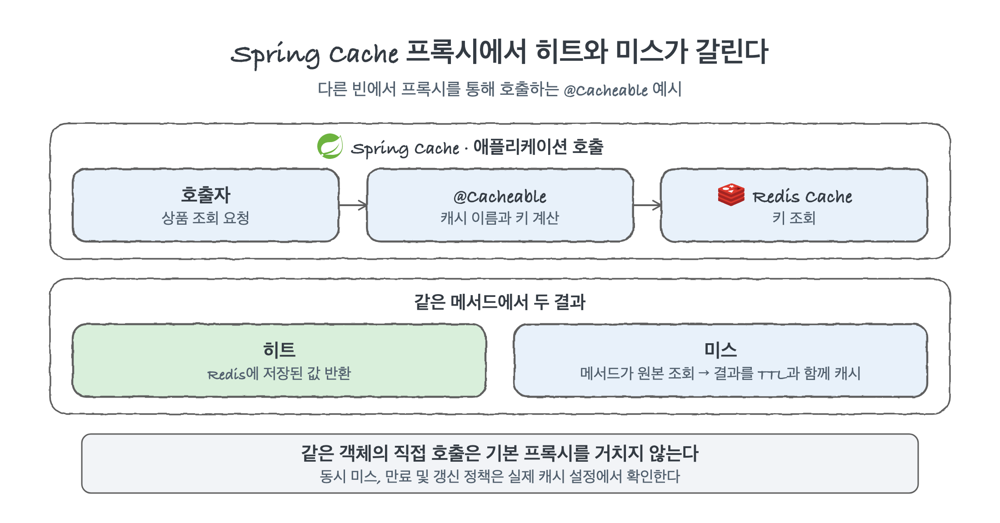

# Spring Boot Caching with Redis

Docker로 단일 Redis를 실행하고 Spring Boot의 CRUD API에 캐시를 적용하는 예제다. 조회 시에는 Look-Aside로 Redis를 먼저 확인하고, 원본을 변경하거나 삭제하는 메서드에서는 캐시 값을 갱신하거나 제거한다.

## Docker에서 Redis 실행과 확인

Docker 이미지는 실행에 필요한 파일을 담은 템플릿이고, 컨테이너는 이미지에서 시작한 격리된 실행 환경이다. 아래 명령은 Redis 8.2.1 이미지를 백그라운드로 실행하고 호스트의 6379 포트를 컨테이너의 6379 포트에 연결한다.

```sh
docker run --name kuke-cache-redis -d -p 6379:6379 redis:8.2.1
docker ps
docker exec -it kuke-cache-redis redis-cli
```

`redis-cli`에서 다음 순서로 키를 저장하고 전체 키와 저장한 값을 확인한 다음, 삭제 후 같은 키를 다시 조회한다.

```text
SET mykey "Hello Kuke Redis"
KEYS *
GET mykey
DEL mykey
GET mykey
```

프로젝트 실습 환경은 Spring Boot 3.5.6, Java 21, Gradle이며, 간단한 CRUD API를 기준으로 캐시 전략을 적용한다.

## Spring Cache 애노테이션의 실행 흐름

| 애노테이션 | 동작 | 적용 대상 |
| --- | --- | --- |
| `@Cacheable` | 메서드 실행 전에 캐시를 조회한다. 캐시 히트면 캐시 값을 바로 반환하고, 캐시 미스면 메서드를 실행해 반환 값을 저장한다. | 원본 데이터 조회 |
| `@CachePut` | 매번 메서드를 실행하고 반환 값으로 캐시를 갱신한다. | 원본 데이터 생성·수정 |
| `@CacheEvict` | 기본 동작에서는 메서드가 정상 완료된 뒤 해당 캐시 항목을 제거한다. | 원본 데이터 삭제 |

Look-Aside에서는 애플리케이션이 Redis를 먼저 확인하고, 캐시 미스가 나면 원본 저장소에 접근한다. 이후 같은 키의 조회가 캐시 히트면 원본 저장소 호출을 생략한다.



그림의 근거 · [Spring Cache 애노테이션](https://docs.spring.io/spring-framework/reference/6.2/integration/cache/annotations.html) · [Spring Data RedisCache](https://docs.spring.io/spring-data/redis/reference/3.5/redis/redis-cache.html)

## 적용 기준

- 반복 조회에는 `@Cacheable`을 적용해 원본 접근을 줄인다. 생성·수정 직후 최신 캐시 값이 필요하면 `@CachePut`으로 갱신한다. 기존 캐시가 없거나 무효화했다면 이후 첫 조회에서 값을 채울 수 있다.
- 원본을 삭제했다면 `@CacheEvict`로 캐시도 제거해 이후 조회에 삭제 이전 값이 반환되는 일을 줄인다.
- `KEYS *`는 실습에서 전체 키를 확인하는 데 사용한다. 운영 환경에서 키를 탐색해야 할 때는 서버 부하를 고려해 `SCAN`을 사용한다.
- 없는 키를 반복 조회하는 Cache Penetration, 동시 캐시 미스로 원본 접근이 몰리는 Cache Stampede, 특정 키에 트래픽이 몰리는 Hot Key에는 각각 별도의 전략을 검토한다.

## 공식 문서

- `@Cacheable`, `@CachePut`, `@CacheEvict`의 실행 시점과 설정을 설명한다. [Spring Framework 6.2 캐싱 애노테이션](https://docs.spring.io/spring-framework/reference/6.2/integration/cache/annotations.html)
- Redis를 캐시 저장소로 연결하는 `RedisCacheManager` 설정을 확인할 수 있다. [Spring Data Redis 3.5 캐시](https://docs.spring.io/spring-data/redis/reference/3.5/redis/redis-cache.html)
- 백그라운드 실행과 호스트 포트 매핑 옵션을 설명한다. [Docker container run](https://docs.docker.com/reference/cli/docker/container/run)
