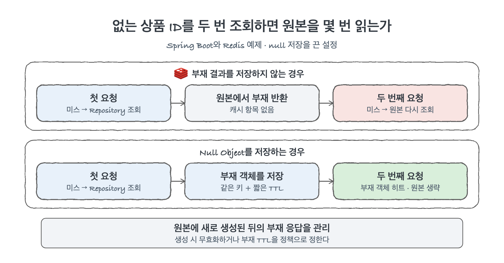

# Preventing Cache Penetration with the Null Object Pattern

Cache Penetration은 캐시가 요청을 걸러내지 못해 원본 저장소까지 부하가 전달되는 현상이다. 존재하지 않는 키를 반복해서 조회할 때 발생할 수 있다. Null Object Pattern은 조회 결과가 없었다는 사실을 캐싱해 같은 키에 대한 후속 요청을 처리한다.

## 없는 키가 원본 저장소에 부하를 주는 이유

Spring Boot 예제에서는 Service Layer가 Redis를 먼저 조회하고, 캐시 미스가 나면 Repository Layer를 조회한다. 예제의 `@Cacheable` 설정은 `null`을 캐싱하지 않으므로, 존재하지 않는 ID를 반복 조회하면 요청마다 같은 경로를 거친다.

1. Redis에서 키를 찾지 못한다.
2. Repository를 조회하고 `null`을 받는다.
3. 저장된 캐시 항목이 없어 다음 요청도 Repository에 도달한다.

이런 요청이 몰리면 캐시가 있더라도 원본 저장소가 모든 조회 부하를 받는다.

## Null Object로 부재를 캐싱하는 흐름

캐시 대상 메서드는 조회 결과가 `null`일 때 부재를 나타내는 객체를 반환한다. 정상 데이터에 항상 ID가 있다면 `id == null`인 객체를 Null Object로 사용할 수 있다.

| 요청 | 조회 경로 | 결과 |
| --- | --- | --- |
| 처음 들어온 없는 키 | Redis 캐시 미스 → Repository 조회 | Null Object를 같은 키에 저장하고 부재로 응답 |
| 같은 키의 후속 요청 | Redis 캐시 히트 | Null Object를 읽고 Repository 조회 없이 부재로 응답 |

부재를 나타내는 객체에 데이터가 없거나 비공개 상태인 이유를 담아 캐시에서 확인할 수도 있다.

그림의 근거 · [Azure Cache-Aside 패턴](https://learn.microsoft.com/en-us/azure/architecture/patterns/cache-aside) · [Spring Data RedisCache](https://docs.spring.io/spring-data/redis/reference/3.5/redis/redis-cache.html)

## 새로 생성된 데이터와 키 개수에 따른 한계

- **신규 데이터 반영 지연**은 Null Object가 남아 있을 때 발생한다. 이때 실제 데이터가 생성된 뒤에도 조회는 계속 부재로 응답한다. TTL을 줄이면 부재 응답이 남는 시간과 Negative Cache의 적중률이 함께 줄어든다. 생성 시 캐시 키를 무효화하면 더 빨리 반영할 수 있으며, 분리된 서비스에서는 생성 이벤트나 무효화 신호를 전달할 경로가 필요하다.
- **서로 다른 미존재 키의 수**도 중요하다. 요청마다 새 키가 들어오면 원본 저장소 조회와 Null Object 저장이 모두 발생한다. TTL 동안 쌓이는 서로 다른 키의 수가 많으면 정상 캐시 항목이 제거되거나 가용 메모리가 부족해질 수 있다. 짧은 TTL도 순간적인 유입 급증에는 한계가 있다.

## 적용 기준

- 같은 미존재 키가 반복되고 가능한 키 수가 제한적이면 Null Object가 간단한 해법이다. TTL은 신규 데이터가 조회되기까지 허용할 지연을 기준으로 잡는다.
- 캐시 용량은 TTL 동안 유입되는 서로 다른 미존재 키 수와 항목당 메모리 사용량을 기준으로 가늠한다. 입력 범위가 넓으면 입력 검증으로 줄일 수 있는 키 범위부터 확인한다.
- 서로 다른 미존재 키가 계속 들어오고 유효 키 집합을 유지할 수 있다면, [Bloom Filter](04_bloom_filter_fundamentals.md)로 해당 키의 포함 가능성을 먼저 확인할 수 있다.

## 공식 문서

- Redis 캐시의 null 값 저장 여부와 TTL 설정을 설명한다. [Spring Data Redis 3.5 캐시 설정](https://docs.spring.io/spring-data/redis/reference/3.5/redis/redis-cache.html)
- HTTP 404처럼 대상이 없다는 응답을 별도 TTL로 캐싱하는 사례다. [Google Cloud CDN Negative Caching](https://docs.cloud.google.com/cdn/docs/using-negative-caching)
