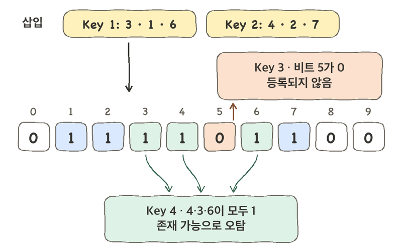

# Bloom Filter Fundamentals

Bloom Filter는 비트 배열과 해시로 키의 집합 포함 여부를 판정한다. 유효한 키를 등록해 두면 많은 미존재 요청을 원본 저장소에 전달하기 전에 걸러 Cache Penetration을 줄일 수 있다.

## 비트 배열에서 삽입과 조회가 동작하는 방식

길이 `m`의 비트 배열을 `0`으로 초기화하고, `k`개의 해시 함수로 각 키를 `0`부터 `m - 1`까지의 위치에 대응시킨다. 삽입할 때는 해당 비트를 모두 `1`로 설정하고, 조회할 때는 같은 위치를 읽는다.

| 조회 결과 | 판정 | 캐시 미스 이후의 처리 |
| --- | --- | --- |
| 하나 이상의 비트가 `0` | 필터에 삽입된 적 없음 | 필터가 현재 유효 키를 모두 반영하고 있으면 부재로 응답 |
| 모든 비트가 `1` | 삽입되었을 가능성이 있음 | 원본 저장소를 조회해 실제 존재 여부 확인 |

10비트 예제에서 `1`은 위치 `3, 1, 6`을, `2`는 `4, 2, 7`을 설정한다. 이후 `3`을 조회하면 위치 `5`가 `0`이어서 부재를 판정한다. `4`는 한 번도 등록하지 않았는데 위치 `4, 3, 6`이 모두 `1`이므로 False Positive가 발생한다.

## 삭제와 데이터 동기화

여러 키가 비트를 공유하므로 기본 Bloom Filter는 개별 원소를 삭제할 수 없다. 공유 비트를 `0`으로 바꾸면 다른 등록 키도 부재로 판정될 수 있다.

원본에서 삭제된 키가 필터에 남으면 불필요한 원본 저장소 조회가 생긴다. 더 중요한 경우는 새로 생성된 유효 키가 필터에 아직 반영되지 않았을 때다. Bloom Filter가 False Negative를 만들지 않는다는 성질은 실제로 삽입된 키에 적용되므로, 신규 키를 필터에서 누락하면 서비스가 그 키를 부재로 잘못 응답할 수 있다.

## 목표 오차율로 크기를 정하고 Redis에 저장하기

`n`을 예상 등록 키 수, `p`를 목표 False Positive Rate라고 하면 필요한 `m`과 `k`를 다음과 같이 산정한다. `ln`은 자연로그다.

- 비트 수 `m ≈ -n × ln(p) / (ln 2)²`. 정수 비트 수는 올림한다.
- 해시 개수 `k ≈ (m / n) × ln 2`. 구현에서는 가까운 양의 정수로 잡는다.
- `n = 1,000`, `p = 0.01`이면 약 `9,586`비트(`1.17 KiB`)와 해시 `7`개가 필요하다. Null Object 한 개가 `30 B`라고 가정하면 같은 공간에 약 40개를 저장할 수 있다.

해시에는 MurmurHash3를 사용할 수 있고, 비트는 Redis Bitmap의 `SETBIT`과 `GETBIT`으로 다룬다. Redis Bitmap 한 키의 범위는 `0`부터 `2³² - 1`까지의 오프셋이며, 전체를 사용하면 `512 MiB`다.

## 적용 기준

- 유효 키 집합을 구축하고 변경을 제때 반영할 수 있으며 미등록 키의 조회가 많을 때 적합하다. 처음 구축하는 동안이나 갱신 지연으로 필터의 완전성을 보장하기 어려운 동안에는 원본 저장소 조회를 허용한다.
- 예상 등록량을 넘으면 `1` 비트가 늘고 False Positive Rate도 상승한다. 비트 배열이 포화되면 미존재 키도 모두 원본 저장소까지 도달하며 필터 조회 비용이 추가된다.
- 비트 배열의 길이는 해시 위치를 결정한다. 기존 Bitmap에 비트를 덧붙이는 방식으로는 확장할 수 없으므로, 데이터 증가 여유와 Redis 키 한도를 함께 고려해 초기 크기를 정한다. 한도를 넘는 경우 [분할과 확장 전략](05_scaling_bloom_filters_with_splitting_sharding_and_sub_filters.md)을 살펴본다.

## 공식 문서

- 집합 포함 여부, False Positive, 예상 원소 수에 따른 필터 크기 산정을 설명한다. [Redis Bloom Filter](https://redis.io/docs/latest/develop/data-types/probabilistic/bloom-filter/)
- `SETBIT`과 `GETBIT`으로 비트를 설정하고 읽는 예제를 제공한다. [Redis Bitmap](https://redis.io/docs/latest/develop/data-types/strings/bitmaps/)
