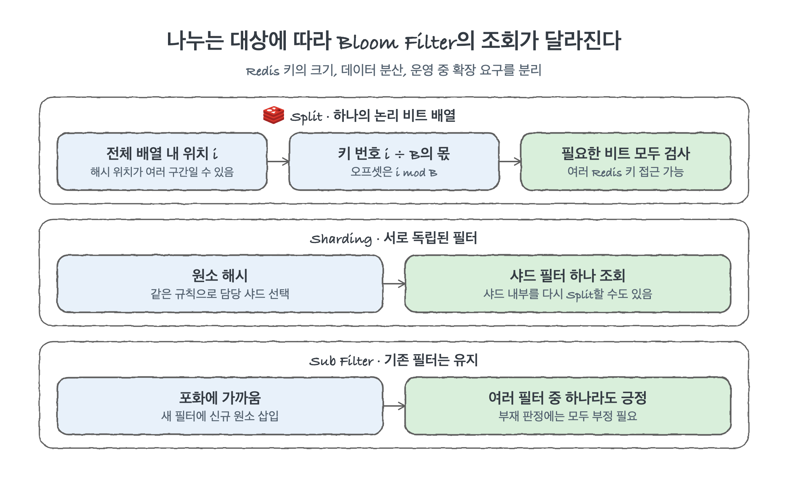

# Scaling Bloom Filters with Splitting, Sharding, and Sub-Filters

Bloom Filter에 예상보다 많은 데이터를 넣으면 False Positive 비율이 올라간다. Redis Bitmap의 키당 크기 한계에는 Split을, 읽기·쓰기와 저장 공간 분산에는 Sharding을, 이미 운영 중인 필터의 용량 확대에는 Sub Filter를 적용할 수 있다.

그림의 근거 · [Redis BF.RESERVE](https://redis.io/docs/latest/commands/bf.reserve/) · [Redis Cluster 사양](https://redis.io/docs/latest/operate/oss_and_stack/reference/cluster-spec/)

## Split으로 큰 비트 배열 저장하기

Redis Bitmap은 키 하나에 최대 `2^32`비트(512 MiB)를 저장할 수 있다. 필요한 배열이 이보다 크면 비트 범위를 여러 키에 나누고, 애플리케이션에서는 전체를 **하나의 논리적 Bloom Filter**로 다룬다.

1. 원소의 해시로 전체 비트 배열에서 확인할 위치 `i`를 계산한다.
2. 배열을 `B`비트씩 나눴다면 `i / B`의 정수 몫으로 Split 키를, `i % B`로 키 내부 오프셋을 구한다.
3. 삽입할 때는 각 위치를 `1`로 설정한다. 조회할 때 모든 위치가 `1`이어야 존재 가능성이 있다고 판단한다.

예를 들어 `3 × 2^32`비트 배열을 `2^32`비트씩 세 키로 나눌 수 있다. Redis Cluster에서 키를 노드에 분산할 수 있지만, 한 원소의 해시 위치가 여러 Split에 걸치면 한 번의 판정에도 여러 키에 접근한다.

## Sharding으로 원소와 부하 분산하기

Sharding은 전체 데이터셋을 **여러 독립적인 Bloom Filter**에 나눈다. 샤드 수가 `N`으로 고정돼 있다면 `hash(value) % N`을 샤드 번호로 사용할 수 있다. 삽입과 조회가 동일한 규칙으로 `bloom-filter:<shardIndex>`를 선택하므로, 원소 하나의 존재 여부는 담당 샤드에서 판정한다.

- 원소가 고르게 분포하면 여러 샤드에 읽기·쓰기와 저장 공간을 나눌 수 있다.
- 예를 들어 해시 함수 개수를 고정하고 1억 건을 512 MB 필터 하나에 넣으면 오차율이 약 `10^-9`다. 1천만 건씩 32 MB 필터 10개에 나누면 총 320 MB를 쓰고 약 `10^-6`의 오차율을 얻는다. 후자의 오차율이 서비스 목표를 충족할 때 메모리를 절약할 수 있다.
- 각 샤드가 담당하는 논리적 필터도 Split으로 여러 Redis 키에 나눌 수 있다.

## Sub Filter로 운영 중인 필터 확장하기

기존 배열의 비트 수를 바꾸면 해시가 가리키는 위치도 달라진다. 더 큰 단일 필터로 교체하려면 기존 데이터를 다시 삽입하고, 교체하는 동안 들어오는 데이터도 새 필터에 반영해야 한다.

Sub Filter를 사용하면 필터가 수용 한계에 가까워질 때 새 필터를 추가하고, 이후 들어오는 원소를 새 필터에 넣는다. 조회 시 원본과 Sub Filter 중 하나라도 긍정이면 존재 가능성이 있다. 부재로 판정하려면 모든 필터에서 부정 응답을 받아야 하므로 필터 수가 늘면 조회 비용도 늘어난다.

- 증설 시점은 삽입 건수, `1`로 설정된 비트의 비율 또는 관측한 False Positive 비율로 판단할 수 있다. 삽입 건수를 기준으로 삼으면 원소를 넣을 때마다 카운터를 갱신한다.
- 예를 들어 새 필터의 용량을 직전 필터의 2배로 늘리고 Sub Filter를 최대 2개로 제한할 수 있다. 조회 비용이 커지는 시점에는 하나의 큰 필터로 재구축할 수 있다.
- 각 필터의 False Positive가 독립적이라고 가정하면 전체 오차율은 `1 - ∏(1 - pᵢ)`이다. 원본과 Sub Filter 두 개가 모두 1%라면 약 2.97%이고, 각각 1%, 0.5%, 0.25%라면 약 1.74%다.

## 적용 기준

| 상황 | 적용 전략 | 설계 시 확인할 점 |
| --- | --- | --- |
| 필요한 비트 배열이 Redis 키 하나의 크기 한계를 넘는다 | Split | 한 요청에서 접근하는 Split 수와 조회 지연 |
| 데이터와 요청이 단일 논리 필터에 집중된다 | Sharding | 원소와 요청의 쏠림, 샤드별 수용량과 목표 오차율 |
| 데이터가 계속 늘고 전체 재구축 비용이 크다 | Sub Filter | 조회해야 할 필터 수, 전체 False Positive 목표와 재구축 시점 |

세 전략은 함께 적용할 수 있다. 함께 쓰면 원소를 담당 샤드로 보내고, 그 샤드의 원본과 Sub Filter를 확인하며, 각 필터의 비트는 해당 Split에서 읽는다. 직접 구현하기 전에는 RedisBloom 등 기존 도구가 필요한 확장 방식과 운영 조건을 지원하는지 확인한다.

필터에서 개별 원소를 삭제해야 한다면, Counting Bloom Filter나 Cuckoo Filter의 메모리 사용량과 갱신 비용을 비교한다.

## 공식 문서

- 초기 수용량, 목표 오탐률, Sub Filter 확장 배수를 설정하는 옵션을 설명한다. [Redis BF.RESERVE](https://redis.io/docs/latest/commands/bf.reserve/)
- Split을 설계할 때 확인할 키당 비트 오프셋과 크기 제한을 설명한다. [Redis SETBIT](https://redis.io/docs/latest/commands/setbit/)
- 분할된 키들이 해시 슬롯을 거쳐 어느 샤드로 배치되는지 확인할 수 있다. [Redis Cluster 키 분배 명세](https://redis.io/docs/latest/operate/oss_and_stack/reference/cluster-spec/)
