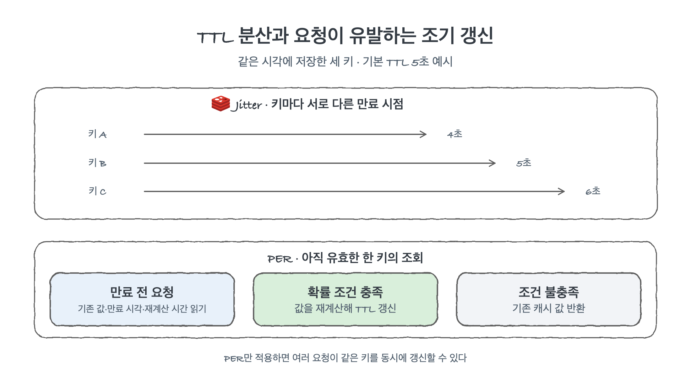
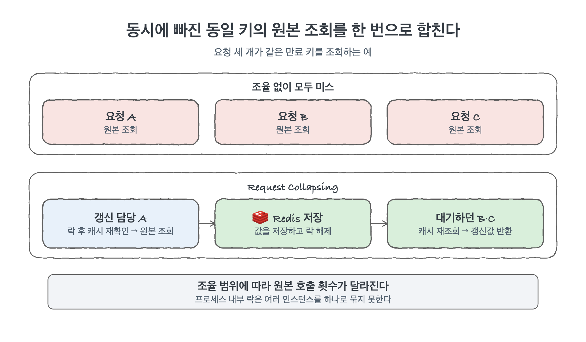

# Mitigating Cache Stampedes

Cache Stampede는 여러 요청이 동시에 캐시 미스를 만나 원본 저장소에 몰리는 현상이다. 인기 키 하나가 만료되거나 여러 키가 동시에 만료될 때, 또는 캐시에 값이 처음 적재되기 전에 발생한다. 갱신을 조율하지 않으면 첫 번째 갱신이 끝날 때까지 후속 요청도 원본을 조회하므로, 평소 캐시를 전제로 운영하는 원본 저장소가 과부하를 겪을 수 있다.

## Jitter와 PER로 만료 전후 부하 분산하기

**Jitter**는 값을 저장할 때 기본 TTL에 키별로 무작위 편차를 준다. 기본 TTL이 5초라면 4~6초 사이에서 뽑아 동시에 적재된 여러 키의 만료가 한 시점에 몰릴 가능성을 낮춘다. 만료 시점에 편차를 허용하는 통계나 정기 콘텐츠에 적합하다.

**Probabilistic Early Recomputation (PER)** 방식에서는 키가 아직 유효할 때 조회 요청을 계기로 확률적으로 갱신한다. 만료까지 남은 시간이 짧거나 직전 재계산이 오래 걸렸을수록 조기 갱신 확률이 높아진다.

1. 캐시에서 값, 직전 재계산 시간 `delta`, 만료 시각 `expiry`를 읽는다.
2. 값이 없거나 `now - delta × beta × ln(U) ≥ expiry`이면 원본에서 값을 읽어 재계산한다. `U`는 `0 < U ≤ 1`인 난수이고, `beta`의 기본값은 `1`이다.
3. 계산한 값과 새 `delta`를 캐시에 저장하고 TTL을 갱신한다. 조기 갱신 조건을 충족하지 않은 요청은 기존 캐시 값을 반환한다.

PER은 만료 전에 해당 키에 요청이 들어와야 조기 갱신할 수 있다. 동시 요청 여러 개가 확률 조건을 충족하면 중복 재계산이 가능하다.

그림의 근거 · [Cloudflare 확률적 조기 갱신](https://blog.cloudflare.com/sometimes-i-cache/) · [AWS ElastiCache TTL과 지터](https://docs.aws.amazon.com/AmazonElastiCache/latest/dg/PerformanceEfficiencyPillar.html)

## Request Collapsing으로 동일 키의 갱신 합치기

여러 요청이 동일 키에서 캐시 미스를 만나면 키 단위로 갱신을 조율한다. 여러 인스턴스에 걸쳐 조율하려면 분산 락을 사용할 수 있다.

1. 락을 얻은 요청은 캐시를 다시 확인한다. 여전히 미스라면 원본을 조회해 캐시에 저장한다. 처리가 끝나면 락을 해제한다.
2. 대기하던 요청은 캐시를 다시 조회해 갱신된 값을 받는다.

그림의 근거 · [Cloudflare Request Collapsing](https://developers.cloudflare.com/cache/concepts/default-cache-behavior/#request-collapsing) · [Redis 분산 락](https://redis.io/docs/latest/develop/clients/patterns/distributed-locks/)

인스턴스별 Local Lock은 조율 범위가 각 인스턴스로 제한되어, 동일 키가 미스일 때 활성 인스턴스 수만큼 원본 조회가 발생할 수 있다. 분산 락을 사용한다면 락 해제 감지에 드는 Polling 비용과 대기 시간을 고려한다. Redis Pub/Sub으로 락 해제를 알리고 Polling을 함께 사용할 수도 있다.

이전 값을 잠시 더 제공할 수 있다면 갱신용 논리 TTL과 삭제용 물리 TTL을 분리할 수 있다. 논리 TTL이 지난 뒤 한 요청이 갱신하는 동안 나머지는 물리 TTL 내에 남아 있는 값을 반환한다.

## Rate Limit으로 원본 저장소 보호하기

캐시가 비어 있고 요청 키가 다양하면 여러 키의 캐시 미스가 동시에 원본으로 이어진다. 원본 저장소가 감당할 수 있는 처리량을 기준으로 호출을 제한하면 일부 요청이 실패하더라도 전체 장애로 번질 가능성을 줄일 수 있다.

예를 들어 캐시를 사용하는 애플리케이션의 처리량이 2,000 TPS이고 원본 저장소의 처리 한도가 1,000 TPS라고 가정한다. 애플리케이션에서 원본 저장소로 나가는 호출에 1,000 TPS 한도를 두면 캐시 히트 요청은 그 한도를 소모하지 않는다. 여러 인스턴스가 같은 저장소를 사용한다면 각 인스턴스의 호출량을 합산해 한도를 맞춘다.

## 적용 기준

| 관찰한 병목 | 적용 전략 | 고려할 비용 |
| --- | --- | --- |
| 여러 키의 만료가 같은 시각에 몰림 | Jitter | 허용 가능한 TTL 편차 |
| 자주 조회되는 키의 갱신이 오래 걸림 | PER | 조기 갱신에 드는 원본 조회, 동시 갱신 가능성 |
| 동일 키의 캐시 미스가 원본 조회를 반복함 | Request Collapsing | 락을 기다리는 시간, 인스턴스 간 조율 비용 |
| 여러 키가 동시에 미스가 나서 원본 처리량을 초과함 | Rate Limit | 원본 저장소별 한도와 한도 초과 시 요청 처리 방식 |

기법은 함께 적용할 수 있다. 예를 들어 Jitter로 여러 키의 만료를 분산하고, 인기 키의 동시 갱신은 Request Collapsing으로 합치며, 원본 호출 총량은 Rate Limit으로 제한한다. 변경 직후 조회가 많은 데이터에는 [Write-Through](07_write_through_caching_for_dynamic_lists.md)를 적용해 캐시를 미리 채울 수 있다.

## 공식 문서

- 캐시 락과 확률적 조기 갱신으로 동시 재계산을 줄이는 방법을 비교한다. [Cloudflare 확률적 캐시 갱신](https://blog.cloudflare.com/sometimes-i-cache)
- 같은 리소스에 대한 동시 캐시 미스를 하나의 원본 요청으로 합치는 동작을 설명한다. [Cloudflare Request Collapsing](https://developers.cloudflare.com/cache/concepts/default-cache-behavior/#request-collapsing)
- 카운터와 만료 시간을 조합해 일정 시간 동안의 요청 수를 제한하는 예제를 제공한다. [Redis INCR Rate Limiter 패턴](https://redis.io/docs/latest/commands/incr/#pattern-rate-limiter)
