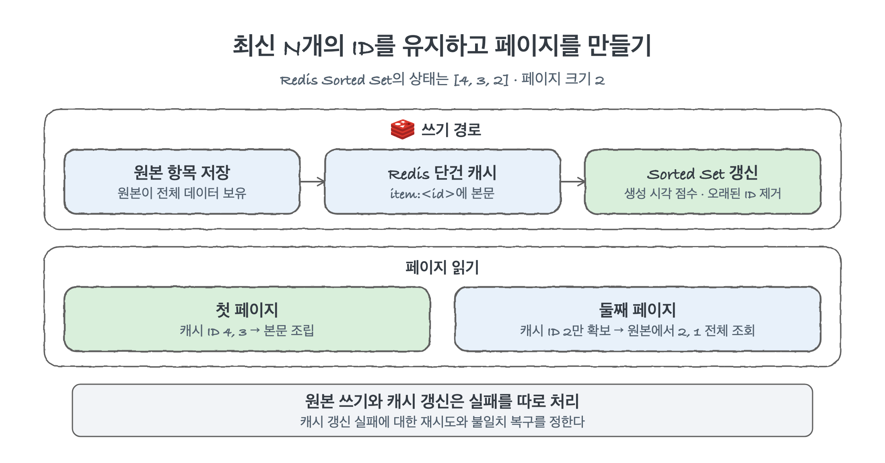

# Write-Through Caching for Dynamic Lists

Write-Through는 데이터의 생성·수정·삭제 시점에 원본 저장소와 캐시를 함께 갱신한다. 변경 직후 조회되는 데이터는 이미 캐시에 있을 가능성이 높아진다. 최신 항목을 자주 조회하는 목록에 이 방식을 적용할 수 있다.

## 목록 페이지를 통째로 캐시할 때의 비용

- [Look-Aside](02_springboot_caching_with_redis.md)로 페이지 응답을 저장하면 페이지 번호, 크기, 필터 조합마다 캐시 키가 생긴다.
- 최신순 목록에 항목 하나가 추가되면 뒤쪽 페이지의 경계도 밀린다. 변경마다 관련 페이지의 캐시를 무효화하면 갱신 범위가 넓고 캐시 히트율이 떨어질 수 있다.
- 정렬된 항목 인덱스를 공유하면 변경된 항목 위주로 갱신하고, 조회 시 필요한 범위를 잘라서 페이지를 만들 수 있다.

## Sorted Set으로 최신 N개 관리

| 저장 위치 | 저장 내용 |
| --- | --- |
| Redis Sorted Set `item-list` | 항목 ID를 멤버로, 생성 시각을 점수로 저장 |
| Redis 단건 캐시 `item:<id>` | 항목의 본문을 저장하고 단건 조회에도 재사용 |
| 원본 저장소 | 전체 항목을 보관하고 캐시 범위 밖의 조회를 처리 |

1. 항목이 생성되면 원본에 기록한 뒤 단건 캐시와 Sorted Set을 갱신한다.
2. Sorted Set 크기가 N을 넘으면 가장 오래된 ID를 목록 인덱스에서 제거한다.
3. 항목 삭제 시에는 목록 인덱스와 단건 캐시에 삭제를 반영한다. 목록의 멤버십이나 정렬 기준이 바뀌는 수정도 인덱스에 반영한다.

## 페이지 조회와 원본 조회 전환

요청 범위의 ID를 Sorted Set에서 구한 뒤, 단건 캐시에서 본문을 읽어 응답을 조립한다. 페이지 번호 방식과 커서 기반 무한 스크롤 방식 모두에 적용할 수 있다.

예를 들어 최신순으로 `[4, 3, 2]`만 캐시하고 페이지당 2건을 요청하면 첫 페이지는 `[4, 3]`으로 응답한다. 둘째 페이지는 캐시에서 `[2]`만 확보되므로, 이 예제에서는 해당 페이지 전체를 원본에서 조회해 `[2, 1]`을 반환한다.

그림의 근거 · [Redis Sorted Set](https://redis.io/docs/latest/develop/data-types/sorted-sets/) · [Redis ZRANGE](https://redis.io/docs/latest/commands/zrange/)

## 적용 기준

- 첫 몇 페이지에 조회가 몰리고 항목 변경이 잦다면, 최신 N개를 유지하는 비용 대비 효과가 크다. N은 실제 페이지별 조회 분포와 캐시 메모리 예산을 보고 정한다.
- 쓰기마다 캐시 갱신이 추가된다. 원본 쓰기 성공 후 캐시 갱신이 실패하면 목록과 단건 데이터에 차이가 생길 수 있으므로, 운영 설계에서는 재시도와 불일치 복구 방법을 정한다.

## 공식 문서

- 원본과 캐시를 쓰기 시점에 함께 업데이트하는 흐름과 쓰기 비용을 설명한다. [Amazon ElastiCache Write-Through](https://docs.aws.amazon.com/AmazonElastiCache/latest/dg/Strategies.html)
- 항목을 점수로 정렬하고 순위나 점수 범위로 조회하는 방법을 설명한다. [Redis Sorted Set](https://redis.io/docs/latest/develop/data-types/sorted-sets/)
- 최신 N개를 유지할 때 순위 범위를 기준으로 초과 항목을 지울 수 있다. [Redis ZREMRANGEBYRANK](https://redis.io/docs/latest/commands/zremrangebyrank/)
