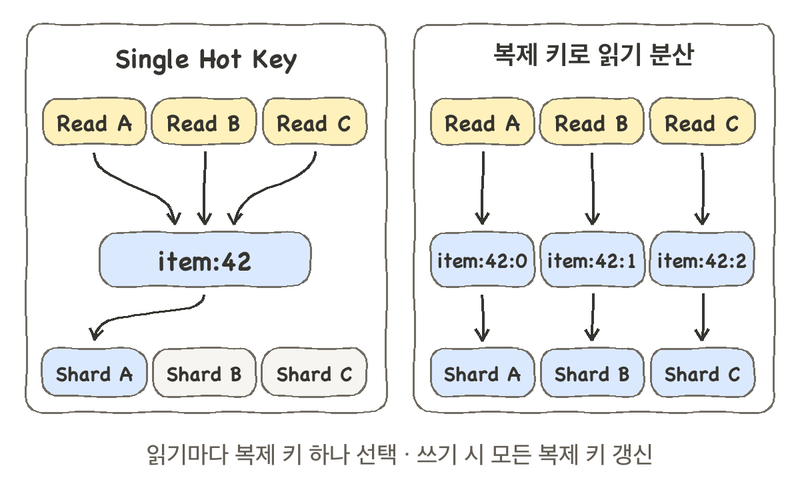

# Handling Hot Keys with Application-Level Sharding and Replication

Hot Key는 인기 상품이나 공통 설정처럼 캐시 요청이 집중되는 키다. 캐시 히트율이 높아도 해당 키를 맡은 Redis 샤드에 부하가 몰릴 수 있다. 애플리케이션에서 같은 값을 여러 캐시 키에 복제하면 읽기 부하를 나눌 수 있다.

## Redis Cluster에서 부하가 몰리는 이유

- Redis Cluster는 `키 → 해시 슬롯 → 샤드` 순서로 요청을 라우팅한다. 한 키는 한 슬롯에 속하므로, 샤드를 추가해도 그 키의 읽기가 여러 샤드로 분산되지는 않는다.
- Redis Replica를 읽기에 사용할 수 있지만, 해당 키의 복제본은 같은 샤드에 속한다. 여러 Hot Key가 같은 샤드에 배치돼도 그 샤드의 부하가 커진다.
- [Stampede 대응](06_mitigating_cache_stampedes.md)은 캐시 미스가 원본 저장소로 몰리는 문제를 줄인다. Hot Key는 캐시 히트 자체가 특정 샤드에 집중될 때도 병목이 된다.

## 애플리케이션에서 키 복제하기

예를 들어 논리 키 `item:42`의 값을 `item:42:0`, `item:42:1`, `item:42:2`에 저장한다.

| 작업 | 처리 방식 |
| --- | --- |
| 쓰기 | 모든 복제 키에 같은 값을 저장한다. |
| 읽기 | 복제 키 하나를 무작위로 골라 조회한다. |
| 갱신·무효화 | 모든 복제 키에 변경을 반영한다. |

접미사가 다른 키들이 서로 다른 샤드에 배치되어야 샤드 간 분산 효과가 생긴다. 복제 키가 실제로 어느 샤드에 배치되는지 확인한다.

## 적용 기준

- 히트율이 높은데 일부 키나 샤드의 요청량과 지연이 높다면, 읽기 비중이 크고 실제 병목을 만드는 키부터 후보로 삼는다.
- 복제 수를 늘리면 읽기 부하를 나눌 수 있지만, 키별 메모리 사용량과 쓰기 작업도 늘어난다. 일부 복제 키의 갱신이 실패했을 때 오래된 값이 얼마나 노출될 수 있는지도 고려한다.
- 읽기·쓰기 비율과 복제 키의 배치를 확인하고, 적용 전후의 샤드별 요청량과 지연으로 분산 효과를 검증한다.

## 공식 문서

- 애플리케이션에서 Hot Key를 여러 프라이머리에 복제해 읽기를 분산하는 방식을 설명한다. [Amazon ElastiCache Hot Key 대응](https://docs.aws.amazon.com/AmazonElastiCache/latest/dg/PerformanceEfficiencyPillar.html)
- 복제 키가 어느 해시 슬롯에 할당되는지 검증하는 명령이다. [Redis CLUSTER KEYSLOT](https://redis.io/docs/latest/commands/cluster-keyslot/)
