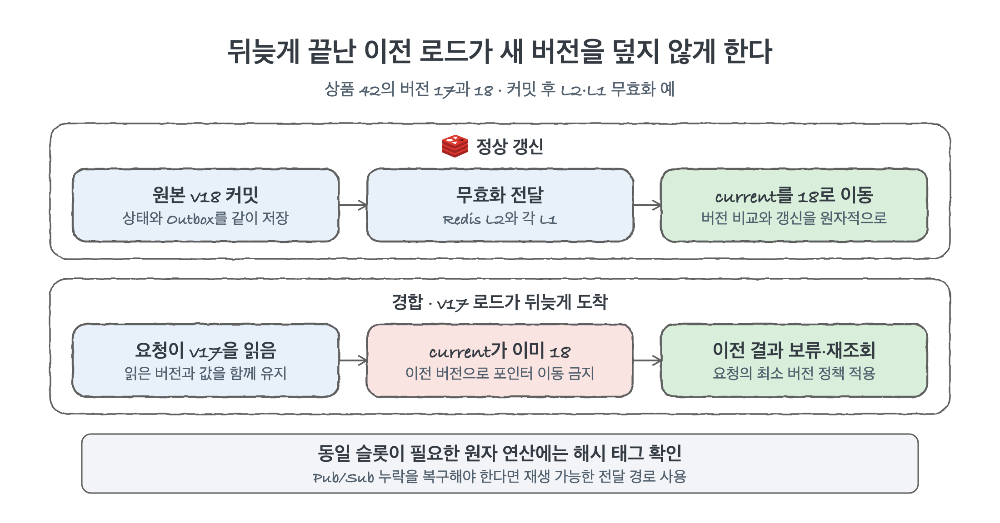

# Cache Invalidation, Versioned Keys, and Consistency Windows

캐시 일관성은 변경이 커밋된 뒤 새 버전이 사용자에게 보이는 조건으로 설명한다. 무효화 전달 지연과 캐시를 채우는 동안의 경합을 함께 처리한다.

## 1. 원본 커밋 후 이벤트로 무효화하기

원본 상태와 변경 이벤트를 같은 로컬 트랜잭션의 outbox에 담을 수 있다. 커밋된 이벤트를 전달하면 Redis L2와 각 인스턴스의 L1을 지우거나 새 버전으로 바꾼다. 소비자는 같은 이벤트가 반복되거나 순서가 바뀌어도 이전 버전으로 돌아가지 않도록 검증한다. Redis Pub/Sub은 놓친 이벤트를 다시 읽는 기능이 없으므로, 누락을 복구해야 한다면 재생할 수 있는 전달 경로와 소비 위치를 유지한다. [Redis Pub/Sub 전달 의미](https://redis.io/docs/latest/develop/pubsub/) · [Redis Streams](https://redis.io/docs/latest/develop/data-types/streams/)

쓰기가 캐시를 지운 뒤에도 앞서 시작한 조회가 이전 값을 반환받아 다시 채울 수 있다. 이 순서를 테스트에서 재현하고, 오래된 로드 결과를 버리거나 재조회하는 규칙을 둔다. [Cache-Aside 일관성](https://learn.microsoft.com/en-us/azure/architecture/patterns/cache-aside)

## 2. 버전 키와 현재 버전의 이동 규칙

예를 들어 상품 42의 값은 `product:{42}:v17`에, 조회가 선택하는 현재 버전은 `product:{42}:current`에 저장한다. 단조 증가하는 원본 버전을 사용해 현재 버전 18을 이미 확인한 뒤 버전 17로 돌아가지 않게 한다. 로드한 결과에는 읽을 당시의 버전을 유지한다. 이전 내용을 최신 키로 다시 붙이면 버전 키를 써도 stale 값이 살아난다.

포인터 비교와 갱신은 경합 중에 오래된 이벤트가 새 버전을 덮어쓰지 못하도록 원자적으로 처리한다. Redis에는 이전 버전을 조회하던 요청이 있을 수 있으므로 값 키의 TTL과 포인터의 수명을 함께 정한다. 포인터가 없어졌다면 신뢰할 수 있는 원본에서 현재 버전을 다시 확인한다. Redis Cluster에서 여러 키를 하나의 원자 연산에 쓰는 경우 키를 같은 슬롯에 배치할 수 있는지 확인한다. [Redis Lua 실행](https://redis.io/docs/latest/develop/programmability/eval-intro/) · [Redis Cluster 해시 태그](https://redis.io/docs/latest/operate/oss_and_stack/management/scaling/)

그림의 근거 · [AWS Transactional Outbox](https://docs.aws.amazon.com/prescriptive-guidance/latest/cloud-design-patterns/transactional-outbox.html) · [Redis 스크립트](https://redis.io/docs/latest/develop/programmability/eval-intro/) · [Redis Pub/Sub](https://redis.io/docs/latest/develop/pubsub/) · [Redis Cluster 사양](https://redis.io/docs/latest/operate/oss_and_stack/reference/cluster-spec/)

## 3. 일관성 창을 운영 정책으로 정의하기

| 읽기 유형 | 정책 예시 |
| --- | --- |
| 상품 소개 조회 | 변경 커밋 후 2초 안에 99%의 관측 요청이 새 버전을 본다는 목표를 둘 수 있다. 이벤트 지연과 L1·L2의 재채움까지 측정한다. |
| 방금 수정한 사용자의 후속 조회 | 쓰기 응답에 버전을 포함하고, 다음 읽기가 그 버전 이상을 요구하면 부족한 캐시 값을 건너뛴다. 원본에서도 요구 버전을 확인한다. |
| 주문 확정이나 권한 결정 | 원본에 유효한 조건을 확인하는 경계를 정하고, 확인에 실패하면 오래된 캐시로 성공을 확정하지 않는다. |

이 수치는 예시다. 실제 측정은 커밋 버전을 알고 있는 테스트가 여러 인스턴스에서 해당 버전이 관찰될 때까지의 시간을 기록하는 방식으로 한다. TTL은 각 계층의 만료 기준이며, 이전 값을 여러 계층에서 다시 읽고 채울 수 있으면 변경 이후 노출 시간과 다를 수 있다. 이벤트 누락이나 복제 지연 때도 같은 정책을 만족하는지 확인한다. [L1과 L2의 일관성 창](10_two_level_caching_with_local_l1_and_remote_l2.md)
