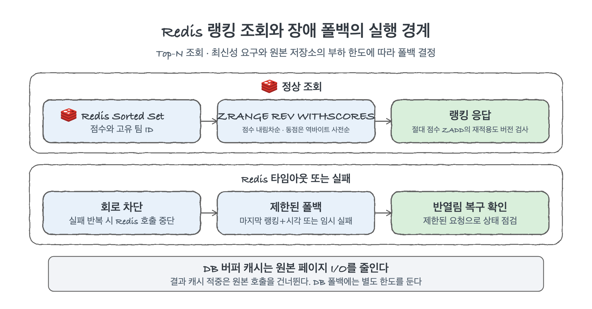

# Database Buffer Caching, Redis Rankings, and Fallbacks

DB의 페이지 캐시와 애플리케이션의 결과 캐시는 서로 다른 데이터를 보관한다. 반복 조회하는 랭킹을 Redis에서 제공한다면 갱신 순서와 장애 때의 응답을 함께 설계한다.

## 1. DB 버퍼 캐시와 애플리케이션 캐시의 역할

PostgreSQL의 공유 버퍼와 InnoDB의 버퍼 풀은 테이블과 인덱스 페이지를 캐싱한다. 같은 페이지를 디스크에서 다시 읽는 비용을 줄여도 DB는 조회 조건을 평가하고 결과를 만들어야 한다. 애플리케이션의 결과 캐시는 키, 값의 구성, TTL을 정할 수 있다. DB 버퍼의 특정 행을 애플리케이션 캐시 키처럼 무효화하거나 개별 TTL로 제어하지는 않는다. 쿼리 작업량은 실행 계획에서, 결과 재사용과 전송 비용은 캐시의 적중률과 응답 바이트에서 확인한다. [PostgreSQL 공유 버퍼](https://www.postgresql.org/docs/18/runtime-config-resource.html) · [InnoDB 버퍼 풀](https://dev.mysql.com/doc/refman/8.4/en/innodb-buffer-pool.html)

PostgreSQL의 `EXPLAIN (ANALYZE, BUFFERS)`에서 `shared hit`은 DB 공유 버퍼 적중이다. 원본 SQL을 생략한 요청 비율을 나타내는 Redis 적중률과 직접 비교하지 않는다. [PostgreSQL EXPLAIN](https://www.postgresql.org/docs/18/sql-explain.html)

## 2. Redis 정렬 집합으로 Top-N 제공하기

멤버에는 유일한 대상 ID, 점수에는 랭킹 기준 값을 저장한다. `ZRANGE ... REV WITHSCORES`로 높은 점수부터 조회한다. 점수가 같으면 `REV`에서는 멤버의 역사전순으로 반환된다. 업무가 먼저 달성한 순서 같은 별도 타이브레이커를 요구하면 점수와 순서를 구성하는 규칙을 명시한다. Redis 점수의 부동소수점 표현을 고려해 정수를 합쳐 저장하는 경우 정밀도 범위도 확인한다. [Redis ZRANGE](https://redis.io/docs/latest/commands/zrange/) · [Redis ZADD](https://redis.io/docs/latest/commands/zadd/)

아래 예는 폐기 가능한 Redis에 랭킹 세 건을 넣고 순서를 확인한다. 예상 순서는 `team-b`, `team-c`, `team-a`다. 갱신으로 `team-a`가 115점을 받으면 맨 앞으로 이동한다.

```sh
: "${CACHE_LAB_SOCKET:?Set the socket path of a disposable Redis instance}"
redis-cli -s "$CACHE_LAB_SOCKET" ZADD cache-lab:ranking 90 team-a 110 team-b 90 team-c
redis-cli -s "$CACHE_LAB_SOCKET" ZRANGE cache-lab:ranking 0 2 REV WITHSCORES
redis-cli -s "$CACHE_LAB_SOCKET" ZADD cache-lab:ranking 115 team-a
redis-cli -s "$CACHE_LAB_SOCKET" ZRANGE cache-lab:ranking 0 2 REV WITHSCORES
```

원본에서 계산한 절대 점수를 `ZADD`로 반영하면 같은 이벤트를 재생해도 증가분이 다시 가산되지는 않는다. 이전 버전의 이벤트가 늦게 도착하면 최신 점수를 덮어쓸 수 있으므로 적용 버전을 확인한다. `ZINCRBY`로 증가량을 반영하는 경로는 이벤트 중복을 따로 걸러야 한다. [Redis ZINCRBY](https://redis.io/docs/latest/commands/zincrby/) · [정렬 집합 랭킹 실습](../redis/06_building_a_top_10_search_ranking_with_redis_sorted_sets.md)

## 3. Redis 장애에서 회로 차단과 폴백 적용하기

Redis 호출에는 요청 예산 안의 타임아웃을 두고, 실패나 지연이 계속되면 회로 차단기가 일정 기간 호출을 중단하도록 한다. 반열림 상태에서는 제한된 수의 요청으로 복구 여부를 확인한다. 모든 요청을 즉시 DB로 돌리면 원본 부하가 급증할 수 있으므로 폴백의 동시성과 비용을 따로 제한한다. [Resilience4j CircuitBreaker](https://resilience4j.readme.io/docs/circuitbreaker)

랭킹처럼 일부 지연을 허용하는 조회는 마지막 랭킹과 생성 시각을 함께 반환하거나, 임시로 결과를 제공할 수 없음을 알린다. 원본에서 즉시 계산하는 폴백은 비용과 타임아웃을 별도로 검증한다. 권한이나 주문 확정에 사용하는 요청은 랭킹 폴백과 다른 일관성 정책을 적용한다. 장애 실험에서 Redis 실패율, DB 폴백 실행 수, 폴백 응답의 나이, 전체 요청의 지연을 기록한다. [일관성 창 정책](12_cache_invalidation_versioned_keys_and_consistency_windows.md)



그림의 근거 · [Redis ZRANGE](https://redis.io/docs/latest/commands/zrange/) · [Resilience4j CircuitBreaker](https://resilience4j.readme.io/docs/circuitbreaker) · [MySQL InnoDB Buffer Pool](https://dev.mysql.com/doc/refman/8.4/en/innodb-buffer-pool.html)
