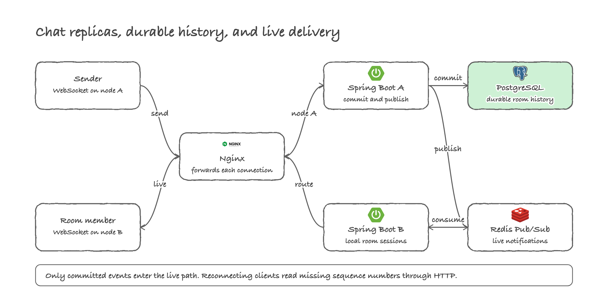

# Designing a Chat Server and Room Fan-Out

그림의 근거 · [Spring Framework 6.2 · WebSocket API](https://docs.spring.io/spring-framework/reference/6.2/web/websocket/server.html) · [Redis · Pub/Sub](https://redis.io/docs/latest/develop/pubsub/) · [Nginx · WebSocket proxying](https://nginx.org/en/docs/http/websocket.html) · [PostgreSQL 18 · Transactions](https://www.postgresql.org/docs/18/tutorial-transactions.html)

## 1. 접속과 메시지 이력을 다른 경로에서 처리한다

실습은 Java 21과 Spring Boot 3.5.16으로 만든 같은 애플리케이션을 두 인스턴스로 실행한다. Nginx가 HTTP와 WebSocket을 프록시한다. PostgreSQL 18에는 사용자·채팅방·멤버십·메시지 이력을 저장하고, 각 인스턴스는 자신에게 연결된 WebSocket 세션을 관리한다. Redis 7.4 Pub/Sub은 두 인스턴스에 새 메시지를 알린다. [Spring Framework 6.2 · WebSocket API](https://docs.spring.io/spring-framework/reference/6.2/web/websocket/server.html) · [Redis · Pub/Sub](https://redis.io/docs/latest/develop/pubsub/) · [Nginx · WebSocket proxying](https://nginx.org/en/docs/http/websocket.html)

## 2. 저장 후 채팅방에 브로드캐스트한다

서버 A가 메시지를 받으면 멤버십과 요청 ID를 확인하고, 방 안의 다음 순번을 메시지와 함께 커밋한다. 새로 저장된 메시지는 커밋 후 Redis에 발행한다. 구독 중인 서버 A와 B는 이벤트의 방 ID로 로컬 세션을 찾아 전송한다. 다른 방 세션은 같은 Redis 이벤트를 받는 프로세스에 연결돼 있어도 전송 대상에서 제외한다. [PostgreSQL 18 · Transactions](https://www.postgresql.org/docs/18/tutorial-transactions.html) · [Redis · Pub/Sub](https://redis.io/docs/latest/develop/pubsub/) · [Spring Data Redis 3.5 · Pub/Sub Messaging](https://docs.spring.io/spring-data/redis/reference/3.5/redis/pubsub.html)

## 3. 저장 확인과 화면 전달의 범위를 구분한다

발신 ACK의 기준은 PostgreSQL에 저장된 메시지와 방 순번이다. 수신자에게 실시간 프레임이 도착했는지까지 확인하는 계약은 별도로 설계해야 한다. 실습에서 Redis 구독이 잠시 끊기거나 커밋 후 발행이 건너뛰어지면 HTTP 이력으로 누락분을 가져온다. 서버별 처리 시간 차이로 실시간 프레임이 방 순번과 다른 순서로 도착할 수 있으므로 클라이언트가 순번을 기준으로 병합한다. [Redis · Delivery semantics](https://redis.io/docs/latest/develop/pubsub/#delivery-semantics) · [PostgreSQL 18 · Sorting Rows](https://www.postgresql.org/docs/18/queries-order.html)
