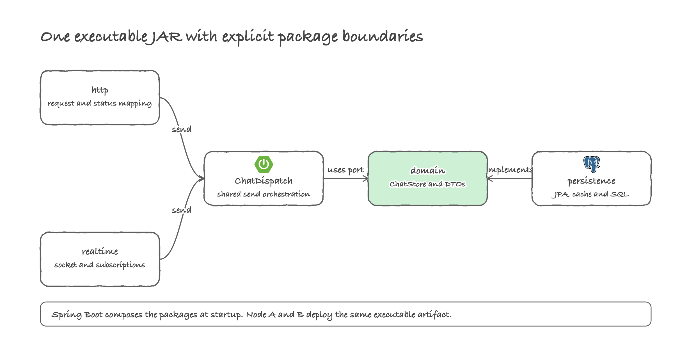

# Structuring Chat Boundaries in One Application

그림의 근거 · [Spring Boot 3.5 · Structuring Your Code](https://docs.spring.io/spring-boot/3.5/reference/using/structuring-your-code.html) · [Spring Modulith · Application Modules](https://docs.spring.io/spring-modulith/reference/fundamentals.html) · [Spring Framework 6.2 · Declarative Transaction Management](https://docs.spring.io/spring-framework/reference/6.2/data-access/transaction/declarative.html) · [Spring Framework 6.2 · WebSocket API](https://docs.spring.io/spring-framework/reference/6.2/web/websocket/server.html)

## 1. 기능과 기술의 변경 이유로 코드를 나눈다

실습은 Maven 실행 JAR 하나를 만들고 패키지 경계로 의존성을 관리한다. `domain`은 데이터 계약과 `ChatStore` 포트를 제공한다. `persistence`는 그 포트를 JPA·PostgreSQL로 구현하고 공개 사용자 프로필 캐시를 다룬다. `realtime`은 WebSocket 세션과 Redis 전달 및 송신 조합을, `http`는 HTTP 상태 코드·요청 바인딩·이력 조회 입구를 맡는다. 루트 애플리케이션이 빈을 조립한다. [Spring Boot 3.5 · Structuring Your Code](https://docs.spring.io/spring-boot/3.5/reference/using/structuring-your-code.html) · [Spring Modulith · Application Modules](https://docs.spring.io/spring-modulith/reference/fundamentals.html)

## 2. 저장 규칙을 HTTP와 WebSocket에서 공유한다

HTTP 송신과 WebSocket 송신은 같은 송신 조합을 호출한다. 이 조합은 `ChatStore`에 저장을 요청하고, 저장 트랜잭션이 반환된 뒤 Redis에 발행한다. 배포 상의 단위를 하나로 두면서 멤버십 검증·중복 방지·순번 발급을 한 경로에 유지할 수 있다. 웹 경계는 JPA 엔티티 대신 도메인 결과를 응답으로 변환한다. [Spring Framework 6.2 · Declarative Transaction Management](https://docs.spring.io/spring-framework/reference/6.2/data-access/transaction/declarative.html) · [Spring Framework 6.2 · WebSocket API](https://docs.spring.io/spring-framework/reference/6.2/web/websocket/server.html)

Redis 브로드캐스트 구독과 WebSocket 세션 등록을 `realtime`에 함께 둔다. 새 메시지가 도착했을 때 전달 가능한 로컬 연결을 고르는 정책이 두 구성 요소에 걸쳐 있기 때문이다. `persistence`에는 PostgreSQL의 쓰기·이력 규칙과 Redis 프로필 캐시를 둔다. 프로필 캐시의 변경이 메시지 fan-out이나 방 순번 발급에 영향을 주지 않도록 호출 경로를 분리한다. [Spring Data Redis 3.5 · Pub/Sub Messaging](https://docs.spring.io/spring-data/redis/reference/3.5/redis/pubsub.html) · [Spring Data Redis 3.5 · Redis Cache](https://docs.spring.io/spring-data/redis/reference/3.5/redis/redis-cache.html)

## 3. 빌드 경계와 배포 경계를 따로 판단한다

학습 단계에서는 모듈마다 JAR과 빌드 설정을 만드는 비용보다 책임 간 의존성을 코드에서 드러내는 데 집중했다. 독립 소비자가 재사용할 계약이 생기거나 컴파일 시 의존성 규칙을 강제해야 하면 Maven 멀티 모듈이 유용하고, 연결 서버만 별도 확장하거나 배포해야 하면 그 시점에 서비스 분리를 검토한다. 이 실습의 두 서버는 같은 실행물을 복제한 구성이다. [Apache Maven · Guide to Working with Multiple Modules](https://maven.apache.org/guides/mini/guide-multiple-modules.html) · [Spring Modulith · Verifying Application Modules](https://docs.spring.io/spring-modulith/reference/verification.html)
