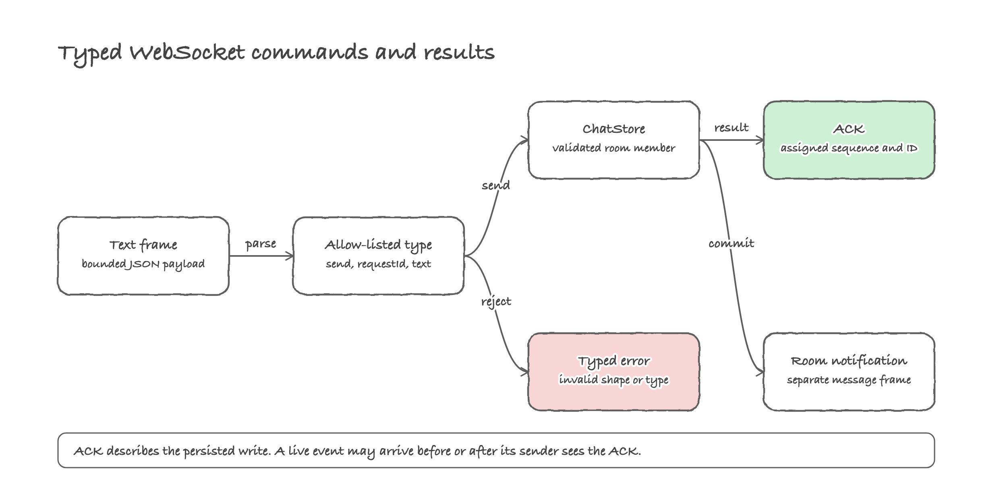

# Defining Chat Messages and Domain Ports



그림의 근거 · [PostgreSQL 18 · Unique Constraints](https://www.postgresql.org/docs/18/ddl-constraints.html#DDL-CONSTRAINTS-UNIQUE-CONSTRAINTS) · [PostgreSQL 18 · Sorting Rows](https://www.postgresql.org/docs/18/queries-order.html) · [RFC 6455 · Data Framing](https://www.rfc-editor.org/rfc/rfc6455.html#section-5) · [FasterXML · JsonTypeInfo](https://github.com/FasterXML/jackson-annotations/blob/2.21/src/main/java/com/fasterxml/jackson/annotation/JsonTypeInfo.java)

## 1. 방 멤버십과 메시지 식별자를 정의한다

사용자는 ID와 표시 이름을 갖는다. 채팅방에는 제목과 멤버 목록이 있으며, 메시지는 방 ID·방 안 순번·발신자 ID·요청 UUID·본문·저장 시각을 포함한다. 메시지 이력의 정렬 키는 시간이나 요청 UUID가 아니라 방 안의 `seq`다. 동일 발신자의 요청 ID 재사용 여부는 방 범위에서 판단한다. [PostgreSQL 18 · Unique Constraints](https://www.postgresql.org/docs/18/ddl-constraints.html#DDL-CONSTRAINTS-UNIQUE-CONSTRAINTS) · [PostgreSQL 18 · Sorting Rows](https://www.postgresql.org/docs/18/queries-order.html)

## 2. WebSocket 프레임에 명령과 이벤트를 표현한다

수신 JSON의 `type`은 지원 명령을 선택하는 값이다. 실습에서는 `send`가 요청 UUID와 본문을 받고, 서버는 `ready`, `ack`, `message`, `error` 프레임으로 연결 준비·저장 확인·브로드캐스트·오류를 구분한다. ACK와 실시간 이벤트는 같은 저장 메시지를 가리킬 수 있으므로 화면에서는 방 ID와 순번으로 합친다. 여러 명령 DTO를 한 타입으로 역직렬화한다면 Jackson의 `JsonTypeInfo.Id.NAME`과 등록된 서브타입 이름을 사용하는 선택지가 있다. [RFC 6455 · Data Framing](https://www.rfc-editor.org/rfc/rfc6455.html#section-5) · [FasterXML · JsonTypeInfo](https://github.com/FasterXML/jackson-annotations/blob/2.21/src/main/java/com/fasterxml/jackson/annotation/JsonTypeInfo.java)

```json
{"type":"send","requestId":"b6b755c7-0e98-48c2-b2b5-cf37a94bca60","text":"hello"}
```

## 3. 저장 기능을 도메인 포트에 모은다

`ChatStore`는 사용자·방 생성, 멤버십 검사, 메시지 저장, 순번 기반 이력 조회를 노출한다. 저장 결과에는 메시지와 `duplicate`가 들어간다. HTTP와 WebSocket은 같은 저장 결과를 받아 각 전송 방식의 응답으로 변환한다. 방 나가기나 역할 변경을 추가하면 멤버십 갱신과 기존 연결의 재인가 정책도 함께 정해야 한다. [Spring Modulith · Application Modules](https://docs.spring.io/spring-modulith/reference/fundamentals.html) · [Spring Framework 6.2 · Handler Methods](https://docs.spring.io/spring-framework/reference/6.2/web/webmvc/mvc-controller/ann-methods.html)
