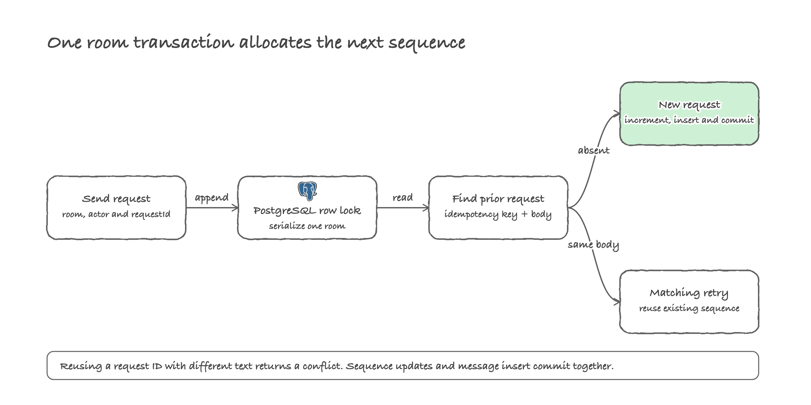

# Persisting Room Sequences and Idempotent Sends

그림의 근거 · [Spring Data JPA 3.5 · Transactionality](https://docs.spring.io/spring-data/jpa/reference/3.5/jpa/transactions.html) · [PostgreSQL 18 · Constraints](https://www.postgresql.org/docs/18/ddl-constraints.html) · [Spring Data JPA 3.5 · Locking](https://docs.spring.io/spring-data/jpa/reference/3.5/jpa/locking.html) · [PostgreSQL 18 · Row-Level Locks](https://www.postgresql.org/docs/18/explicit-locking.html#LOCKING-ROWS)

## 1. JPA와 PostgreSQL로 이력의 원본을 저장한다

PostgreSQL은 사용자·방·방 멤버십·메시지를 저장한다. JPA 저장 어댑터는 조회와 변경을 `ChatStore`에 맞춘다. 메시지에는 `(room_id, seq)` 고유 제약을 두고 동일 방의 발신자·요청 ID 조합에도 고유 제약을 둔다. 방과 멤버십은 데이터베이스에서 조회한다. [Spring Data JPA 3.5 · Transactionality](https://docs.spring.io/spring-data/jpa/reference/3.5/jpa/transactions.html) · [PostgreSQL 18 · Constraints](https://www.postgresql.org/docs/18/ddl-constraints.html)

## 2. 방 행을 잠그고 순번과 메시지를 함께 커밋한다

송신 트랜잭션은 JPA의 `PESSIMISTIC_WRITE`로 방 행을 잠근 뒤 요청을 확인한다. 새 요청이면 방의 다음 순번을 할당하고 메시지를 삽입한 뒤 같은 트랜잭션에서 커밋한다. 같은 방의 다른 저장은 해당 행 잠금이 풀릴 때까지 기다리고, 다른 방은 서로 다른 행을 사용한다. 이 잠금이 보장하는 순서는 DB에 기록되는 방 순번이며 Redis 발행 순서는 별도다. [Spring Data JPA 3.5 · Locking](https://docs.spring.io/spring-data/jpa/reference/3.5/jpa/locking.html) · [PostgreSQL 18 · Row-Level Locks](https://www.postgresql.org/docs/18/explicit-locking.html#LOCKING-ROWS)

## 3. 재시도는 이미 저장된 메시지를 돌려준다

같은 방·발신자·요청 UUID와 같은 본문을 다시 보내면 기존 메시지와 순번을 반환한다. 같은 UUID로 다른 본문을 보내면 충돌로 처리한다. 클라이언트는 응답을 잃은 발송을 재시도할 때 처음 사용한 UUID를 유지한다. 방 하나에 쓰기가 집중되면 방 행에서 대기할 수 있으므로 총 부하뿐 아니라 방별 분포도 측정한다. [PostgreSQL 18 · Unique Constraints](https://www.postgresql.org/docs/18/ddl-constraints.html#DDL-CONSTRAINTS-UNIQUE-CONSTRAINTS) · [PostgreSQL 18 · Row-Level Locks](https://www.postgresql.org/docs/18/explicit-locking.html#LOCKING-ROWS) · [RFC 9110 · Idempotent Methods](https://www.rfc-editor.org/rfc/rfc9110.html#section-9.2.2)
