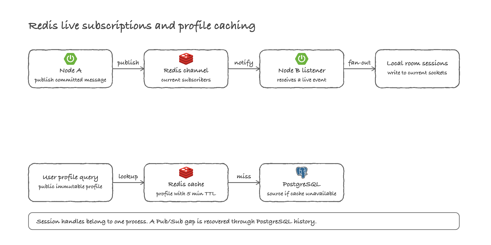

# Managing Redis Pub/Sub, Sessions, and Profile Cache

그림의 근거 · [Redis · Delivery semantics](https://redis.io/docs/latest/develop/pubsub/#delivery-semantics) · [Spring Data Redis 3.5 · Subscriber](https://docs.spring.io/spring-data/redis/reference/3.5/redis/pubsub.html) · [Spring Framework 6.2 · WebSocket API](https://docs.spring.io/spring-framework/reference/6.2/web/websocket/server.html) · [Spring Framework · ConcurrentWebSocketSessionDecorator](https://docs.spring.io/spring-framework/docs/6.2.x/javadoc-api/org/springframework/web/socket/handler/ConcurrentWebSocketSessionDecorator.html)

## 1. Redis는 현재 구독자에게 변경을 알린다

각 애플리케이션 복제본이 Redis Pub/Sub을 구독하며, 커밋 뒤 발행된 메시지를 받아 같은 방의 로컬 WebSocket 세션에 전달한다. Spring Data Redis의 리스너 컨테이너가 구독 연결과 리스너 실행을 관리한다. Redis Pub/Sub의 전달 보장은 at-most-once이므로 구독 단절 중 놓친 메시지는 PostgreSQL 이력에서 조회한다. [Redis · Delivery semantics](https://redis.io/docs/latest/develop/pubsub/#delivery-semantics) · [Spring Data Redis 3.5 · Subscriber](https://docs.spring.io/spring-data/redis/reference/3.5/redis/pubsub.html)

## 2. WebSocket 세션의 수명은 각 서버 연결과 맞춘다

같은 채팅방에 A와 B 서버의 세션이 함께 있을 수 있다. 각 서버는 방별로 연결을 등록하고 준비 프레임을 보낸 뒤 실시간 전송을 시작한다. 연결이 종료되면 등록을 제거한다. 발신 ACK와 구독 경로 메시지가 동시에 도착할 수 있으므로 세션 송신을 직렬화하고 버퍼 상한을 둔다. 연결이 끊긴 클라이언트는 새 연결과 HTTP 이력으로 현재 위치를 복구한다. [Spring Framework 6.2 · WebSocket API](https://docs.spring.io/spring-framework/reference/6.2/web/websocket/server.html) · [Spring Framework · ConcurrentWebSocketSessionDecorator](https://docs.spring.io/spring-framework/docs/6.2.x/javadoc-api/org/springframework/web/socket/handler/ConcurrentWebSocketSessionDecorator.html)

## 3. 사용자 프로필 캐시와 권한 조회를 구분한다

공개 사용자 프로필 조회에는 Spring Cache와 Redis 캐시를 쓰고 TTL을 5분으로 둔다. 캐시 미스나 Redis 읽기 실패 시에는 PostgreSQL에서 프로필을 읽는다. 실습의 표시 이름은 생성 후 갱신하지 않는 데이터다. 방 입장 및 메시지 권한은 PostgreSQL 멤버십으로 확인한다. 프로필 갱신 기능을 추가하면 TTL 동안 허용할 구버전 표시와 갱신 시 캐시 제거를 함께 결정한다. [Spring Data Redis 3.5 · Redis Cache](https://docs.spring.io/spring-data/redis/reference/3.5/redis/redis-cache.html) · [Spring Framework 6.2 · Cache Abstraction](https://docs.spring.io/spring-framework/reference/6.2/integration/cache.html)
