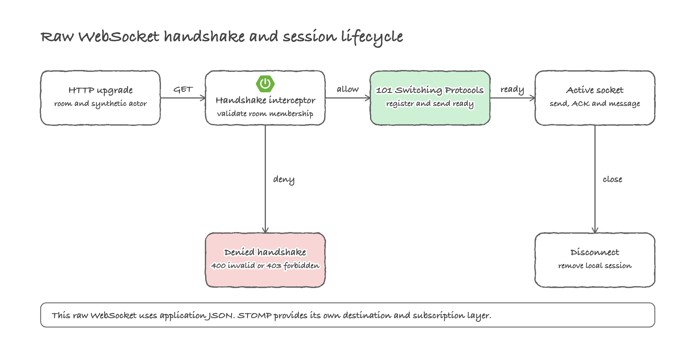

# Handling WebSocket Upgrades, Frames, and Sessions

그림의 근거 · [RFC 9110 · HTTP Semantics](https://www.rfc-editor.org/rfc/rfc9110.html) · [RFC 6455 · Opening Handshake and Data Framing](https://www.rfc-editor.org/rfc/rfc6455.html#section-4) · [Spring Framework 6.2 · WebSocket Handshake](https://docs.spring.io/spring-framework/reference/6.2/web/websocket/server.html) · [Spring Security · WebSocket Authentication](https://docs.spring.io/spring-security/reference/6.5/servlet/integrations/websocket.html)

## 1. HTTP의 요청·응답과 지속 연결을 조합한다

HTTP로 사용자·방을 만들고 채팅 이력을 페이지로 읽는다. 실시간 전송에는 서버와 클라이언트가 같은 연결에서 모두 프레임을 보낼 수 있는 WebSocket을 사용한다. HTTP 업그레이드가 `101 Switching Protocols`로 끝나면 프레임 헤더의 길이·opcode·FIN 플래그로 데이터를 해석한다. 클라이언트 프레임에는 마스킹이 적용된다. [RFC 9110 · HTTP Semantics](https://www.rfc-editor.org/rfc/rfc9110.html) · [RFC 6455 · Opening Handshake and Data Framing](https://www.rfc-editor.org/rfc/rfc6455.html#section-4)

## 2. 핸드셰이크와 연결 핸들러의 책임을 나눈다

`/ws/chat/{roomId}?userId=...`의 핸드셰이크 인터셉터는 경로와 실습 사용자 값을 해석하고 방 멤버십을 확인한다. 업그레이드 후 핸들러는 로컬 세션을 등록하고 `ready`를 보낸다. 이후 지원하는 JSON 명령을 해석하고 저장 결과를 응답하며, 종료된 세션은 브로드캐스트 대상에서 제거한다. `userId`는 루프백 실습용 식별자다. 운영에서는 인증된 Principal에서 사용자 ID를 가져와 같은 멤버십 검사를 수행한다. [Spring Framework 6.2 · WebSocket Handshake](https://docs.spring.io/spring-framework/reference/6.2/web/websocket/server.html) · [Spring Security · WebSocket Authentication](https://docs.spring.io/spring-security/reference/6.5/servlet/integrations/websocket.html)

## 3. Raw WebSocket과 STOMP의 추상화 수준을 비교한다

Raw WebSocket은 프레임 운반을 제공한다. 실습은 방과 명령 종류가 단순해 애플리케이션이 JSON 계약·세션 등록·Redis 브로드캐스트를 직접 구현한다. 범용 목적지, 구독 규칙, 메시지 컨트롤러 또는 외부 브로커 릴레이가 필요해지면 STOMP를 검토한다. STOMP의 전달·재접속 보장은 선택한 브로커와 서버 설정까지 함께 확인한다. [Spring Framework 6.2 · STOMP Overview](https://docs.spring.io/spring-framework/reference/6.2/web/websocket/stomp/overview.html) · [Spring Framework 6.2 · External Broker](https://docs.spring.io/spring-framework/reference/6.2/web/websocket/stomp/handle-broker-relay.html)
