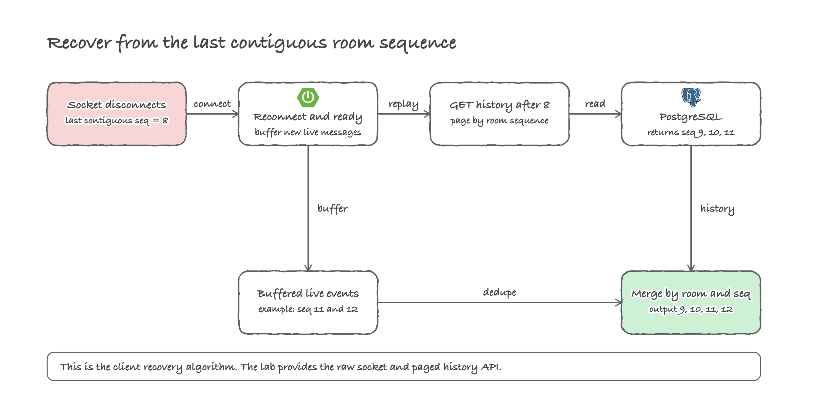

# Serving Chat History and Replaying Missed Messages

그림의 근거 · [Spring Framework 6.2 · Annotated Controllers](https://docs.spring.io/spring-framework/reference/6.2/web/webmvc/mvc-controller.html) · [RFC 9110 · Status Codes](https://www.rfc-editor.org/rfc/rfc9110.html#section-15) · [PostgreSQL 18 · Multicolumn Indexes](https://www.postgresql.org/docs/18/indexes-multicolumn.html) · [PostgreSQL 18 · LIMIT and OFFSET](https://www.postgresql.org/docs/18/queries-limit.html)

## 1. HTTP로 사용자와 방을 준비하고 메시지를 보낸다

`POST /users`는 `displayName`으로 사용자를 만들고 `GET /users/{id}`는 공개 프로필을 조회한다. `POST /rooms`는 실습 사용자 헤더 `X-Chat-User`와 제목·멤버 ID를 받아 방을 만든다. 생성 API는 201을 반환한다. `POST /rooms/{roomId}/messages`는 같은 헤더와 `requestId`, `text`를 받고 200과 저장 메시지·중복 여부를 반환한다. 잘못된 입력에 400, 사용자 미존재에 404, 멤버십 거부에 403, 요청 ID와 본문의 충돌에 409를 사용한다. [Spring Framework 6.2 · Annotated Controllers](https://docs.spring.io/spring-framework/reference/6.2/web/webmvc/mvc-controller.html) · [RFC 9110 · Status Codes](https://www.rfc-editor.org/rfc/rfc9110.html#section-15)

## 2. 마지막으로 이어서 처리한 순번부터 읽는다

`GET /rooms/{roomId}/messages?after=0&limit=50`은 `X-Chat-User`의 멤버십을 확인한다. 같은 방의 `seq > after`인 행을 순번 오름차순으로 읽고 `items`, `nextAfter`, `hasMore`를 돌려준다. 범위 조건과 정렬은 방 ID와 순번의 복합 키에 맞춘다. `limit`은 1~100이며 최대 한 행을 더 읽어 `hasMore`를 판정한다. `hasMore`가 참이면 `nextAfter`를 사용해 조회를 계속한다. [PostgreSQL 18 · Multicolumn Indexes](https://www.postgresql.org/docs/18/indexes-multicolumn.html) · [PostgreSQL 18 · LIMIT and OFFSET](https://www.postgresql.org/docs/18/queries-limit.html)

## 3. 재접속 이력과 지연된 실시간 이벤트를 병합한다

재연결 뒤 `ready`를 받은 시점부터 실시간 프레임을 임시 보관하면서 마지막 연속 처리 순번 이후의 HTTP 이력을 읽는다. HTTP와 실시간 경로에서 같은 메시지가 들어오면 `(roomId, seq)`로 중복을 제거하고, 연속된 범위까지만 표시 상태를 전진시킨다. 새 순번 사이에 공백이 있거나 연결이 다시 끊기면 마지막 연속 순번부터 재조회한다. [Redis · Delivery semantics](https://redis.io/docs/latest/develop/pubsub/#delivery-semantics) · [PostgreSQL 18 · Sorting Rows](https://www.postgresql.org/docs/18/queries-order.html)
