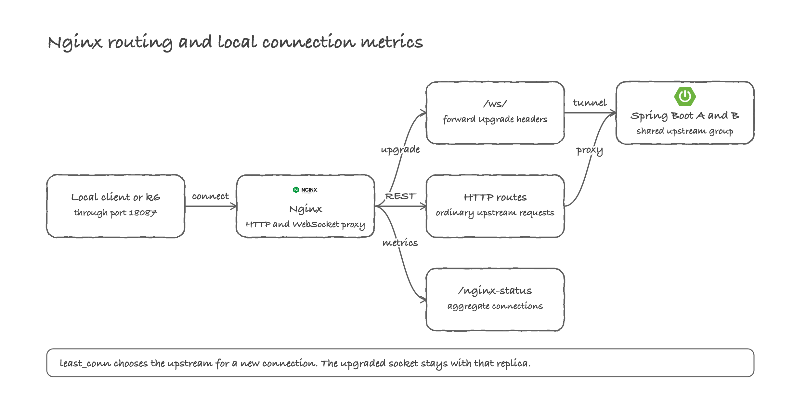

# Deploying Chat with Compose and Nginx

그림의 근거 · [Docker Docs · Control startup and shutdown order in Compose](https://docs.docker.com/compose/how-tos/startup-order/) · [Nginx · Load Balancing](https://nginx.org/en/docs/http/load_balancing.html) · [Nginx · WebSocket proxying](https://nginx.org/en/docs/http/websocket.html) · [Nginx · proxy_read_timeout](https://nginx.org/en/docs/http/ngx_http_proxy_module.html#proxy_read_timeout) · [Nginx · ngx_http_stub_status_module](https://nginx.org/en/docs/http/ngx_http_stub_status_module.html)

## 1. Compose에서 같은 애플리케이션을 두 번 실행한다

`app-a`와 `app-b`는 같은 Spring Boot 실행물을 사용하고 노드 ID를 구분한다. 두 앱은 PostgreSQL과 Redis를 연결하며, Nginx는 HTTP와 WebSocket을 받아 업스트림으로 전달한다. 루프백 포트 18085와 18086은 각 앱의 독립 확인에, 18087은 프록시 경유 시험에 사용한다. 헬스체크를 사용하는 의존성에서는 시작 순서와 서비스 준비 여부를 구분한다. [Docker Docs · Control startup and shutdown order in Compose](https://docs.docker.com/compose/how-tos/startup-order/) · [Nginx · Load Balancing](https://nginx.org/en/docs/http/load_balancing.html)

## 2. WebSocket 업그레이드를 프록시에서 전달한다

WebSocket 경로에서는 업스트림에 HTTP/1.1을 사용하고 `Upgrade`와 `Connection` 헤더를 전달한다. 실습은 `map`으로 연결 헤더를 정하고 `least_conn`을 사용해 새 연결을 배정한다. 업그레이드된 연결은 같은 업스트림으로 유지된다. 실습의 `proxy_read_timeout`은 65초이며 업스트림에서 두 읽기 사이에 허용하는 시간이다. 실제 메시지 빈도와 heartbeat 설계에 맞춰 이 값을 평가한다. [Nginx · WebSocket proxying](https://nginx.org/en/docs/http/websocket.html) · [Nginx · Load Balancing](https://nginx.org/en/docs/http/load_balancing.html) · [Nginx · proxy_read_timeout](https://nginx.org/en/docs/http/ngx_http_proxy_module.html#proxy_read_timeout)

## 3. 프록시 상태와 채팅 전달 지표를 함께 본다

`/nginx-status`의 `stub_status`에서 활성 연결과 누적 연결·요청 수를 확인한다. 채팅 성능은 프록시 지표에 더해 WebSocket 연결 결과, 발송 ACK, 방 수신자가 관측한 전달 지연과 누락을 시나리오별로 기록한다. 부하 도구의 타임아웃이나 계획 대비 시작량도 함께 보면 응답 지연만으로 성능을 판단하는 일을 줄일 수 있다. [Nginx · ngx_http_stub_status_module](https://nginx.org/en/docs/http/ngx_http_stub_status_module.html) · [Grafana k6 · WebSockets](https://grafana.com/docs/k6/latest/using-k6/protocols/websockets/) · [Grafana k6 · Built-in metrics](https://grafana.com/docs/k6/latest/using-k6/metrics/reference/)
