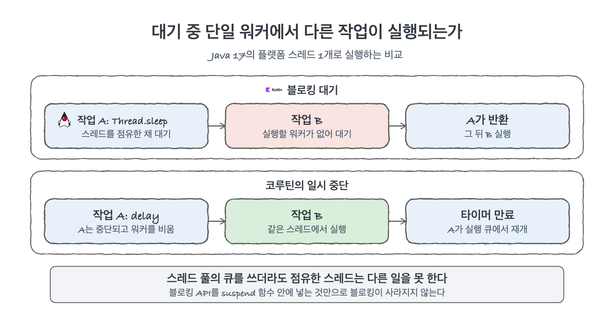

# From JVM Threads and Thread Pools to Kotlin Coroutines

작업이 결과를 기다릴 때 실행 스레드까지 점유하는지에 따라 같은 스레드에서 할 수 있는 일이 달라진다. Java 17의 플랫폼 스레드와 스레드 풀을 먼저 살펴보고, 코루틴이 대기 중인 작업을 어떻게 중단하는지 비교한다.

## 1. JVM 프로세스와 스레드

하나의 JVM 프로세스에서 여러 스레드가 실행될 수 있다. 스레드는 JVM 힙에 있는 객체를 공유하고, 각자 호출 프레임을 저장하는 JVM 스택을 가진다. 여러 스레드가 같은 객체를 변경한다면 접근 순서와 변경 내용이 다른 스레드에 보이는 시점을 고려해야 한다. [Java 17 · JVM 런타임 데이터 영역](https://docs.oracle.com/javase/specs/jvms/se17/html/jvms-2.html#jvms-2.5) · [Java 17 · 스레드와 메모리 모델](https://docs.oracle.com/javase/specs/jls/se17/html/jls-17.html)

아래에서 `thread`는 새 스레드를 시작하고 `join()`은 그 스레드가 끝날 때까지 기다린다. 작업 스레드가 `result`에 쓴 값은 `join()`이 성공적으로 반환한 뒤 읽을 수 있다. 실행 중인 여러 스레드가 동시에 같은 값을 읽고 바꾸는 경우에는 별도의 동기화가 필요하다. [Kotlin · `thread`](https://kotlinlang.org/api/core/kotlin-stdlib/kotlin.concurrent/thread.html) · [Java 17 · `start`, `join`과 happens-before](https://docs.oracle.com/javase/specs/jls/se17/html/jls-17.html#jls-17.4.5)

```kotlin
import kotlin.concurrent.thread

fun main() {
    val caller = Thread.currentThread()
    var result = 0
    val worker = thread(name = "stock-worker") {
        check(Thread.currentThread() !== caller)
        result = listOf(2, 3, 5).sum()
    }

    worker.join()
    check(result == 10)
}
```

## 2. 단일 스레드에서 대기가 다른 작업에 미치는 영향

하나의 스레드에서 작업 A와 B를 실행할 때 A가 블로킹 I/O로 기다리면, A가 끝날 때까지 같은 스레드에서 B를 실행할 수 없다. 작업을 여러 스레드에 배치하면 한 스레드가 기다리는 동안 다른 스레드가 독립된 일을 처리할 수 있다. CPU를 쓰는 작업도 여러 코어에서 동시에 실행되면 병렬로 처리할 수 있다. 여러 작업이 번갈아 진행될 수 있는 **동시성**은 스레드 하나에서도 가능하다. [Java 17 · 스레드 풀의 동작](https://docs.oracle.com/en/java/javase/17/docs/api/java.base/java/util/concurrent/ThreadPoolExecutor.html) · [Kotlin · 코루틴의 동시성](https://kotlinlang.org/docs/coroutines-basics.html)

## 3. 스레드 풀에서 작업 실행하기

`ExecutorService`는 작업을 제출하는 코드와 스레드를 관리하는 코드를 분리한다. `submit`은 `Future`를 반환하고 `get()`은 완료되지 않은 작업의 결과를 기다리는 동안 호출 스레드를 차단한다. 스레드 풀이 더 이상 필요 없으면 종료한다. `shutdown()`은 이미 제출한 작업을 마치게 하고, `shutdownNow()`는 대기 중인 작업의 시작을 막고 실행 중인 작업에 중단을 시도한다. [Java 17 · `ExecutorService`](https://docs.oracle.com/en/java/javase/17/docs/api/java.base/java/util/concurrent/ExecutorService.html)

`Executors.newFixedThreadPool(n)`은 동시에 일하는 스레드 수를 제한하고 크기 제한이 없는 대기열을 사용한다. 요청이 처리보다 빠르게 들어오면 대기열이 늘어날 수 있다. 대기열 용량과 포화 시의 동작까지 제어하려면 `ThreadPoolExecutor`에서 큐와 거절 정책을 지정할 수 있다. 아래 예제는 작업 하나를 블로킹하고, 스레드 수에 따라 독립된 작업이 어느 시점에 실행되는지 확인한다. [Java 17 · `Executors`](https://docs.oracle.com/en/java/javase/17/docs/api/java.base/java/util/concurrent/Executors.html) · [Java 17 · 큐와 거절 정책](https://docs.oracle.com/en/java/javase/17/docs/api/java.base/java/util/concurrent/ThreadPoolExecutor.html)

```kotlin
import java.util.concurrent.ArrayBlockingQueue
import java.util.concurrent.Callable
import java.util.concurrent.CountDownLatch
import java.util.concurrent.RejectedExecutionException
import java.util.concurrent.ThreadPoolExecutor
import java.util.concurrent.TimeUnit.SECONDS

fun checkPool(workers: Int) {
    val pool = ThreadPoolExecutor(
        workers, workers, 0, SECONDS,
        ArrayBlockingQueue<Runnable>(1), ThreadPoolExecutor.AbortPolicy(),
    )
    val waitingStarted = CountDownLatch(1)
    val releaseWaiting = CountDownLatch(1)

    try {
        val waiting = pool.submit(Callable {
            waitingStarted.countDown()
            releaseWaiting.await()
            "waiting task done"
        })
        check(waitingStarted.await(5, SECONDS))
        val independent = pool.submit(Callable { "independent task done" })

        if (workers == 1) {
            check(!independent.isDone)
            val rejection = runCatching { pool.submit(Callable { "extra task" }) }.exceptionOrNull()
            check(rejection is RejectedExecutionException)
        } else {
            check(independent.get(5, SECONDS) == "independent task done")
        }

        releaseWaiting.countDown()
        check(waiting.get(5, SECONDS) == "waiting task done")
        check(independent.get(5, SECONDS) == "independent task done")
    } finally {
        releaseWaiting.countDown()
        pool.shutdownNow()
    }
}

fun main() {
    checkPool(workers = 1)
    checkPool(workers = 2)
}
```

## 4. 블로킹 대기와 코루틴의 중단 비교

플랫폼 스레드가 블로킹 호출로 기다리는 동안 그 스레드는 다른 작업을 실행할 수 없다. 블로킹 대기가 많은 서비스에서 스레드 수를 키우면 스택과 스케줄링 비용도 고려해야 한다. 중단을 지원하는 `await()`에서는 코루틴이 결과를 기다리는 동안 실행 스레드를 다른 코루틴이 사용할 수 있다. 아래 예제에서는 두 작업이 같은 스레드를 사용하면서도, 먼저 시작한 작업이 중단된 동안 다른 작업이 끝난다. [Kotlin · 중단 함수와 코루틴](https://kotlinlang.org/docs/coroutines-basics.html) · [kotlinx.coroutines · `runBlocking`의 이벤트 루프](https://kotlinlang.org/api/kotlinx.coroutines/kotlinx-coroutines-core/kotlinx.coroutines/run-blocking.html)

이 예제는 [01번의 코루틴 실습 의존성](01_kotlin_coroutine_fundamentals_jobs_and_cancellation.md)을 사용한다.

```kotlin
import kotlinx.coroutines.CompletableDeferred
import kotlinx.coroutines.async
import kotlinx.coroutines.runBlocking

fun main() = runBlocking {
    val caller = Thread.currentThread()
    val started = CompletableDeferred<Unit>()
    val release = CompletableDeferred<Unit>()
    val waiting = async {
        check(Thread.currentThread() === caller)
        started.complete(Unit)
        release.await()
        "waiting task done"
    }

    started.await()
    val independent = async {
        check(Thread.currentThread() === caller)
        "independent task done"
    }
    check(independent.await() == "independent task done")
    check(!waiting.isCompleted)

    release.complete(Unit)
    check(waiting.await() == "waiting task done")
}
```

코루틴 안에서 `Thread.sleep()`이나 블로킹 파일 API를 호출하면 해당 스레드는 계속 차단된다. 블로킹 I/O가 필요한 코드는 `withContext(Dispatchers.IO)`로 실행 위치를 분리할 수 있다. Java 21 이상에서는 가상 스레드로 블로킹 방식의 코드를 구성하는 선택지도 있다. 가상 스레드와 코루틴 모두 대기 작업의 동시성을 높이는 데 쓰이며, CPU 계산 자체를 더 빠르게 만드는 기능은 아니다. [kotlinx.coroutines · `Dispatchers.IO`](https://kotlinlang.org/api/kotlinx.coroutines/kotlinx-coroutines-core/kotlinx.coroutines/-dispatchers/-i-o.html) · [Java 21 · 가상 스레드](https://docs.oracle.com/en/java/javase/21/core/virtual-threads.html)



그림의 근거 · [Java 17 Thread.sleep](https://docs.oracle.com/en/java/javase/17/docs/api/java.base/java/lang/Thread.html#sleep(long)) · [Kotlin delay](https://kotlinlang.org/api/kotlinx.coroutines/kotlinx-coroutines-core/kotlinx.coroutines/delay.html)
