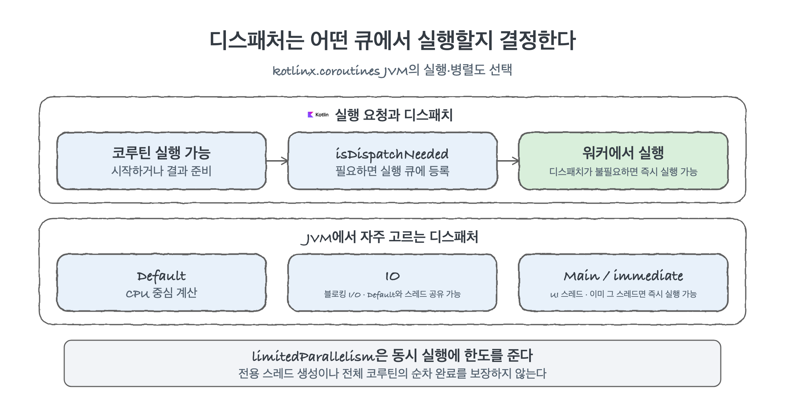

# Kotlin Coroutine Dispatchers and Parallelism

디스패처는 코루틴이 실행할 코드를 어느 스레드나 실행 큐에 맡길지 정한다. 계산 작업과 블로킹 I/O에는 각각 맞는 디스패처를 사용하고, UI 업데이트는 UI 스레드에서 실행한다. 예제는 Java 17과 [01번에서 설정한 `kotlinx-coroutines-core` 1.10.2](01_kotlin_coroutine_fundamentals_jobs_and_cancellation.md)를 사용한다.

## 1. `CoroutineDispatcher`의 역할과 디스패치 과정

코루틴을 시작하거나 다시 실행해야 할 때 코루틴 컨텍스트의 디스패처가 관여한다. 일반적인 디스패치 과정에서는 `isDispatchNeeded(context)`로 실행을 넘겨야 하는지 확인한다. 실행을 넘겨야 하면 `dispatch`가 실행을 스레드 풀이나 UI 이벤트 큐에 예약한다. 현재 실행 위치에서 곧바로 진행할 수 있다면 추가 큐 이동을 생략할 수 있다. [kotlinx.coroutines · `CoroutineDispatcher`](https://kotlinlang.org/api/kotlinx.coroutines/kotlinx-coroutines-core/kotlinx.coroutines/-coroutine-dispatcher/)

`launch(dispatcher)`와 `async(dispatcher)`는 새 자식 코루틴에 디스패처를 지정한다. `withContext(dispatcher)`는 블록에 지정한 디스패처를 적용하고, 결과가 준비되면 호출부가 원래 컨텍스트에서 이어서 실행된다. 풀 기반 디스패처에서 재개 시점의 스레드 이름은 달라질 수 있다. [Kotlin · 코루틴 컨텍스트와 디스패처](https://kotlinlang.org/docs/coroutine-context-and-dispatchers.html) · [kotlinx.coroutines · `withContext`](https://kotlinlang.org/api/kotlinx.coroutines/kotlinx-coroutines-core/kotlinx.coroutines/with-context.html)

## 2. `ExecutorService`로 디스패처 만들기

JVM에서는 `ExecutorService.asCoroutineDispatcher()`로 기존 실행기를 코루틴에 연결할 수 있다. 이름 붙인 전용 스레드가 필요한 예제에서는 단일 스레드 실행기를 만들고, 작업이 모두 끝난 뒤 `use`로 디스패처를 닫는다. 이 디스패처가 닫히면 연결된 `ExecutorService`도 종료 절차를 시작한다. [kotlinx.coroutines · `asCoroutineDispatcher`](https://kotlinlang.org/api/kotlinx.coroutines/kotlinx-coroutines-core/kotlinx.coroutines/as-coroutine-dispatcher.html) · [kotlinx.coroutines · `ExecutorCoroutineDispatcher`](https://kotlinlang.org/api/kotlinx.coroutines/kotlinx-coroutines-core/kotlinx.coroutines/-executor-coroutine-dispatcher/)

```kotlin
import java.util.concurrent.Executors
import kotlinx.coroutines.asCoroutineDispatcher
import kotlinx.coroutines.runBlocking
import kotlinx.coroutines.withContext

fun main() {
    val executor = Executors.newSingleThreadExecutor { task -> Thread(task, "stock-worker") }
    executor.asCoroutineDispatcher().use { dispatcher ->
        runBlocking {
            val caller = Thread.currentThread()
            val workerName = withContext(dispatcher) { Thread.currentThread().name }

            check(workerName == "stock-worker")
            check(Thread.currentThread() === caller)
        }
    }
    check(executor.isShutdown)
}
```

## 3. `Dispatchers.Default`와 `Dispatchers.IO`

| 디스패처 | 적합한 작업 |
| --- | --- |
| `Dispatchers.Default` | 대량 데이터 변환이나 계산처럼 CPU를 주로 사용하는 작업 |
| `Dispatchers.IO` | 파일 읽기나 블로킹 JDBC 호출처럼 결과를 기다리는 동안 스레드를 점유하는 작업 |

JVM에서 두 디스패처는 스레드를 공유할 수 있다. `withContext(Dispatchers.IO)`는 블로킹 작업에 맞는 실행 정책을 적용한다. 이미 `Default`에서 실행 중이면 같은 스레드에서 계속 실행될 수도 있다. `delay()`나 중단을 지원하는 네트워크 API는 대기 중에 스레드를 점유하지 않으므로 대기만을 이유로 `IO`를 지정할 필요는 없다. [kotlinx.coroutines · `Dispatchers.Default`](https://kotlinlang.org/api/kotlinx.coroutines/kotlinx-coroutines-core/kotlinx.coroutines/-dispatchers/-default.html) · [kotlinx.coroutines · `Dispatchers.IO`와 스레드 공유](https://kotlinlang.org/api/kotlinx.coroutines/kotlinx-coroutines-core/kotlinx.coroutines/-dispatchers/-i-o.html)

## 4. 공유 스레드 풀과 `limitedParallelism`

`dispatcher.limitedParallelism(n)`은 기존 디스패처에서 동시에 실행되는 작업을 최대 `n`개로 제한하는 뷰를 만든다. 예를 들어 `Dispatchers.IO.limitedParallelism(8)`을 파일 가져오기 작업에 공통으로 사용하면 해당 뷰의 실행량을 따로 제어할 수 있다. `IO`의 제한 뷰는 기본 `IO` 한도와 별개로 각자의 제한을 적용받고 스레드는 공유한다. 여러 뷰의 실행량을 합하면 기본 `IO` 한도를 넘을 수 있다. [kotlinx.coroutines · `limitedParallelism`](https://kotlinlang.org/api/kotlinx.coroutines/kotlinx-coroutines-core/kotlinx.coroutines/-coroutine-dispatcher/limited-parallelism.html) · [kotlinx.coroutines · `Dispatchers.IO`의 제한 뷰](https://kotlinlang.org/api/kotlinx.coroutines/kotlinx-coroutines-core/kotlinx.coroutines/-dispatchers/-i-o.html)

`limitedParallelism(1)`도 한 코루틴이 중단되면 같은 뷰에서 다른 코루틴을 실행할 수 있다. 아래에서 첫 작업이 신호를 기다리는 동안 두 번째 작업이 끝난다. 중단 지점까지 포함해 공유 상태를 보호하려면 `Mutex`, 작업 전체에 걸쳐 동시 수행 수를 제한하려면 `Semaphore` 같은 동기화 수단을 사용한다. [kotlinx.coroutines · 동기화 API](https://kotlinlang.org/api/kotlinx.coroutines/kotlinx-coroutines-core/kotlinx.coroutines.sync/)

```kotlin
import kotlinx.coroutines.CompletableDeferred
import kotlinx.coroutines.Dispatchers
import kotlinx.coroutines.async
import kotlinx.coroutines.launch
import kotlinx.coroutines.runBlocking
import kotlinx.coroutines.withTimeout

fun main() = runBlocking {
    val oneAtATime = Dispatchers.Default.limitedParallelism(1)
    val started = CompletableDeferred<Unit>()
    val release = CompletableDeferred<Unit>()
    val first = launch(oneAtATime) {
        started.complete(Unit)
        release.await()
    }

    withTimeout(5_000) { started.await() }
    val second = async(oneAtATime) { 42 }

    check(withTimeout(5_000) { second.await() } == 42)
    check(!first.isCompleted)
    release.complete(Unit)
    first.join()
}
```

## 5. `Dispatchers.Main`과 `Dispatchers.Main.immediate`

`Dispatchers.Main`은 플랫폼이 제공하는 UI 스레드에서 실행한다. Android에서는 Android용 디스패처, Swing에서는 Swing용 디스패처가 필요하다. 일반 JVM 콘솔 프로젝트에서 `Main`을 쓰려면 사용할 UI 디스패처를 추가한다. `Main.immediate`는 이미 해당 UI 스레드에 있을 때 가능한 경우 큐에 다시 넣는 과정을 생략한다. 그 결과 `Main`에 맡긴 작업과 실행 순서가 달라질 수 있다. [kotlinx.coroutines · `Dispatchers.Main`](https://kotlinlang.org/api/kotlinx.coroutines/kotlinx-coroutines-core/kotlinx.coroutines/-dispatchers/-main.html) · [kotlinx.coroutines · `Main.immediate`](https://kotlinlang.org/api/kotlinx.coroutines/kotlinx-coroutines-core/kotlinx.coroutines/-main-coroutine-dispatcher/immediate.html)

JVM에서 아래 예제를 실행하려면 `build.gradle.kts`의 `dependencies`에 `implementation("org.jetbrains.kotlinx:kotlinx-coroutines-swing:1.10.2")`를 추가한다. 두 자식은 모두 Swing 이벤트 디스패치 스레드에서 실행되지만, `Main.immediate`를 쓴 자식은 호출부가 다음 줄을 실행하기 전에 시작한다. [kotlinx.coroutines · Swing 디스패처](https://kotlinlang.org/api/kotlinx.coroutines/kotlinx-coroutines-swing/)

```kotlin
import javax.swing.SwingUtilities
import kotlinx.coroutines.Dispatchers
import kotlinx.coroutines.launch
import kotlinx.coroutines.runBlocking
import kotlinx.coroutines.withContext

fun main() = runBlocking {
    val events = withContext(Dispatchers.Main) {
        val trace = mutableListOf<String>()
        check(SwingUtilities.isEventDispatchThread())

        launch(Dispatchers.Main) { trace.add("queued") }
        launch(Dispatchers.Main.immediate) { trace.add("immediate") }
        trace.add("caller")
        trace
    }

    check(events == listOf("immediate", "caller", "queued"))
}
```



그림의 근거 · [Kotlin 1.10.2 CoroutineDispatcher](https://github.com/Kotlin/kotlinx.coroutines/blob/1.10.2/kotlinx-coroutines-core/common/src/CoroutineDispatcher.kt) · [Kotlin Dispatchers.IO](https://kotlinlang.org/api/kotlinx.coroutines/kotlinx-coroutines-core/kotlinx.coroutines/-dispatchers/-i-o.html) · [Kotlin limitedParallelism](https://kotlinlang.org/api/kotlinx.coroutines/kotlinx-coroutines-core/kotlinx.coroutines/-coroutine-dispatcher/limited-parallelism.html) · [Kotlin Main.immediate](https://kotlinlang.org/api/kotlinx.coroutines/kotlinx-coroutines-core/kotlinx.coroutines/-main-coroutine-dispatcher/immediate.html)
