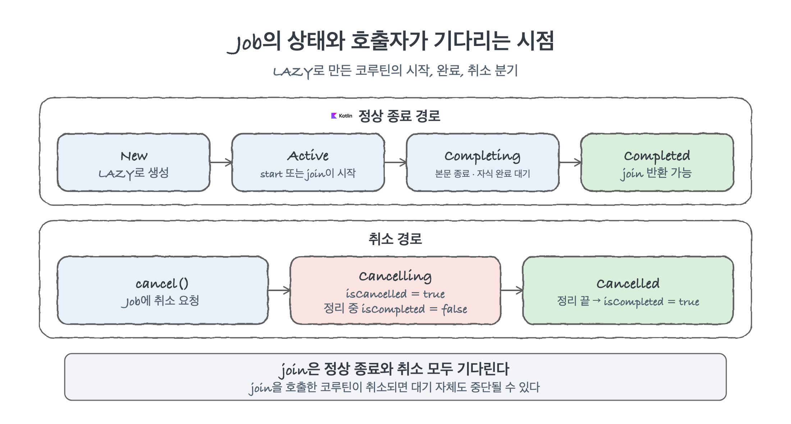

# Controlling Kotlin Coroutines with Job

`Job`으로 코루틴을 언제 시작하고, 어느 작업이 끝날 때까지 기다리며, 언제 취소할지 정할 수 있다. 취소를 요청한 시점과 정리가 끝난 시점은 다를 수 있다. 예제는 Java 17과 [01번의 `kotlinx-coroutines-core` 1.10.2 설정](01_kotlin_coroutine_fundamentals_jobs_and_cancellation.md)을 사용한다.

## 1. `join()`으로 순차 실행하기

A가 끝난 뒤 B를 시작해야 한다면 A의 `Job`에 `join()`을 호출한 다음 B를 실행한다. 이미 둘을 `launch`로 시작한 뒤 `joinAll()`을 호출하면 둘의 완료를 기다리지만, 실행 순서는 고정되지 않는다. 함수의 반환값이 다음 단계에 필요하다면 `suspend` 함수를 순서대로 호출하거나 `Deferred.await()`로 결과를 받는다. [kotlinx.coroutines · `Job.join`](https://kotlinlang.org/api/kotlinx.coroutines/kotlinx-coroutines-core/kotlinx.coroutines/-job/join.html) · [kotlinx.coroutines · `joinAll`](https://kotlinlang.org/api/kotlinx.coroutines/kotlinx-coroutines-core/kotlinx.coroutines/join-all.html)

`join()`은 대상의 정상 종료와 취소를 모두 완료로 기다린다. 기다리는 쪽의 코루틴이 취소되면 `join()`에서 `CancellationException`을 받을 수 있다. [kotlinx.coroutines · `Job.join`](https://kotlinlang.org/api/kotlinx.coroutines/kotlinx-coroutines-core/kotlinx.coroutines/-job/join.html)

```kotlin
import kotlinx.coroutines.launch
import kotlinx.coroutines.runBlocking

fun main() = runBlocking {
    val events = mutableListOf<String>()
    val load = launch { events.add("loaded") }
    load.join()

    val save = launch {
        check(events == listOf("loaded"))
        events.add("saved")
    }
    save.join()
    check(events == listOf("loaded", "saved"))
}
```

## 2. `CoroutineStart.LAZY`로 시작 미루기

`launch(start = CoroutineStart.LAZY)`는 처음에는 `New` 상태다. `start()`로 명시적으로 시작할 수 있고, `join()`은 아직 시작하지 않은 작업을 시작한 뒤 기다린다. `async(start = CoroutineStart.LAZY)`는 `await()`로도 시작한다. 스코프는 시작하지 않은 자식도 기다리므로, 지연 작업을 만들었다면 필요한 경우에 시작하고 사용하지 않을 때는 취소한다. [kotlinx.coroutines · `CoroutineStart.LAZY`](https://kotlinlang.org/api/kotlinx.coroutines/kotlinx-coroutines-core/kotlinx.coroutines/-coroutine-start/-l-a-z-y/)

```kotlin
import kotlinx.coroutines.CoroutineStart
import kotlinx.coroutines.async
import kotlinx.coroutines.cancelAndJoin
import kotlinx.coroutines.launch
import kotlinx.coroutines.runBlocking

fun main() = runBlocking {
    var reads = 0
    val count = async(start = CoroutineStart.LAZY) {
        reads++
        3
    }
    check(reads == 0 && !count.isActive && !count.isCompleted)
    check(count.await() == 3)
    check(reads == 1)

    val unused = launch(start = CoroutineStart.LAZY) { reads++ }
    unused.cancelAndJoin()
    check(reads == 1 && unused.isCancelled && unused.isCompleted)
}
```

## 3. 취소를 요청하고 정리 기다리기

`cancel()`은 취소를 요청하고 돌아온다. 정리 완료까지 기다려야 하면 `cancelAndJoin()`을 쓰거나 `cancel()` 뒤에 `join()`을 호출한다. 이미 `try`에 진입한 코루틴이 취소로 블록을 빠져나갈 때도 `finally`는 실행된다. 정리 자체가 중단 함수를 꼭 호출해야 하는 경우에만 `withContext(NonCancellable)`로 해당 구간을 감싼다. [kotlinx.coroutines · `cancelAndJoin`](https://kotlinlang.org/api/kotlinx.coroutines/kotlinx-coroutines-core/kotlinx.coroutines/cancel-and-join.html) · [kotlinx.coroutines · `NonCancellable`](https://kotlinlang.org/api/kotlinx.coroutines/kotlinx-coroutines-core/kotlinx.coroutines/-non-cancellable/)

아래에서는 정리 코드가 신호를 기다리는 동안 `isCancelled`는 `true`이고 `isCompleted`는 `false`다. 신호를 보내 정리가 끝나면 `join()`이 반환한다.

```kotlin
import kotlinx.coroutines.CompletableDeferred
import kotlinx.coroutines.NonCancellable
import kotlinx.coroutines.awaitCancellation
import kotlinx.coroutines.launch
import kotlinx.coroutines.runBlocking
import kotlinx.coroutines.withContext

fun main() = runBlocking {
    val started = CompletableDeferred<Unit>()
    val cleanupStarted = CompletableDeferred<Unit>()
    val finishCleanup = CompletableDeferred<Unit>()
    val job = launch {
        try {
            started.complete(Unit)
            awaitCancellation()
        } finally {
            withContext(NonCancellable) {
                cleanupStarted.complete(Unit)
                finishCleanup.await()
            }
        }
    }

    try {
        started.await()
        job.cancel()
        cleanupStarted.await()
        check(job.isCancelled && !job.isActive && !job.isCompleted)
    } finally {
        finishCleanup.complete(Unit)
    }
    job.join()
    check(job.isCancelled && job.isCompleted)
}
```

## 4. 취소를 확인하는 시점

코루틴 취소는 협력적으로 동작한다. 취소를 지원하는 중단 함수에서 취소를 감지할 수 있다. 실행 중 중단 지점이 없는 계산에서는 `ensureActive()`로 취소를 확인한다. `isActive`로 조건을 검사하면 취소 여부에 따라 루프를 직접 끝낼 수 있고, `yield()`는 취소를 확인하면서 다른 코루틴에 실행 기회를 준다. 예외를 넓게 잡을 때 `CancellationException`은 다시 던져 취소가 전파되게 한다. [kotlinx.coroutines · `ensureActive`](https://kotlinlang.org/api/kotlinx.coroutines/kotlinx-coroutines-core/kotlinx.coroutines/ensure-active.html) · [kotlinx.coroutines · `yield`](https://kotlinlang.org/api/kotlinx.coroutines/kotlinx-coroutines-core/kotlinx.coroutines/yield.html) · [Kotlin · 코루틴 예외와 취소](https://kotlinlang.org/docs/exception-handling.html)

아래에서는 묶음 하나를 처리하기 전에 취소를 확인한다. 실행 중인 작업은 스스로 취소를 요청한 뒤에도 다음 줄을 실행한다. 계산 함수에 들어가 첫 `ensureActive()`를 만나면 작업이 종료된다.

```kotlin
import kotlinx.coroutines.cancel
import kotlinx.coroutines.currentCoroutineContext
import kotlinx.coroutines.ensureActive
import kotlinx.coroutines.launch
import kotlinx.coroutines.runBlocking

suspend fun sumStock(batches: List<IntArray>): Long {
    val context = currentCoroutineContext()
    var total = 0L
    for (batch in batches) {
        context.ensureActive()
        total += batch.sumOf { it.toLong() }
    }
    return total
}

fun main() = runBlocking {
    val stock = listOf(intArrayOf(2, 3), intArrayOf(4))
    check(sumStock(stock) == 9L)

    val events = mutableListOf<String>()
    val job = launch {
        currentCoroutineContext().cancel()
        events.add("before check")
        sumStock(stock)
        events.add("after check")
    }
    job.join()

    check(events == listOf("before check"))
    check(job.isCancelled && job.isCompleted)
}
```

## 5. `Job` 상태와 관찰 가능한 값

| 상태 | `isActive` | `isCompleted` | `isCancelled` |
| --- | --- | --- | --- |
| `New` | `false` | `false` | `false` |
| `Active` | `true` | `false` | `false` |
| `Completing` | `true` | `false` | `false` |
| `Cancelling` | `false` | `false` | `true` |
| `Completed` | `false` | `true` | `false` |
| `Cancelled` | `false` | `true` | `true` |

`Completing`은 본문이 끝난 뒤 자식이 끝나기를 기다리는 상태다. 외부에서 보는 세 값은 `Active`와 같다. 아래에서는 `UNDISPATCHED`로 부모 본문을 먼저 실행한다. 부모 본문이 끝나도 자식이 신호를 기다리는 동안 부모는 완료 상태가 되지 않는다. 상태 프로퍼티는 읽는 시점의 값이다. 후속 작업을 안전하게 시작하려면 완료나 취소 상태를 반복 조회하기보다 `join()`으로 완료를 기다린다. [kotlinx.coroutines · `Job` 상태 표](https://kotlinlang.org/api/kotlinx.coroutines/kotlinx-coroutines-core/kotlinx.coroutines/-job/) · [kotlinx.coroutines · `CoroutineStart.UNDISPATCHED`](https://kotlinlang.org/api/kotlinx.coroutines/kotlinx-coroutines-core/kotlinx.coroutines/-coroutine-start/-u-n-d-i-s-p-a-t-c-h-e-d/)

```kotlin
import kotlinx.coroutines.CompletableDeferred
import kotlinx.coroutines.CoroutineStart
import kotlinx.coroutines.launch
import kotlinx.coroutines.runBlocking

fun main() = runBlocking {
    val finishChild = CompletableDeferred<Unit>()
    var bodyFinished = false
    val parent = launch(start = CoroutineStart.UNDISPATCHED) {
        launch { finishChild.await() }
        bodyFinished = true
    }

    check(bodyFinished && parent.isActive && !parent.isCompleted && !parent.isCancelled)
    finishChild.complete(Unit)
    parent.join()

    check(!parent.isActive && parent.isCompleted && !parent.isCancelled)
}
```



그림의 근거 · [Kotlin 1.10.2 Job](https://github.com/Kotlin/kotlinx.coroutines/blob/1.10.2/kotlinx-coroutines-core/common/src/Job.kt) · [Kotlin Job.join](https://kotlinlang.org/api/kotlinx.coroutines/kotlinx-coroutines-core/kotlinx.coroutines/-job/join.html)
