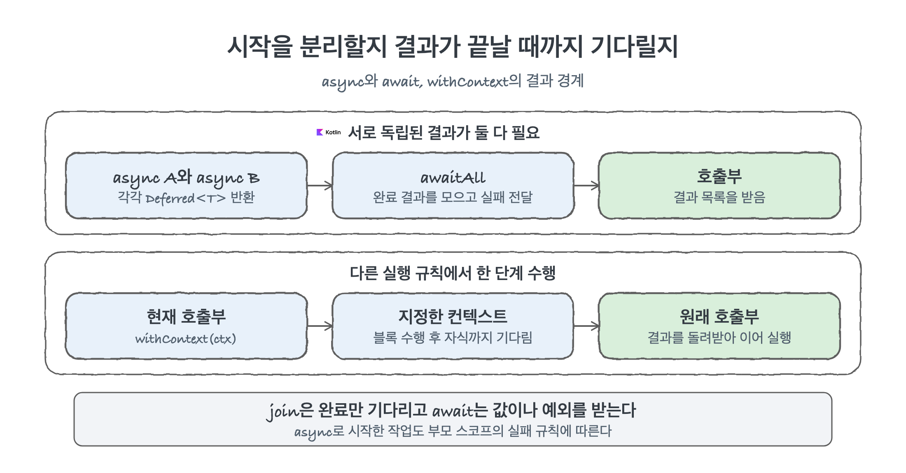

# Getting Results from Kotlin Coroutines

`async`는 작업을 시작하고 나중에 결과를 받을 수 있는 `Deferred`를 반환한다. `awaitAll`은 여러 `Deferred`의 결과를 모은다. `withContext`는 특정 컨텍스트에서 수행한 작업의 결과를 현재 호출부에 돌려준다. 예제는 Java 17과 [01번의 `kotlinx-coroutines-core` 1.10.2 설정](01_kotlin_coroutine_fundamentals_jobs_and_cancellation.md)을 사용한다.

## 1. `async`와 `await()`로 결과 받기

`async`는 기본 시작 모드에서 자식 작업을 실행하도록 예약한다. 결과를 받을 시점에 `await()`를 호출한다. `await()`는 결과가 아직 없으면 호출 코루틴을 중단하며, 작업이 성공하면 결과값을 반환하고 실패하면 예외를 던진다. 여러 작업을 겹쳐 진행하려면 독립된 작업부터 시작하고 나중에 `await()`로 결과를 받는다. `async { ... }.await()`를 여러 줄에 차례로 적으면 각 결과를 받은 뒤 다음 작업을 시작한다. [kotlinx.coroutines · `async`](https://kotlinlang.org/api/kotlinx.coroutines/kotlinx-coroutines-core/kotlinx.coroutines/async.html) · [kotlinx.coroutines · `Deferred.await`](https://kotlinlang.org/api/kotlinx.coroutines/kotlinx-coroutines-core/kotlinx.coroutines/-deferred/await.html) · [Kotlin · 중단 함수 합성](https://kotlinlang.org/docs/composing-suspending-functions.html)

```kotlin
import kotlinx.coroutines.Deferred
import kotlinx.coroutines.async
import kotlinx.coroutines.delay
import kotlinx.coroutines.runBlocking

suspend fun loadStock(sku: String): Int {
    delay(1)
    return if (sku == "pen") 3 else 0
}

fun main() = runBlocking {
    val sku = "pen"
    val stock: Deferred<Int> = async { loadStock(sku) }
    val requested = 2
    val available = stock.await()

    check(available == 3)
    check(available >= requested)
}
```

## 2. `Deferred<T>`는 결과를 가진 `Job`

| 호출 또는 프로퍼티 | 의미 |
| --- | --- |
| `join()` | `Job`의 완료를 기다리고 `Unit`을 반환한다. 기다리는 코루틴 자체가 취소되면 취소 예외를 받을 수 있다. |
| `await()` | `Deferred<T>`의 성공 결과 `T`를 반환하거나 그 작업의 실패를 던진다. 정상 완료한 `Deferred`를 다시 기다려도 같은 결과를 읽는다. |
| `cancel()`, `isActive`, `isCompleted`, `isCancelled` | `Deferred`가 `Job`에서 상속한 취소 동작과 상태 프로퍼티다. |

일반 스코프에서 `CancellationException` 외의 예외로 실패한 `async`는 부모에 실패를 전파한다. 아래에서는 `supervisorScope`로 자식의 실패를 격리하고, `join()` 이후에도 `await()`로 실패를 읽을 수 있는지 확인한다. [kotlinx.coroutines · `Deferred`](https://kotlinlang.org/api/kotlinx.coroutines/kotlinx-coroutines-core/kotlinx.coroutines/-deferred/) · [kotlinx.coroutines · `Job.join`](https://kotlinlang.org/api/kotlinx.coroutines/kotlinx-coroutines-core/kotlinx.coroutines/-job/join.html) · [kotlinx.coroutines · `supervisorScope`](https://kotlinlang.org/api/kotlinx.coroutines/kotlinx-coroutines-core/kotlinx.coroutines/supervisor-scope.html)

```kotlin
import kotlinx.coroutines.Job
import kotlinx.coroutines.async
import kotlinx.coroutines.runBlocking
import kotlinx.coroutines.supervisorScope

fun main() = runBlocking {
    supervisorScope {
        val stock = async<Int> { error("stock lookup failed") }
        val job: Job = stock
        job.join()
        check(job.isCompleted && job.isCancelled)

        val failure = try {
            stock.await()
            null
        } catch (e: IllegalStateException) {
            e
        }
        check(failure?.message == "stock lookup failed")
    }
}
```

## 3. 여러 작업의 결과 모으기

입력마다 `async`를 한 번씩 시작한 뒤 `awaitAll()`을 호출하면 모든 성공 결과를 입력 순서로 받을 수 있다. 완료 순서를 입력 순서에 맞출 필요는 없다. `jobs.map { it.await() }`는 앞쪽 작업부터 기다리지만, `awaitAll()`은 어느 작업에서든 실패가 관찰되면 남은 작업의 완료를 기다리지 않고 예외를 전달한다. `supervisorScope`에서 이 예외를 처리한 뒤에도 다른 자식이 계속 실행될 수 있으므로, 더 이상 필요 없는 작업은 취소한다. [kotlinx.coroutines · `awaitAll`](https://kotlinlang.org/api/kotlinx.coroutines/kotlinx-coroutines-core/kotlinx.coroutines/await-all.html) · [kotlinx.coroutines · `supervisorScope`](https://kotlinlang.org/api/kotlinx.coroutines/kotlinx-coroutines-core/kotlinx.coroutines/supervisor-scope.html)

```kotlin
import kotlinx.coroutines.CompletableDeferred
import kotlinx.coroutines.async
import kotlinx.coroutines.awaitAll
import kotlinx.coroutines.awaitCancellation
import kotlinx.coroutines.cancelAndJoin
import kotlinx.coroutines.coroutineScope
import kotlinx.coroutines.runBlocking
import kotlinx.coroutines.supervisorScope
import kotlinx.coroutines.withTimeout

fun main() = runBlocking {
    val completionOrder = mutableListOf<String>()
    val quantities = coroutineScope {
        val notebookReady = CompletableDeferred<Unit>()
        val pen = async {
            notebookReady.await()
            completionOrder.add("pen")
            3
        }
        val notebook = async {
            completionOrder.add("notebook")
            notebookReady.complete(Unit)
            7
        }
        awaitAll(pen, notebook)
    }
    check(completionOrder == listOf("notebook", "pen"))
    check(quantities == listOf(3, 7))

    supervisorScope {
        val pending = async<Int> { awaitCancellation() }
        val failed = async<Int> { error("lookup failed") }
        try {
            val failure = try {
                withTimeout(5_000) { awaitAll(pending, failed) }
                null
            } catch (e: IllegalStateException) {
                e
            }
            check(failure?.message == "lookup failed")
            check(!pending.isCompleted)
        } finally {
            pending.cancelAndJoin()
        }
    }
}
```

## 4. `withContext()`로 실행 컨텍스트를 지정하고 결과 받기

`withContext(context) { ... }`는 지정한 컨텍스트에서 블록을 실행한다. 블록과 자식 작업이 끝나면 블록의 결과를 직접 반환하고, 호출자는 원래 컨텍스트에서 이어서 실행한다. 한 계산을 `Dispatchers.Default`에 맡겨 결과를 받은 뒤 다음 단계로 진행하려는 경우에 적합하다. 두 작업을 먼저 시작하고 나중에 개별 결과를 받을 때는 각각 `async`로 시작한다. [kotlinx.coroutines · `withContext`](https://kotlinlang.org/api/kotlinx.coroutines/kotlinx-coroutines-core/kotlinx.coroutines/with-context.html)

```kotlin
import kotlinx.coroutines.Dispatchers
import kotlinx.coroutines.runBlocking
import kotlinx.coroutines.withContext

data class StockLine(val quantity: Int, val unitPrice: Long)

suspend fun inventoryValue(lines: List<StockLine>): Long = withContext(Dispatchers.Default) {
    lines.sumOf { it.quantity * it.unitPrice }
}

fun main() = runBlocking {
    val caller = Thread.currentThread()
    val lines = listOf(StockLine(3, 1_200), StockLine(2, 2_500))
    val value = inventoryValue(lines)

    check(value == 8_600L)
    check(Thread.currentThread() === caller)
}
```



그림의 근거 · [Kotlin async](https://kotlinlang.org/api/kotlinx.coroutines/kotlinx-coroutines-core/kotlinx.coroutines/async.html) · [Kotlin awaitAll](https://kotlinlang.org/api/kotlinx.coroutines/kotlinx-coroutines-core/kotlinx.coroutines/await-all.html) · [Kotlin withContext](https://kotlinlang.org/api/kotlinx.coroutines/kotlinx-coroutines-core/kotlinx.coroutines/with-context.html)
