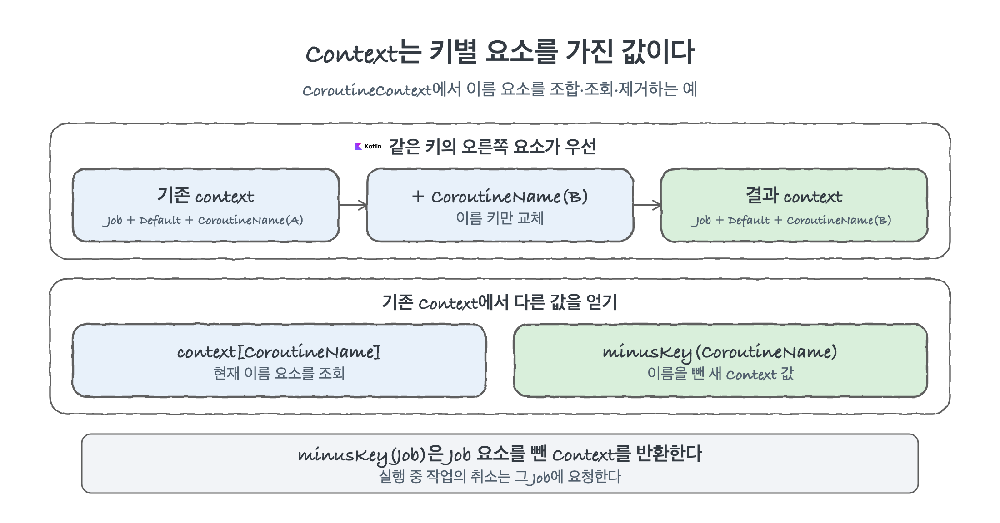

# Kotlin CoroutineContext: Composition, Lookup, and Removal

`CoroutineContext`에는 코루틴의 `Job`, 디스패처, 이름 같은 요소가 들어 있다. `+`로 여러 요소를 조합하고, `context[key]`로 읽고, `minusKey()`로 특정 요소를 뺀 컨텍스트를 얻는다. 예제는 Java 17과 [01번의 `kotlinx-coroutines-core` 1.10.2 설정](01_kotlin_coroutine_fundamentals_jobs_and_cancellation.md)을 사용한다.

## 1. `CoroutineContext`의 요소와 키

`CoroutineContext`는 키로 접근할 수 있는 불변 요소 집합이다. `CoroutineContext.Element`는 자신의 `key`를 가지며, 같은 키에는 하나의 요소가 들어간다. `EmptyCoroutineContext`는 요소가 없는 컨텍스트다. 집합에 들어 있는 `Job` 자체의 진행 상태는 코루틴의 실행에 따라 바뀔 수 있다. [Kotlin · `CoroutineContext`와 `Element`](https://kotlinlang.org/api/core/kotlin-stdlib/kotlin.coroutines/-coroutine-context/)

| 요소 | 조회 키 | 역할 |
| --- | --- | --- |
| `Job` | `Job` | 코루틴의 수명, 부모·자식 관계, 취소를 다룬다. |
| `CoroutineDispatcher` | `ContinuationInterceptor` | 코루틴을 어느 실행 문맥에 예약할지 정한다. |
| `CoroutineName` | `CoroutineName` | 코루틴에 디버깅용 이름을 붙인다. |
| `CoroutineExceptionHandler` | `CoroutineExceptionHandler` | 다른 전파 경로가 없는 미처리 예외를 보고한다. |

[Kotlin · 컨텍스트와 디스패처](https://kotlinlang.org/docs/coroutine-context-and-dispatchers.html) · [kotlinx.coroutines · `CoroutineExceptionHandler`](https://kotlinlang.org/api/kotlinx.coroutines/kotlinx-coroutines-core/kotlinx.coroutines/-coroutine-exception-handler/)

## 2. `+`로 컨텍스트 구성하기

`left + right`는 두 컨텍스트를 조합한다. 같은 키의 요소가 양쪽에 있으면 오른쪽 요소가 남는다. `CoroutineName`을 바꾸면 기존 디스패처는 유지된다. `Dispatchers.IO`를 추가하면 같은 `ContinuationInterceptor` 키의 기존 디스패처를 교체한다. 컨텍스트를 조합한 뒤 `launch`나 `withContext` 등에 전달해 실행에 적용할 수 있다. [Kotlin · `CoroutineContext.plus`](https://kotlinlang.org/api/core/kotlin-stdlib/kotlin.coroutines/-coroutine-context/plus.html) · [Kotlin · 코루틴 컨텍스트 상속](https://kotlinlang.org/docs/coroutine-context-and-dispatchers.html)

```kotlin
import kotlin.coroutines.ContinuationInterceptor
import kotlin.coroutines.EmptyCoroutineContext
import kotlinx.coroutines.CoroutineName
import kotlinx.coroutines.Dispatchers

fun main() {
    val base = EmptyCoroutineContext + CoroutineName("report") + Dispatchers.Default
    val named = base + CoroutineName("stock")
    val stockIo = named + Dispatchers.IO

    check(base[CoroutineName]?.name == "report")
    check(named[CoroutineName]?.name == "stock")
    check(named[ContinuationInterceptor] === Dispatchers.Default)
    check(stockIo[CoroutineName]?.name == "stock")
    check(stockIo[ContinuationInterceptor] === Dispatchers.IO)
}
```

## 3. 키로 요소 조회하기

`context[key]`는 해당 키의 요소를 반환하며, 키가 없으면 `null`을 반환한다. `currentCoroutineContext()`로 현재 실행 중인 코루틴의 컨텍스트를 읽는다. 요소 하나를 찾아 쓰려면 `get`, 모든 요소를 훑어 키 목록처럼 누적 결과를 만들려면 `fold`를 쓴다. [Kotlin · `CoroutineContext.get`](https://kotlinlang.org/api/core/kotlin-stdlib/kotlin.coroutines/-coroutine-context/get.html) · [Kotlin · `CoroutineContext.fold`](https://kotlinlang.org/api/core/kotlin-stdlib/kotlin.coroutines/-coroutine-context/fold.html) · [kotlinx.coroutines · `currentCoroutineContext`](https://kotlinlang.org/api/kotlinx.coroutines/kotlinx-coroutines-core/kotlinx.coroutines/current-coroutine-context.html)

요청 ID처럼 직접 정의한 값도 `CoroutineContext.Element`로 넣을 수 있다. 아래 `RequestId`는 전용 키를 가진다. 중단 함수에서는 같은 키로 값을 찾는다. [Kotlin · `AbstractCoroutineContextElement`](https://kotlinlang.org/api/core/kotlin-stdlib/kotlin.coroutines/-abstract-coroutine-context-element/)

```kotlin
import kotlin.coroutines.AbstractCoroutineContextElement
import kotlin.coroutines.CoroutineContext
import kotlinx.coroutines.CoroutineName
import kotlinx.coroutines.Job
import kotlinx.coroutines.currentCoroutineContext
import kotlinx.coroutines.runBlocking

class RequestId(val value: String) : AbstractCoroutineContextElement(Key) {
    companion object Key : CoroutineContext.Key<RequestId>
}

suspend fun requestId(): String? = currentCoroutineContext()[RequestId]?.value

fun main() = runBlocking(CoroutineName("stock") + RequestId("req-42")) {
    check(requestId() == "req-42")
    val context = currentCoroutineContext()
    val keys = context.fold(mutableSetOf<CoroutineContext.Key<*>>()) { collected, element ->
        collected.apply { add(element.key) }
    }
    check(keys.containsAll(listOf(CoroutineName, RequestId, Job)))
}
```

## 4. `minusKey()`로 요소 제거하기

`context.minusKey(key)`는 해당 요소를 제외한 컨텍스트를 반환한다. 키가 없다면 기존 컨텍스트가 그대로 반환된다. `minusKey(Job)`의 결과에서 `Job`을 조회할 수 없어도 원래 작업은 계속 살아 있다. 작업을 취소하려면 해당 `Job`에 `cancel()`을 호출한다. [Kotlin · `CoroutineContext.minusKey`](https://kotlinlang.org/api/core/kotlin-stdlib/kotlin.coroutines/-coroutine-context/minus-key.html) · [kotlinx.coroutines · `Job`](https://kotlinlang.org/api/kotlinx.coroutines/kotlinx-coroutines-core/kotlinx.coroutines/-job/)

`withContext`는 현재 컨텍스트에 전달받은 컨텍스트를 합친다. 아래에서 전달한 설정에서 이름을 제거하면 그 설정에는 이름이 사라진다. `withContext` 블록에서는 전달한 새 이름이 없으므로 호출부의 `CoroutineName("request")`를 이어받는다. [kotlinx.coroutines · `withContext`의 컨텍스트 합성](https://kotlinlang.org/api/kotlinx.coroutines/kotlinx-coroutines-core/kotlinx.coroutines/with-context.html)

```kotlin
import kotlin.coroutines.ContinuationInterceptor
import kotlinx.coroutines.CoroutineName
import kotlinx.coroutines.Dispatchers
import kotlinx.coroutines.currentCoroutineContext
import kotlinx.coroutines.runBlocking
import kotlinx.coroutines.withContext

fun main() = runBlocking(CoroutineName("request")) {
    val configured = Dispatchers.Default + CoroutineName("worker")
    val withoutName = configured.minusKey(CoroutineName)

    check(configured[CoroutineName]?.name == "worker")
    check(withoutName[CoroutineName] == null)
    check(withoutName[ContinuationInterceptor] === Dispatchers.Default)

    withContext(withoutName) {
        val active = currentCoroutineContext()
        check(active[CoroutineName]?.name == "request")
        check(active[ContinuationInterceptor] === Dispatchers.Default)
    }
}
```



그림의 근거 · [Kotlin CoroutineContext.plus](https://kotlinlang.org/api/core/kotlin-stdlib/kotlin.coroutines/-coroutine-context/plus.html) · [Kotlin CoroutineContext.minusKey](https://kotlinlang.org/api/core/kotlin-stdlib/kotlin.coroutines/-coroutine-context/minus-key.html) · [Kotlin 1.10.2 Job](https://github.com/Kotlin/kotlinx.coroutines/blob/1.10.2/kotlinx-coroutines-core/common/src/Job.kt)
