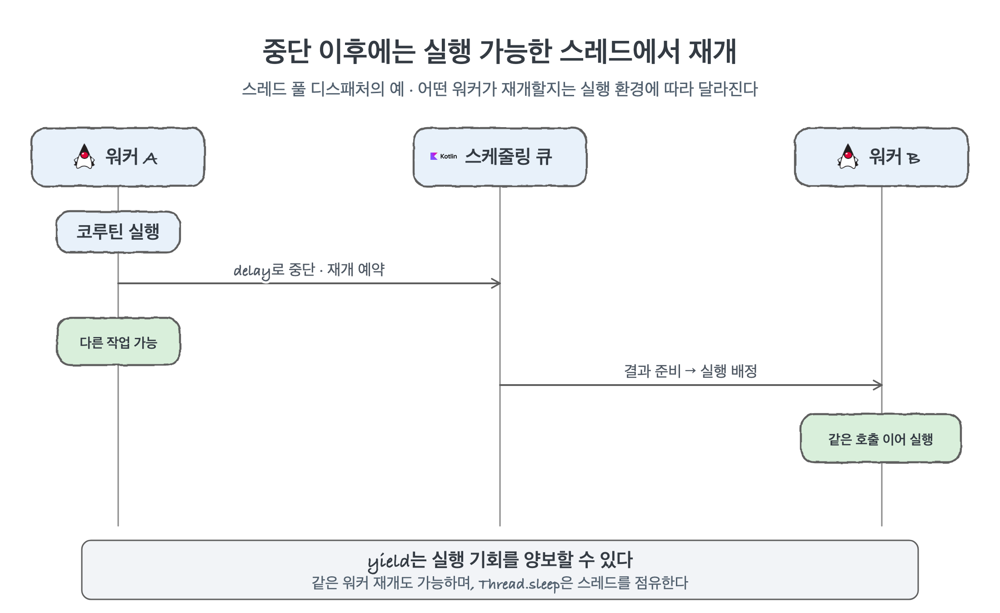

# Understanding Kotlin Coroutine Execution: Suspension, Yielding, and Threads

일반 함수는 호출자에게 값이나 제어를 반환하면 그 호출을 마친다. 코루틴은 중단된 호출을 나중에 이어서 실행할 수 있다. 이 차이를 기준으로 스레드 양보와 재개 시 실행 스레드를 살펴본다. 예제는 Java 17과 [01번의 `kotlinx-coroutines-core` 1.10.2 설정](01_kotlin_coroutine_fundamentals_jobs_and_cancellation.md)을 사용한다.

## 1. 루틴, 서브루틴, 코루틴의 호출 흐름

| 개념 | 실행 흐름 |
| --- | --- |
| 루틴 | 프로그램에서 한 가지 일을 수행하는 코드 단위다. |
| 서브루틴 | 다른 루틴이 호출하는 함수나 절차다. 일반 함수 호출에서 호출부는 하위 함수가 반환한 뒤 다음 줄을 실행한다. |
| 코루틴 | 실행 중 중단 지점에서 멈추고, 조건이 충족되면 그 지점부터 다시 실행할 수 있는 작업이다. |

아래에서 `formatSku`는 값을 곧바로 반환하는 일반 함수다. `stockLabel`은 양수 시간의 `delay()`에서 중단될 수 있다. 재개되면 중단 전에 계산한 `sku`를 사용해 최종 결과를 만든다. 컴파일러는 중단 함수의 재개 위치와 필요한 지역 값을 보존할 수 있게 상태 머신으로 변환한다. [Kotlin · 코루틴과 상태 머신](https://kotlinlang.org/spec/asynchronous-programming-with-coroutines.html) · [kotlinx.coroutines · `delay`](https://kotlinlang.org/api/kotlinx.coroutines/kotlinx-coroutines-core/kotlinx.coroutines/delay.html)

```kotlin
import kotlinx.coroutines.delay
import kotlinx.coroutines.runBlocking

fun formatSku(raw: String): String = raw.trim().uppercase()

suspend fun stockLabel(raw: String): String {
    val sku = formatSku(raw)
    delay(1)
    return "$sku ready"
}

fun main() = runBlocking {
    check(stockLabel(" pen ") == "PEN ready")
}
```

## 2. `yield()`와 대기 중 스레드 사용

| 호출 | 대기 중의 동작 |
| --- | --- |
| `yield()` | 다른 코루틴에 실행 기회를 준다. 디스패처에 다른 실행 가능 작업이 없으면 중단 없이 돌아올 수 있다. 취소 상태도 확인한다. |
| `delay(ms)` | 양수 시간을 넘기면 최소 그 시간만큼 코루틴을 중단한다. 기다리는 동안 스레드는 다른 일을 할 수 있다. |
| `Deferred.await()` | 결과가 준비될 때까지 코루틴을 중단한다. 결과가 준비되어 있으면 바로 반환할 수 있다. |
| `Thread.sleep(ms)` | 호출한 스레드가 잠든다. 그동안 같은 스레드에서 다른 코루틴을 실행할 수 없다. |

[kotlinx.coroutines · `yield`](https://kotlinlang.org/api/kotlinx.coroutines/kotlinx-coroutines-core/kotlinx.coroutines/yield.html) · [kotlinx.coroutines · `delay`](https://kotlinlang.org/api/kotlinx.coroutines/kotlinx-coroutines-core/kotlinx.coroutines/delay.html) · [kotlinx.coroutines · `Deferred.await`](https://kotlinlang.org/api/kotlinx.coroutines/kotlinx-coroutines-core/kotlinx.coroutines/-deferred/await.html) · [Java 17 · `Thread`](https://docs.oracle.com/en/java/javase/17/docs/api/java.base/java/lang/Thread.html)

두 작업 모두 한 스레드에서 실행된다. 첫 작업은 `yield()`를 호출해 다른 작업이 진행할 기회를 준다. 확인할 수 있는 순서는 첫 작업 내부의 `before yield`와 `after yield`다. 둘째 작업까지 포함해 실행 순서를 정해야 한다면 `join()`, `await()` 또는 `CompletableDeferred` 같은 신호를 사용한다. [kotlinx.coroutines · `yield`에 실행 순서를 의존하는 사례](https://kotlinlang.org/api/kotlinx.coroutines/kotlinx-coroutines-core/kotlinx.coroutines/yield.html) · [05번 · `Job.join()`으로 순서 제어](05_controlling_kotlin_coroutines_with_job.md)

```kotlin
import kotlinx.coroutines.joinAll
import kotlinx.coroutines.launch
import kotlinx.coroutines.runBlocking
import kotlinx.coroutines.yield

fun main() = runBlocking {
    val events = mutableListOf<String>()
    val first = launch {
        events.add("before yield")
        yield()
        events.add("after yield")
    }
    val second = launch { events.add("other work") }

    joinAll(first, second)
    check(events.toSet() == setOf("before yield", "after yield", "other work"))
    check(events.indexOf("before yield") < events.indexOf("after yield"))
    println(events)
}
```

## 3. 코루틴의 시작 스레드와 재개 스레드

코루틴이 실행·재개될 때 사용할 스레드는 디스패처가 정한다. 전용 단일 스레드 디스패처는 지정된 스레드에서 재개하고, 풀 기반 디스패처는 재개 시점에 사용할 수 있는 스레드에서 진행한다. `CoroutineStart.UNDISPATCHED`는 첫 실제 중단 지점까지 호출 스레드에서 실행하고, 이후 재개에는 지정된 디스패처를 사용한다. [Kotlin · 코루틴 실행 스레드와 디스패처](https://kotlinlang.org/docs/coroutine-context-and-dispatchers.html) · [kotlinx.coroutines · `CoroutineStart.UNDISPATCHED`](https://kotlinlang.org/api/kotlinx.coroutines/kotlinx-coroutines-core/kotlinx.coroutines/-coroutine-start/-u-n-d-i-s-p-a-t-c-h-e-d/)

아래에서는 아직 완료되지 않은 `CompletableDeferred`를 `await()`하므로 실제 중단이 발생한다. 신호를 받은 다음에는 같은 코루틴의 `Job`으로 실행을 이어 가며, 스레드는 `stock-worker`로 바뀐다. [kotlinx.coroutines · 실행기를 디스패처로 변환](https://kotlinlang.org/api/kotlinx.coroutines/kotlinx-coroutines-core/kotlinx.coroutines/as-coroutine-dispatcher.html)

```kotlin
import java.util.concurrent.Executors
import kotlinx.coroutines.CompletableDeferred
import kotlinx.coroutines.CoroutineStart
import kotlinx.coroutines.Job
import kotlinx.coroutines.asCoroutineDispatcher
import kotlinx.coroutines.async
import kotlinx.coroutines.currentCoroutineContext
import kotlinx.coroutines.runBlocking

fun main() {
    val executor = Executors.newSingleThreadExecutor { task -> Thread(task, "stock-worker") }
    executor.asCoroutineDispatcher().use { dispatcher ->
        runBlocking {
            val caller = Thread.currentThread()
            val resume = CompletableDeferred<Unit>()
            val observed = async(dispatcher, start = CoroutineStart.UNDISPATCHED) {
                val before = Thread.currentThread()
                val job = checkNotNull(currentCoroutineContext()[Job])
                resume.await()
                check(currentCoroutineContext()[Job] === job)
                before to Thread.currentThread()
            }

            check(!observed.isCompleted)
            resume.complete(Unit)
            val (before, after) = observed.await()
            check(before === caller && after.name == "stock-worker")
        }
    }
}
```



그림의 근거 · [Kotlin delay](https://kotlinlang.org/api/kotlinx.coroutines/kotlinx-coroutines-core/kotlinx.coroutines/delay.html) · [Kotlin 1.10.2 CoroutineDispatcher](https://github.com/Kotlin/kotlinx.coroutines/blob/1.10.2/kotlinx-coroutines-core/common/src/CoroutineDispatcher.kt) · [Kotlin yield](https://kotlinlang.org/api/kotlinx.coroutines/kotlinx-coroutines-core/kotlinx.coroutines/yield.html) · [Java 17 Thread.sleep](https://docs.oracle.com/en/java/javase/17/docs/api/java.base/java/lang/Thread.html#sleep(long))
