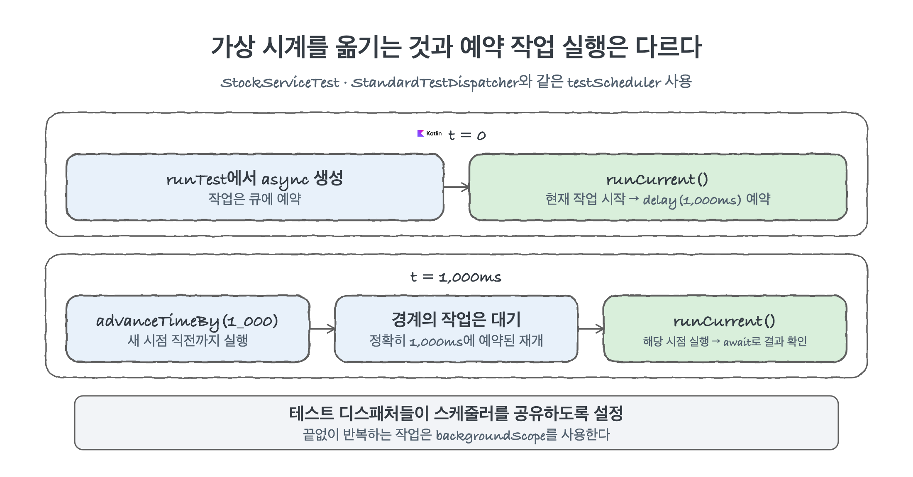

# Testing Kotlin Coroutines with JUnit 5 and Virtual Time

코루틴 단위 테스트에서는 외부 조회를 테스트 더블로 바꾸고, 대기와 재개 시점을 가상 시간으로 제어한다. 결과값뿐 아니라 작업이 언제 시작하고 언제 완료되는지도 검증할 수 있다. 실습은 Java 17, JUnit 5.12.2, `kotlinx-coroutines-test` 1.10.2를 사용한다.

## 1. 단위 테스트 환경 설정하기

단위 테스트는 함수나 클래스의 동작을 정해진 입력과 기대 결과로 검증한다. 재고 차감 함수라면 정상 차감과 재고 초과 요청을 서로 다른 테스트에서 확인한다. Kotlin/JVM 프로젝트의 `build.gradle.kts`에 아래 설정을 추가하고, 예제 파일은 `src/test/kotlin`에 둔다. `./gradlew test`로 JUnit Platform에서 실행한다. [Kotlin · Kotlin/JVM에서 JUnit 사용하기](https://kotlinlang.org/docs/jvm-test-using-junit.html) · [JUnit 5 · Gradle에서 테스트 실행](https://docs.junit.org/5.12.2/user-guide/#running-tests-build-gradle) · [kotlinx.coroutines · 테스트 라이브러리](https://kotlinlang.org/api/kotlinx.coroutines/kotlinx-coroutines-test/)

```kotlin
dependencies {
    implementation("org.jetbrains.kotlinx:kotlinx-coroutines-core:1.10.2")

    testImplementation(platform("org.junit:junit-bom:5.12.2"))
    testImplementation(kotlin("test-junit5"))
    testImplementation("org.jetbrains.kotlinx:kotlinx-coroutines-test:1.10.2")
    testRuntimeOnly("org.junit.jupiter:junit-jupiter-engine")
    testRuntimeOnly("org.junit.platform:junit-platform-launcher")
}

tasks.test {
    useJUnitPlatform()
}
```

### `ReservationTest.kt`에서 테스트 작성하기

`@Test`가 붙은 함수가 테스트가 된다. `assertEquals`로 성공 결과를, `assertFailsWith`로 예상 예외를 확인한다. 테스트 이름에 상황과 결과를 적으면 실행 보고서에서 실패한 조건을 찾기 쉽다. [Kotlin · `kotlin.test`](https://kotlinlang.org/api/core/kotlin-test/kotlin.test/)

```kotlin
import kotlin.test.Test
import kotlin.test.assertEquals
import kotlin.test.assertFailsWith

fun remainingStock(available: Int, requested: Int): Int {
    require(requested in 1..available)
    return available - requested
}

class ReservationTest {
    @Test
    fun `reservation subtracts the requested quantity`() {
        assertEquals(2, remainingStock(available = 5, requested = 3))
    }

    @Test
    fun `reservation larger than available stock is rejected`() {
        assertFailsWith<IllegalArgumentException> {
            remainingStock(available = 5, requested = 6)
        }
    }
}
```

## 2. 테스트 더블로 의존성 바꾸기

테스트 더블은 실제 의존성 대신 넣는 객체다. 스텁은 지정한 응답을 반환하고, 페이크는 메모리 저장소처럼 간단한 구현을 제공한다. 호출 기록이 필요할 때는 스파이를 쓰고, 상호작용을 검증하는 테스트에는 모의 객체를 사용할 수 있다. 재고 조회에는 메모리의 맵을 읽는 페이크를 넣고, 조회한 SKU도 기록한다. [저장소의 테스트 대역 정리](../practical-testing/05_test_doubles_and_mockito.md)

아래 `StockFixture.kt`와 다음 절의 `StockServiceTest.kt`는 같은 패키지에 둔다. 서비스에 디스패처를 주입하면 테스트가 `runTest`와 같은 스케줄러에서 대기와 재개를 제어할 수 있다. [kotlinx.coroutines · 테스트 디스패처와 스케줄러](https://kotlinlang.org/api/kotlinx.coroutines/kotlinx-coroutines-test/)

```kotlin
import kotlinx.coroutines.CoroutineDispatcher
import kotlinx.coroutines.delay
import kotlinx.coroutines.withContext

interface StockSource {
    suspend fun read(sku: String): Int
}

class FakeStockSource(private val quantities: Map<String, Int>) : StockSource {
    val requestedSkus = mutableListOf<String>()

    override suspend fun read(sku: String): Int {
        requestedSkus.add(sku)
        delay(1_000)
        return quantities[sku] ?: 0
    }
}

class StockService(
    private val source: StockSource,
    private val dispatcher: CoroutineDispatcher,
) {
    suspend fun quantity(sku: String): Int = withContext(dispatcher) { source.read(sku) }
}
```

## 3. `runTest`로 가상 시간 제어하기

`runTest`는 테스트용 코루틴 스코프를 제공한다. 테스트 스케줄러를 사용하는 디스패처에서 `delay()`로 기다리는 시간은 가상 시간으로 진행된다. 코드가 `Dispatchers.IO`나 `Dispatchers.Default`를 직접 사용하면 그곳의 지연에는 테스트 스케줄러가 적용되지 않는다. [kotlinx.coroutines · `runTest`](https://kotlinlang.org/api/kotlinx.coroutines/kotlinx-coroutines-test/kotlinx.coroutines.test/run-test.html)

| 도구 | 동작 |
| --- | --- |
| `StandardTestDispatcher(testScheduler)` | 작업을 스케줄러에 예약한다. 테스트 본문에서 현재 시점의 작업을 실행하려면 `runCurrent()`를 호출한다. |
| `UnconfinedTestDispatcher(testScheduler)` | `runTest`의 최상위 자식에 즉시 진입할 수 있게 한다. 예약된 작업의 구체적인 실행 순서는 테스트의 전제로 삼지 않는다. |
| `advanceTimeBy(ms)` | 가상 시계를 전진시키고 새 시점 직전까지의 작업을 실행한다. 새 시점에 정확히 예약된 작업은 `runCurrent()`로 실행한다. |
| `advanceUntilIdle()` | 스케줄러에 남은 일반 작업이 없어질 때까지 가상 시간을 진행한다. |

[kotlinx.coroutines · `StandardTestDispatcher`](https://kotlinlang.org/api/kotlinx.coroutines/kotlinx-coroutines-test/kotlinx.coroutines.test/-standard-test-dispatcher.html) · [kotlinx.coroutines · `UnconfinedTestDispatcher`](https://kotlinlang.org/api/kotlinx.coroutines/kotlinx-coroutines-test/kotlinx.coroutines.test/-unconfined-test-dispatcher.html) · [kotlinx.coroutines · 가상 시간 경계](https://kotlinlang.org/api/kotlinx.coroutines/kotlinx-coroutines-test/kotlinx.coroutines.test/-test-coroutine-scheduler/advance-time-by.html)

## 4. `StockServiceTest.kt`에서 중단과 재개 검증하기

첫 테스트는 조회 시작, 가상 시간 1초 경계, 결과 반환을 각각 확인한다. 둘째 테스트는 조회 과정 전체를 진행시켜 등록되지 않은 SKU의 결과를 확인한다. 두 테스트는 `StandardTestDispatcher(testScheduler)`로 서비스의 실행 위치를 테스트 스케줄러에 연결한다. [kotlinx.coroutines · 가상 시간과 스케줄링](https://kotlinlang.org/api/kotlinx.coroutines/kotlinx-coroutines-test/)

```kotlin
import kotlinx.coroutines.ExperimentalCoroutinesApi
import kotlinx.coroutines.async
import kotlinx.coroutines.test.StandardTestDispatcher
import kotlinx.coroutines.test.advanceTimeBy
import kotlinx.coroutines.test.advanceUntilIdle
import kotlinx.coroutines.test.currentTime
import kotlinx.coroutines.test.runCurrent
import kotlinx.coroutines.test.runTest
import kotlin.test.Test
import kotlin.test.assertEquals
import kotlin.test.assertFalse
import kotlin.test.assertTrue

@OptIn(ExperimentalCoroutinesApi::class)
class StockServiceTest {
    @Test
    fun `quantity arrives at the scheduled virtual time`() = runTest {
        val source = FakeStockSource(mapOf("pen" to 3))
        val service = StockService(source, StandardTestDispatcher(testScheduler))
        val result = async { service.quantity("pen") }

        assertTrue(source.requestedSkus.isEmpty())
        runCurrent()
        assertEquals(listOf("pen"), source.requestedSkus)

        advanceTimeBy(1_000)
        assertEquals(1_000L, currentTime)
        assertFalse(result.isCompleted)

        runCurrent()
        assertTrue(result.isCompleted)
        assertEquals(3, result.await())
    }

    @Test
    fun `missing sku has zero stock`() = runTest {
        val source = FakeStockSource(emptyMap())
        val service = StockService(source, StandardTestDispatcher(testScheduler))
        val result = async { service.quantity("eraser") }

        advanceUntilIdle()
        assertTrue(result.isCompleted)
        assertEquals(0, result.await())
        assertEquals(listOf("eraser"), source.requestedSkus)
    }
}
```



그림의 근거 · [Kotlin 1.10.2 TestCoroutineScheduler](https://github.com/Kotlin/kotlinx.coroutines/blob/1.10.2/kotlinx-coroutines-test/common/src/TestCoroutineScheduler.kt) · [Kotlin 1.10.2 TestScope](https://github.com/Kotlin/kotlinx.coroutines/blob/1.10.2/kotlinx-coroutines-test/common/src/TestScope.kt)

## 5. 장기 실행 작업과 `Dispatchers.Main` 테스트하기

끝없이 반복하는 작업은 `backgroundScope`에서 시작할 수 있다. 테스트가 끝나면 이 스코프의 작업이 자동으로 취소된다. `advanceUntilIdle()`은 백그라운드 작업만 남으면 시간 전진을 멈춘다. 주기 작업을 검증하려면 `advanceTimeBy()`와 `runCurrent()`로 필요한 구간을 명시한다. [kotlinx.coroutines · `backgroundScope`](https://kotlinlang.org/api/kotlinx.coroutines/kotlinx-coroutines-test/kotlinx.coroutines.test/-test-scope/background-scope.html)

아래는 `BackgroundRefreshTest.kt`에 넣는 예제다.

```kotlin
import kotlinx.coroutines.ExperimentalCoroutinesApi
import kotlinx.coroutines.delay
import kotlinx.coroutines.launch
import kotlinx.coroutines.test.advanceTimeBy
import kotlinx.coroutines.test.runCurrent
import kotlinx.coroutines.test.runTest
import kotlin.test.Test
import kotlin.test.assertEquals

@OptIn(ExperimentalCoroutinesApi::class)
class BackgroundRefreshTest {
    @Test
    fun `refresh runs once per virtual second`() = runTest {
        var refreshes = 0
        backgroundScope.launch {
            while (true) {
                delay(1_000)
                refreshes++
            }
        }

        runCurrent()
        advanceTimeBy(2_000)
        runCurrent()
        assertEquals(2, refreshes)
    }
}
```

UI 코드가 `Dispatchers.Main`을 직접 사용한다면 테스트에서 `Dispatchers.setMain()`으로 테스트 디스패처를 설치할 수 있다. `Main` 변경은 프로세스 전역에 적용되므로, 이를 사용하는 작업이 끝난 뒤 `finally`나 테스트 정리 단계에서 `Dispatchers.resetMain()`으로 복원한다. [kotlinx.coroutines · `setMain`](https://kotlinlang.org/api/kotlinx.coroutines/kotlinx-coroutines-test/kotlinx.coroutines.test/set-main.html) · [kotlinx.coroutines · `resetMain`](https://kotlinlang.org/api/kotlinx.coroutines/kotlinx-coroutines-test/kotlinx.coroutines.test/reset-main.html)
