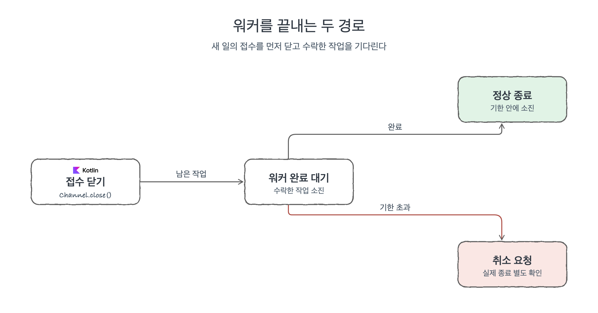

# Gracefully Shutting Down Coroutine Workers

서비스 종료에서는 새 일을 받지 않는 시점, 이미 받은 일을 마치는 시점, 남은 일을 취소할 시점을 구분한다. 대기열과 워커 Job은 서비스 수명을 아는 소유자에게 둔다. [kotlinx.coroutines · CoroutineScope](https://kotlinlang.org/api/kotlinx.coroutines/kotlinx-coroutines-core/kotlinx.coroutines/-coroutine-scope/) · [kotlinx.coroutines · Job.join](https://kotlinlang.org/api/kotlinx.coroutines/kotlinx-coroutines-core/kotlinx.coroutines/-job/join.html) · [kotlinx.coroutines · SendChannel.close](https://kotlinlang.org/api/kotlinx.coroutines/kotlinx-coroutines-core/kotlinx.coroutines.channels/-send-channel/close.html) · [kotlinx.coroutines · withTimeoutOrNull](https://kotlinlang.org/api/kotlinx.coroutines/kotlinx-coroutines-core/kotlinx.coroutines/with-timeout-or-null.html)

## 1. 접수를 닫고 수락된 작업의 완료를 기다린다

예제는 유한 Channel에 trySend가 성공한 일을 수락한다. close는 이후 접수를 거절하며, 워커는 이미 수락한 항목을 차례로 처리한다. 정해 둔 시간까지 기다린 뒤 완료하지 못했다면 채널과 워커의 취소를 요청한다. [kotlinx.coroutines · Channel](https://kotlinlang.org/api/kotlinx.coroutines/kotlinx-coroutines-core/kotlinx.coroutines.channels/-channel/) · [kotlinx.coroutines · trySend](https://kotlinlang.org/api/kotlinx.coroutines/kotlinx-coroutines-core/kotlinx.coroutines.channels/-send-channel/try-send.html) · [kotlinx.coroutines · SendChannel.close](https://kotlinlang.org/api/kotlinx.coroutines/kotlinx-coroutines-core/kotlinx.coroutines.channels/-send-channel/close.html) · [kotlinx.coroutines · ReceiveChannel.cancel](https://kotlinlang.org/api/kotlinx.coroutines/kotlinx-coroutines-core/kotlinx.coroutines.channels/-receive-channel/cancel.html) · [kotlinx.coroutines · withTimeoutOrNull](https://kotlinlang.org/api/kotlinx.coroutines/kotlinx-coroutines-core/kotlinx.coroutines/with-timeout-or-null.html)



그림의 근거 · [kotlinx.coroutines · Channel](https://kotlinlang.org/api/kotlinx.coroutines/kotlinx-coroutines-core/kotlinx.coroutines.channels/-channel/) · [kotlinx.coroutines · trySend](https://kotlinlang.org/api/kotlinx.coroutines/kotlinx-coroutines-core/kotlinx.coroutines.channels/-send-channel/try-send.html) · [kotlinx.coroutines · SendChannel.close](https://kotlinlang.org/api/kotlinx.coroutines/kotlinx-coroutines-core/kotlinx.coroutines.channels/-send-channel/close.html) · [kotlinx.coroutines · ReceiveChannel.cancel](https://kotlinlang.org/api/kotlinx.coroutines/kotlinx-coroutines-core/kotlinx.coroutines.channels/-receive-channel/cancel.html) · [kotlinx.coroutines · withTimeoutOrNull](https://kotlinlang.org/api/kotlinx.coroutines/kotlinx-coroutines-core/kotlinx.coroutines/with-timeout-or-null.html) · [kotlinx.coroutines · CoroutineScope](https://kotlinlang.org/api/kotlinx.coroutines/kotlinx-coroutines-core/kotlinx.coroutines/-coroutine-scope/) · [kotlinx.coroutines · Job.join](https://kotlinlang.org/api/kotlinx.coroutines/kotlinx-coroutines-core/kotlinx.coroutines/-job/join.html)

```kotlin
import kotlinx.coroutines.CompletableDeferred
import kotlinx.coroutines.CoroutineScope
import kotlinx.coroutines.awaitCancellation
import kotlinx.coroutines.channels.Channel
import kotlinx.coroutines.launch
import kotlinx.coroutines.runBlocking
import kotlinx.coroutines.withTimeout
import kotlinx.coroutines.withTimeoutOrNull

private class DrainableWorker(scope: CoroutineScope, handle: suspend (Int) -> Unit) {
    private val queue = Channel<Int>(capacity = 8)
    private val worker = scope.launch {
        for (item in queue) handle(item)
    }

    init {
        worker.invokeOnCompletion { failure ->
            if (failure != null) queue.cancel()
        }
    }

    fun tryAccept(item: Int): Boolean = queue.trySend(item).isSuccess

    suspend fun shutdown(graceMillis: Long): Boolean {
        require(graceMillis > 0)
        queue.close()
        var drained = false
        try {
            drained = withTimeoutOrNull(graceMillis) {
                worker.join()
                !worker.isCancelled
            } == true
            return drained
        } finally {
            if (!drained) {
                queue.cancel()
                worker.cancel()
            }
        }
    }
}

fun main() = runBlocking {
    val processed = mutableListOf<Int>()
    val orderly = DrainableWorker(this) { processed.add(it) }
    check(orderly.tryAccept(1) && orderly.tryAccept(2))
    check(orderly.shutdown(graceMillis = 2_000))
    check(processed == listOf(1, 2) && !orderly.tryAccept(3))

    val started = CompletableDeferred<Unit>()
    val cleaned = CompletableDeferred<Unit>()
    val slow = DrainableWorker(this) {
        try {
            started.complete(Unit)
            awaitCancellation()
        } finally {
            cleaned.complete(Unit)
        }
    }
    check(slow.tryAccept(1))
    started.await()
    check(!slow.shutdown(graceMillis = 25))
    withTimeout(2_000) { cleaned.await() }
}
```

## 2. 기한 초과와 실제 종료를 구별한다

false는 정상 소진에 실패해 취소를 요청했다는 뜻이다. 블로킹 API가 취소에 협력하지 않으면 워커가 아직 자원을 쓰고 있을 수 있다. 의존 자원을 닫기 전 실제 종료 확인 방법을 정하고, 유실할 수 없는 작업은 내구성 있는 저장소의 상태와 대조한다. [kotlinx.coroutines · CoroutineScope](https://kotlinlang.org/api/kotlinx.coroutines/kotlinx-coroutines-core/kotlinx.coroutines/-coroutine-scope/) · [kotlinx.coroutines · withTimeoutOrNull](https://kotlinlang.org/api/kotlinx.coroutines/kotlinx-coroutines-core/kotlinx.coroutines/with-timeout-or-null.html) · [kotlinx.coroutines · Job.join](https://kotlinlang.org/api/kotlinx.coroutines/kotlinx-coroutines-core/kotlinx.coroutines/-job/join.html) · [kotlinx.coroutines · ReceiveChannel.cancel](https://kotlinlang.org/api/kotlinx.coroutines/kotlinx-coroutines-core/kotlinx.coroutines.channels/-receive-channel/cancel.html)

요청과 함께 끝나야 할 작업은 요청의 자식으로 둔다. 요청이 끝난 뒤에도 이어질 작업은 Job과 종료 절차를 가진 서비스 소유 스코프로 접수한다. GlobalScope에 맡기면 이 서비스의 종료 작업이 해당 Job을 자동으로 기다리지 않는다. [kotlinx.coroutines · GlobalScope](https://kotlinlang.org/api/kotlinx.coroutines/kotlinx-coroutines-core/kotlinx.coroutines/-global-scope/) · [kotlinx.coroutines · CoroutineScope](https://kotlinlang.org/api/kotlinx.coroutines/kotlinx-coroutines-core/kotlinx.coroutines/-coroutine-scope/) · [kotlinx.coroutines · Job.join](https://kotlinlang.org/api/kotlinx.coroutines/kotlinx-coroutines-core/kotlinx.coroutines/-job/join.html)
