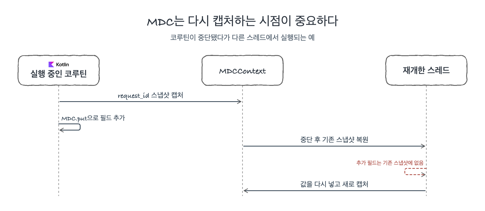

# Propagating Logging Context Across Coroutines

SLF4J의 MDC는 요청 ID 같은 로그 문맥을 보관한다. 코루틴이 다른 스레드에서 재개될 수 있으므로 MDCContext로 필요한 값을 캡처한다. [SLF4J · Manual](https://www.slf4j.org/manual.html) · [kotlinx.coroutines · MDCContext](https://kotlinlang.org/api/kotlinx.coroutines/kotlinx-coroutines-slf4j/kotlinx.coroutines.slf4j/-m-d-c-context/) · [Logback · MDC](https://logback.qos.ch/manual/mdc.html)

## 1. 요청별 MDC를 캡처하고 실행 경계에서 복원한다

kotlinx-coroutines-slf4j:1.10.2와 MDC를 구현하는 SLF4J provider를 둔다. 아래는 Logback을 사용하는 예시다. 요청별로 값이 다른 두 자식이 중단된 뒤에도 자신의 ID를 갖고, 호출부의 ID도 유지되는지 확인한다. [kotlinx.coroutines 1.10.2](https://github.com/Kotlin/kotlinx.coroutines/tree/1.10.2) · [SLF4J · Manual](https://www.slf4j.org/manual.html) · [kotlinx.coroutines · MDCContext](https://kotlinlang.org/api/kotlinx.coroutines/kotlinx-coroutines-slf4j/kotlinx.coroutines.slf4j/-m-d-c-context/) · [Logback · MDC](https://logback.qos.ch/manual/mdc.html)

```kotlin
import kotlinx.coroutines.Dispatchers
import kotlinx.coroutines.async
import kotlinx.coroutines.awaitAll
import kotlinx.coroutines.delay
import kotlinx.coroutines.runBlocking
import kotlinx.coroutines.slf4j.MDCContext
import kotlinx.coroutines.withContext
import org.slf4j.MDC

fun main() {
    MDC.put("requestId", "outer")
    try {
        runBlocking(MDCContext()) {
            val ids = listOf("req-41", "req-42")
            val observed = ids.map { id ->
                async(Dispatchers.Default + MDCContext(mapOf("requestId" to id))) {
                    delay(1)
                    requireNotNull(MDC.get("requestId"))
                }
            }.awaitAll()
            check(observed == ids)

            withContext(MDCContext(mapOf("requestId" to "req-43"))) {
                MDC.put("step", "read")
                withContext(MDCContext()) {
                    delay(1)
                    check(MDC.get("step") == "read")
                }
            }
            check(MDC.get("requestId") == "outer")
        }
    } finally {
        MDC.remove("requestId")
    }
}
```

## 2. 스냅샷 이후에 추가한 값을 전파한다

MDC.put만 호출하면 캡처한 MDCContext는 바뀌지 않아 중단 후 새 값이 사라질 수 있다. 후속 구간에서 값을 유지하려면 MDCContext를 다시 캡처한다. 로그에 노출할 키는 요청 ID처럼 필요한 것만 선택한다. [kotlinx.coroutines · MDCContext](https://kotlinlang.org/api/kotlinx.coroutines/kotlinx-coroutines-slf4j/kotlinx.coroutines.slf4j/-m-d-c-context/) · [Logback · MDC](https://logback.qos.ch/manual/mdc.html)



그림의 근거 · [kotlinx.coroutines · MDCContext](https://kotlinlang.org/api/kotlinx.coroutines/kotlinx-coroutines-slf4j/kotlinx.coroutines.slf4j/-m-d-c-context/) · [Logback · MDC](https://logback.qos.ch/manual/mdc.html)
