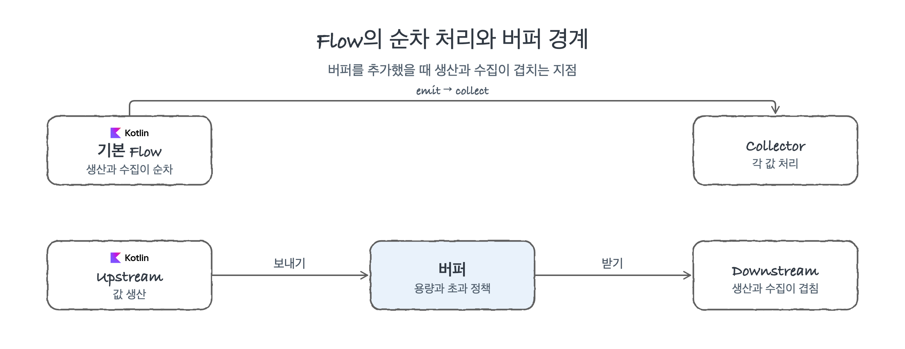

# Building Cold Flows and Controlling Backpressure

flow 빌더로 만든 스트림은 수집이 시작될 때 값을 만들고, 다시 수집하면 빌더를 다시 실행한다. map 같은 중간 연산은 수집 시 적용된다. [kotlinx.coroutines · flow](https://kotlinlang.org/api/kotlinx.coroutines/kotlinx-coroutines-core/kotlinx.coroutines.flow/flow.html) · [kotlinx.coroutines · take](https://kotlinlang.org/api/kotlinx.coroutines/kotlinx-coroutines-core/kotlinx.coroutines.flow/take.html)

## 1. 수집 시작과 중단 시점을 확인한다

아래 코드는 수집 전에는 작업이 시작되지 않음과 take로 일부만 받은 뒤 다시 수집할 수 있음을 확인한다. 기본 파이프라인에서는 emit과 수집이 순차로 이어진다. [kotlinx.coroutines · flow](https://kotlinlang.org/api/kotlinx.coroutines/kotlinx-coroutines-core/kotlinx.coroutines.flow/flow.html) · [kotlinx.coroutines · take](https://kotlinlang.org/api/kotlinx.coroutines/kotlinx-coroutines-core/kotlinx.coroutines.flow/take.html) · [kotlinx.coroutines · buffer](https://kotlinlang.org/api/kotlinx.coroutines/kotlinx-coroutines-core/kotlinx.coroutines.flow/buffer.html)

```kotlin
import kotlinx.coroutines.flow.buffer
import kotlinx.coroutines.flow.flow
import kotlinx.coroutines.flow.map
import kotlinx.coroutines.flow.take
import kotlinx.coroutines.flow.toList
import kotlinx.coroutines.runBlocking

fun main() = runBlocking {
    var starts = 0
    val values = flow {
        starts += 1
        for (value in 1..4) emit(value)
    }.map { it * 10 }

    check(starts == 0)
    check(values.take(2).toList() == listOf(10, 20))
    check(values.buffer(2).toList() == listOf(10, 20, 30, 40))
    check(starts == 2)
}
```

## 2. 버퍼와 실행 위치가 바꾸는 범위를 확인한다

buffer는 앞뒤 작업을 겹쳐 실행하고 용량과 초과 정책을 갖는다. flowOn은 앞선 연산의 실행 컨텍스트를 바꾸며, 디스패처가 달라지면 중간 전송 버퍼가 생길 수 있다. 취소할 때 전송 중이던 요소까지 수집된다고 가정하지 않는다. [kotlinx.coroutines · buffer](https://kotlinlang.org/api/kotlinx.coroutines/kotlinx-coroutines-core/kotlinx.coroutines.flow/buffer.html) · [kotlinx.coroutines · flowOn](https://kotlinlang.org/api/kotlinx.coroutines/kotlinx-coroutines-core/kotlinx.coroutines.flow/flow-on.html) · [kotlinx.coroutines · flow](https://kotlinlang.org/api/kotlinx.coroutines/kotlinx-coroutines-core/kotlinx.coroutines.flow/flow.html)



그림의 근거 · [kotlinx.coroutines · buffer](https://kotlinlang.org/api/kotlinx.coroutines/kotlinx-coroutines-core/kotlinx.coroutines.flow/buffer.html) · [kotlinx.coroutines · flowOn](https://kotlinlang.org/api/kotlinx.coroutines/kotlinx-coroutines-core/kotlinx.coroutines.flow/flow-on.html) · [kotlinx.coroutines · flow](https://kotlinlang.org/api/kotlinx.coroutines/kotlinx-coroutines-core/kotlinx.coroutines.flow/flow.html)

원소마다 처리해야 하는 기록과 최신 상태만 필요한 값을 구분한다. 드롭이나 상태 병합이 가능할 때만 해당 정책을 사용하고, 구독 시작과 재연결 의미는 [채팅 실시간 전달](19_delivering_chat_events_with_shared_flow.md)에서 확인한다. [kotlinx.coroutines · buffer](https://kotlinlang.org/api/kotlinx.coroutines/kotlinx-coroutines-core/kotlinx.coroutines.flow/buffer.html) · [kotlinx.coroutines · SharedFlow](https://kotlinlang.org/api/kotlinx.coroutines/kotlinx-coroutines-core/kotlinx.coroutines.flow/-shared-flow/) · [kotlinx.coroutines · StateFlow](https://kotlinlang.org/api/kotlinx.coroutines/kotlinx-coroutines-core/kotlinx.coroutines.flow/-state-flow/)
