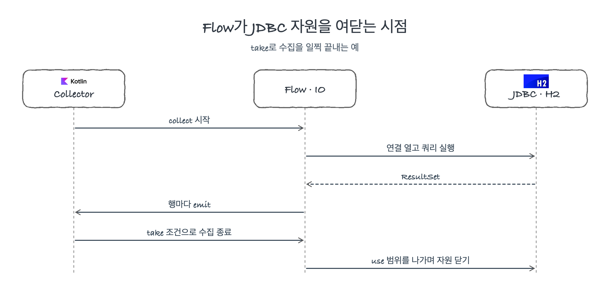

# Streaming JDBC Records with Kotlin Flow

JDBC 조회를 Flow로 감싸면 수집할 때 JDBC 자원을 열고 ResultSet을 순회하며 레코드를 전달할 수 있다. 블로킹 조회는 IO 디스패처에서 실행한다. [Java 17 · ResultSet](https://docs.oracle.com/en/java/javase/17/docs/api/java.sql/java/sql/ResultSet.html) · [kotlinx.coroutines · flow](https://kotlinlang.org/api/kotlinx.coroutines/kotlinx-coroutines-core/kotlinx.coroutines.flow/flow.html) · [kotlinx.coroutines · flowOn](https://kotlinlang.org/api/kotlinx.coroutines/kotlinx-coroutines-core/kotlinx.coroutines.flow/flow-on.html) · [kotlinx.coroutines · Dispatchers.IO](https://kotlinlang.org/api/kotlinx.coroutines/kotlinx-coroutines-core/kotlinx.coroutines/-dispatchers/-i-o.html)

## 1. 연결과 커서를 수집 범위 안에 둔다

예제 main은 로컬 H2 2.3.232를 사용한다. 실서비스에서는 커넥션 풀에서 연결을 제공한다. 각 collect에서 새 연결을 열고, take로 수집을 일찍 끝냈을 때에도 연결이 닫혔는지 확인한다. [H2 · Features](https://www.h2database.com/html/features.html) · [kotlinx.coroutines · flow](https://kotlinlang.org/api/kotlinx.coroutines/kotlinx-coroutines-core/kotlinx.coroutines.flow/flow.html) · [kotlinx.coroutines · take](https://kotlinlang.org/api/kotlinx.coroutines/kotlinx-coroutines-core/kotlinx.coroutines.flow/take.html) · [Java 17 · ResultSet](https://docs.oracle.com/en/java/javase/17/docs/api/java.sql/java/sql/ResultSet.html)



그림의 근거 · [H2 · Features](https://www.h2database.com/html/features.html) · [kotlinx.coroutines · flow](https://kotlinlang.org/api/kotlinx.coroutines/kotlinx-coroutines-core/kotlinx.coroutines.flow/flow.html) · [kotlinx.coroutines · take](https://kotlinlang.org/api/kotlinx.coroutines/kotlinx-coroutines-core/kotlinx.coroutines.flow/take.html) · [Java 17 · ResultSet](https://docs.oracle.com/en/java/javase/17/docs/api/java.sql/java/sql/ResultSet.html)

```kotlin
import java.sql.Connection
import java.sql.DriverManager
import java.util.concurrent.atomic.AtomicReference
import kotlinx.coroutines.Dispatchers
import kotlinx.coroutines.currentCoroutineContext
import kotlinx.coroutines.ensureActive
import kotlinx.coroutines.flow.Flow
import kotlinx.coroutines.flow.flow
import kotlinx.coroutines.flow.flowOn
import kotlinx.coroutines.flow.take
import kotlinx.coroutines.flow.toList
import kotlinx.coroutines.runBlocking

private data class UserRow(val id: Long, val name: String)

private fun usersAfter(open: () -> Connection, exclusiveId: Long): Flow<UserRow> = flow {
    open().use { connection ->
        connection.prepareStatement(
            "SELECT id, name FROM demo_user WHERE id > ? ORDER BY id"
        ).use { statement ->
            statement.setLong(1, exclusiveId)
            statement.executeQuery().use { rows ->
                while (true) {
                    currentCoroutineContext().ensureActive()
                    if (!rows.next()) break
                    emit(UserRow(rows.getLong(1), rows.getString(2)))
                }
            }
        }
    }
}.flowOn(Dispatchers.IO)

fun main() = runBlocking {
    val url = "jdbc:h2:mem:coroutineflow"
    DriverManager.getConnection(url).use { anchor ->
        anchor.createStatement().use {
            it.executeUpdate("CREATE TABLE demo_user (id BIGINT PRIMARY KEY, name VARCHAR(30))")
            it.executeUpdate("INSERT INTO demo_user VALUES (1, 'Kim'), (2, 'Lee'), (3, 'Park')")
        }
        val opened = AtomicReference<Connection>()
        val rows = usersAfter(
            open = { DriverManager.getConnection(url).also(opened::set) },
            exclusiveId = 0,
        ).take(2).toList()
        check(rows.map { it.id } == listOf(1L, 2L))
        check(opened.get().isClosed)
    }
}
```

## 2. Flow의 수집 방식과 JDBC 드라이버 동작을 나눠 확인한다

한 행씩 emit해도 JDBC가 결과를 모두 미리 가져올 수 있다. fetch size, 커서 설정과 질의 시간 제한은 사용하는 드라이버의 조건을 확인한다. 느린 수집이 연결을 오래 점유한다면 정렬 키를 기준으로 페이지별로 읽고 연결을 반환하는 방법도 검토한다. [Java 17 · Statement](https://docs.oracle.com/en/java/javase/17/docs/api/java.sql/java/sql/Statement.html) · [Java 17 · ResultSet](https://docs.oracle.com/en/java/javase/17/docs/api/java.sql/java/sql/ResultSet.html) · [kotlinx.coroutines · flowOn](https://kotlinlang.org/api/kotlinx.coroutines/kotlinx-coroutines-core/kotlinx.coroutines.flow/flow-on.html)

코루틴 취소는 다음 확인 지점에서 관찰한다. 이미 차단된 JDBC 호출의 종료는 드라이버 지원에 의존하므로, 필요하면 질의 타임아웃이나 지원되는 Statement.cancel 계약도 적용한다. [kotlinx.coroutines · ensureActive](https://kotlinlang.org/api/kotlinx.coroutines/kotlinx-coroutines-core/kotlinx.coroutines/ensure-active.html) · [kotlinx.coroutines · Dispatchers.IO](https://kotlinlang.org/api/kotlinx.coroutines/kotlinx-coroutines-core/kotlinx.coroutines/-dispatchers/-i-o.html) · [Java 17 · Statement](https://docs.oracle.com/en/java/javase/17/docs/api/java.sql/java/sql/Statement.html)
