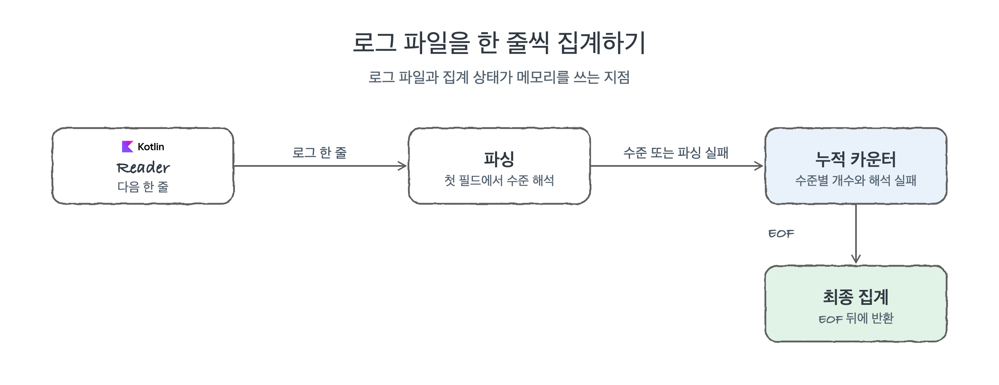

# Analyzing Log Files with Kotlin Flow

파일의 로그를 한 줄씩 읽어 파싱하고 분류 결과만 누적한다. 파일 읽기와 최종 집계에서 어떤 메모리를 쓰는지 각각 확인한다. [Java 17 · Files](https://docs.oracle.com/en/java/javase/17/docs/api/java.base/java/nio/file/Files.html) · [kotlinx.coroutines · flow](https://kotlinlang.org/api/kotlinx.coroutines/kotlinx-coroutines-core/kotlinx.coroutines.flow/flow.html) · [kotlinx.coroutines · fold](https://kotlinlang.org/api/kotlinx.coroutines/kotlinx-coroutines-core/kotlinx.coroutines.flow/fold.html)

## 1. 로그 한 줄을 읽은 뒤 수준별 카운터를 갱신한다

이 실습은 첫 필드를 로그 수준으로 해석한다. 한꺼번에 파일을 읽지 않고 Reader를 닫으며, 수준별 카운터와 해석하지 못한 줄의 수를 유지한다. [Java 17 · Files](https://docs.oracle.com/en/java/javase/17/docs/api/java.base/java/nio/file/Files.html) · [kotlinx.coroutines · flow](https://kotlinlang.org/api/kotlinx.coroutines/kotlinx-coroutines-core/kotlinx.coroutines.flow/flow.html) · [kotlinx.coroutines · flowOn](https://kotlinlang.org/api/kotlinx.coroutines/kotlinx-coroutines-core/kotlinx.coroutines.flow/flow-on.html) · [kotlinx.coroutines · fold](https://kotlinlang.org/api/kotlinx.coroutines/kotlinx-coroutines-core/kotlinx.coroutines.flow/fold.html)



그림의 근거 · [Java 17 · Files](https://docs.oracle.com/en/java/javase/17/docs/api/java.base/java/nio/file/Files.html) · [kotlinx.coroutines · flow](https://kotlinlang.org/api/kotlinx.coroutines/kotlinx-coroutines-core/kotlinx.coroutines.flow/flow.html) · [kotlinx.coroutines · flowOn](https://kotlinlang.org/api/kotlinx.coroutines/kotlinx-coroutines-core/kotlinx.coroutines.flow/flow-on.html) · [kotlinx.coroutines · fold](https://kotlinlang.org/api/kotlinx.coroutines/kotlinx-coroutines-core/kotlinx.coroutines.flow/fold.html)

```kotlin
import java.nio.file.Files
import java.nio.file.Path
import kotlinx.coroutines.Dispatchers
import kotlinx.coroutines.flow.flow
import kotlinx.coroutines.flow.flowOn
import kotlinx.coroutines.flow.fold
import kotlinx.coroutines.runBlocking

private fun levels(path: Path) = flow {
    Files.newBufferedReader(path).use { lines ->
        while (true) {
            val line = lines.readLine() ?: break
            emit(line.substringBefore(' '))
        }
    }
}.flowOn(Dispatchers.IO)

private data class Summary(val warnings: Long = 0, val errors: Long = 0, val malformed: Long = 0)

fun main() = runBlocking {
    val path = Files.createTempFile("flow-log", ".txt")
    try {
        Files.writeString(path, "INFO request\nWARN slow\nERROR timeout\nUNKNOWN entry\n")
        val summary = levels(path).fold(Summary()) { totals, level ->
            when (level) {
                "INFO" -> totals
                "WARN" -> totals.copy(warnings = totals.warnings + 1)
                "ERROR" -> totals.copy(errors = totals.errors + 1)
                else -> totals.copy(malformed = totals.malformed + 1)
            }
        }
        check(summary == Summary(warnings = 1, errors = 1, malformed = 1))
    } finally {
        Files.deleteIfExists(path)
    }
}
```

## 2. 고정 파일과 지속 수집의 종료 조건을 구분한다

이 예는 EOF에서 끝나므로 fold가 최종값을 돌려준다. 계속 들어오는 로그는 시간 창이나 건수로 결과를 내보내며, 파일 교체나 읽기 실패 뒤의 위치를 관리한다. 너무 많은 키를 계속 집계하면 한 줄씩 읽더라도 상태가 커진다. [kotlinx.coroutines · fold](https://kotlinlang.org/api/kotlinx.coroutines/kotlinx-coroutines-core/kotlinx.coroutines.flow/fold.html) · [kotlinx.coroutines · flow](https://kotlinlang.org/api/kotlinx.coroutines/kotlinx-coroutines-core/kotlinx.coroutines.flow/flow.html) · [Java 17 · Files](https://docs.oracle.com/en/java/javase/17/docs/api/java.base/java/nio/file/Files.html)
