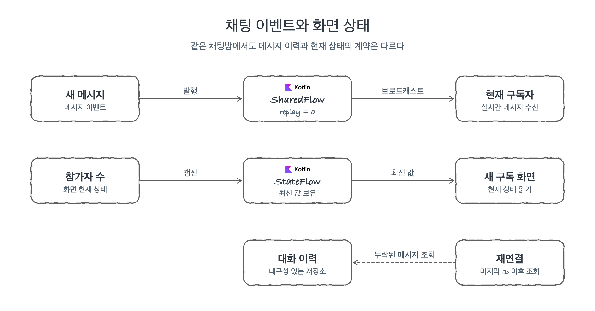

# Delivering Chat Events with SharedFlow

채팅의 새 메시지는 구독 중인 클라이언트에게 브로드캐스트하고, 참가자 수 같은 화면 상태는 최신 값으로 표현할 수 있다. 두 값은 전달·보관 계약이 다르다. [kotlinx.coroutines · SharedFlow](https://kotlinlang.org/api/kotlinx.coroutines/kotlinx-coroutines-core/kotlinx.coroutines.flow/-shared-flow/) · [kotlinx.coroutines · StateFlow](https://kotlinlang.org/api/kotlinx.coroutines/kotlinx-coroutines-core/kotlinx.coroutines.flow/-state-flow/)

## 1. 메시지 이벤트와 현재 상태를 나눈다

아래 예제는 replay가 0인 SharedFlow로 동시에 메시지를 받고, StateFlow로 현재 참가자 수를 읽는다. 구독이 시작되기 전에 발행한 메시지는 재생되지 않는다. [kotlinx.coroutines · SharedFlow](https://kotlinlang.org/api/kotlinx.coroutines/kotlinx-coroutines-core/kotlinx.coroutines.flow/-shared-flow/) · [kotlinx.coroutines · StateFlow](https://kotlinlang.org/api/kotlinx.coroutines/kotlinx-coroutines-core/kotlinx.coroutines.flow/-state-flow/) · [kotlinx.coroutines · take](https://kotlinlang.org/api/kotlinx.coroutines/kotlinx-coroutines-core/kotlinx.coroutines.flow/take.html)



그림의 근거 · [kotlinx.coroutines · SharedFlow](https://kotlinlang.org/api/kotlinx.coroutines/kotlinx-coroutines-core/kotlinx.coroutines.flow/-shared-flow/) · [kotlinx.coroutines · StateFlow](https://kotlinlang.org/api/kotlinx.coroutines/kotlinx-coroutines-core/kotlinx.coroutines.flow/-state-flow/) · [kotlinx.coroutines · take](https://kotlinlang.org/api/kotlinx.coroutines/kotlinx-coroutines-core/kotlinx.coroutines.flow/take.html)

```kotlin
import kotlinx.coroutines.CoroutineStart
import kotlinx.coroutines.flow.MutableSharedFlow
import kotlinx.coroutines.flow.MutableStateFlow
import kotlinx.coroutines.flow.asSharedFlow
import kotlinx.coroutines.flow.asStateFlow
import kotlinx.coroutines.flow.take
import kotlinx.coroutines.flow.toList
import kotlinx.coroutines.launch
import kotlinx.coroutines.runBlocking

private class Room {
    private val messages = MutableSharedFlow<String>(replay = 0, extraBufferCapacity = 8)
    val live = messages.asSharedFlow()

    private val members = MutableStateFlow(0)
    val online = members.asStateFlow()

    suspend fun publish(message: String) = messages.emit(message)
    fun updateCount(count: Int) { members.value = count }
}

fun main() = runBlocking {
    val room = Room()
    room.publish("before join")

    val first = mutableListOf<String>()
    val second = mutableListOf<String>()
    val clientA = launch(start = CoroutineStart.UNDISPATCHED) { room.live.take(2).toList(first) }
    val clientB = launch(start = CoroutineStart.UNDISPATCHED) { room.live.take(2).toList(second) }
    room.updateCount(2)

    room.publish("hello")
    room.publish("welcome")
    clientA.join()
    clientB.join()

    check(first == listOf("hello", "welcome") && second == first)
    check(room.online.value == 2)
}
```

## 2. 느린 구독자와 재연결에 대한 계약을 정한다

기본 SUSPEND 정책은 구독자 때문에 버퍼가 가득 차면 emit을 기다리게 한다. 구독자가 없는 replay 0 발행은 보관되지 않는다. 미수신 메시지까지 가져와야 한다면 내구성 있는 대화 이력에서 마지막 메시지 이후를 조회하고, 이력과 실시간 이벤트가 겹칠 때 메시지 ID로 중복을 제거한다. [kotlinx.coroutines · SharedFlow](https://kotlinlang.org/api/kotlinx.coroutines/kotlinx-coroutines-core/kotlinx.coroutines.flow/-shared-flow/) · [kotlinx.coroutines · StateFlow](https://kotlinlang.org/api/kotlinx.coroutines/kotlinx-coroutines-core/kotlinx.coroutines.flow/-state-flow/)

클라이언트 수집은 연결의 수명에 맞춰 종료한다. 프로세스 간 전달과 재연결, 송신자별 권한 확인은 별도로 설계한다. 구독 시작 전 발행·느린 구독자·재연결 시나리오를 각각 확인한다. [kotlinx.coroutines · SharedFlow](https://kotlinlang.org/api/kotlinx.coroutines/kotlinx-coroutines-core/kotlinx.coroutines.flow/-shared-flow/) · [kotlinx.coroutines · CoroutineScope](https://kotlinlang.org/api/kotlinx.coroutines/kotlinx-coroutines-core/kotlinx.coroutines/-coroutine-scope/)
