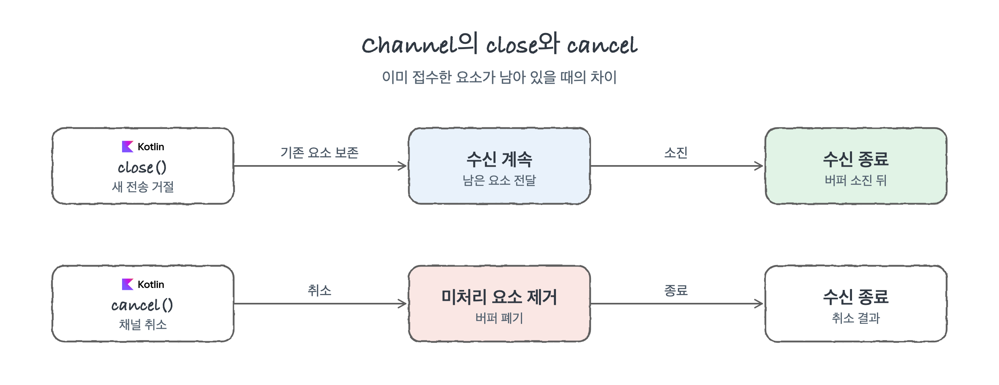

# Passing Data Through Kotlin Channels

Channel은 보낸 값을 한 수신자가 받아 처리하는 전달 경계다. 용량이 0인 rendezvous 채널은 송신과 수신이 만나야 진행하고, 버퍼가 있는 채널은 용량만큼 먼저 받을 수 있다. [kotlinx.coroutines · Channel](https://kotlinlang.org/api/kotlinx.coroutines/kotlinx-coroutines-core/kotlinx.coroutines.channels/-channel/) · [Kotlin · Channels](https://kotlinlang.org/docs/channels.html)

## 1. 가득 찬 채널과 닫힌 채널을 구별한다

trySend는 일시 중단 없이 접수를 시도한다. 아래는 버퍼가 가득 차면 전송이 실패하고, close 뒤에는 남은 항목을 읽은 다음 수신이 종료되는 예다. [kotlinx.coroutines · trySend](https://kotlinlang.org/api/kotlinx.coroutines/kotlinx-coroutines-core/kotlinx.coroutines.channels/-send-channel/try-send.html) · [kotlinx.coroutines · SendChannel.close](https://kotlinlang.org/api/kotlinx.coroutines/kotlinx-coroutines-core/kotlinx.coroutines.channels/-send-channel/close.html) · [kotlinx.coroutines · Channel](https://kotlinlang.org/api/kotlinx.coroutines/kotlinx-coroutines-core/kotlinx.coroutines.channels/-channel/)

```kotlin
import kotlinx.coroutines.channels.Channel
import kotlinx.coroutines.runBlocking

fun main() = runBlocking {
    val jobs = Channel<Int>(capacity = 1)
    check(jobs.trySend(10).isSuccess)

    val full = jobs.trySend(20)
    check(full.isFailure && !full.isClosed)

    check(jobs.close())
    check(jobs.trySend(30).isClosed)
    check(jobs.receive() == 10)
    check(jobs.receiveCatching().isClosed)
}
```

## 2. 닫기와 취소의 후속 효과를 확인한다

close는 새 전송을 거절하면서 이미 접수한 항목을 수신할 수 있게 한다. close 전에 이미 중단돼 있던 send는 닫기만으로 취소되지 않는다. cancel은 남은 수신을 종료하고 버퍼의 미처리 요소를 제거한다. 전달 실패로 자원 정리가 필요한 경우 onUndeliveredElement를 검토한다. [kotlinx.coroutines · SendChannel.close](https://kotlinlang.org/api/kotlinx.coroutines/kotlinx-coroutines-core/kotlinx.coroutines.channels/-send-channel/close.html) · [kotlinx.coroutines · ReceiveChannel.cancel](https://kotlinlang.org/api/kotlinx.coroutines/kotlinx-coroutines-core/kotlinx.coroutines.channels/-receive-channel/cancel.html) · [kotlinx.coroutines · Channel](https://kotlinlang.org/api/kotlinx.coroutines/kotlinx-coroutines-core/kotlinx.coroutines.channels/-channel/)



그림의 근거 · [kotlinx.coroutines · SendChannel.close](https://kotlinlang.org/api/kotlinx.coroutines/kotlinx-coroutines-core/kotlinx.coroutines.channels/-send-channel/close.html) · [kotlinx.coroutines · ReceiveChannel.cancel](https://kotlinlang.org/api/kotlinx.coroutines/kotlinx-coroutines-core/kotlinx.coroutines.channels/-receive-channel/cancel.html) · [kotlinx.coroutines · Channel](https://kotlinlang.org/api/kotlinx.coroutines/kotlinx-coroutines-core/kotlinx.coroutines.channels/-channel/)

## 3. 채널의 공정성은 작업 완료 순서와 다르다

채널 가이드의 공정성은 여러 코루틴의 send·receive 호출을 호출 순서에 맞춰 처리한다는 뜻이다. 어느 작업이 먼저 호출할지와 어느 수신자가 처리를 먼저 마칠지는 스케줄러와 작업 시간에 달려 있다. 여러 작업의 결과가 입력 순서로 필요하면 순번을 보존하고 수집 측에서 맞춘다. [Kotlin · Channels](https://kotlinlang.org/docs/channels.html) · [kotlinx.coroutines · Channel](https://kotlinlang.org/api/kotlinx.coroutines/kotlinx-coroutines-core/kotlinx.coroutines.channels/-channel/)
