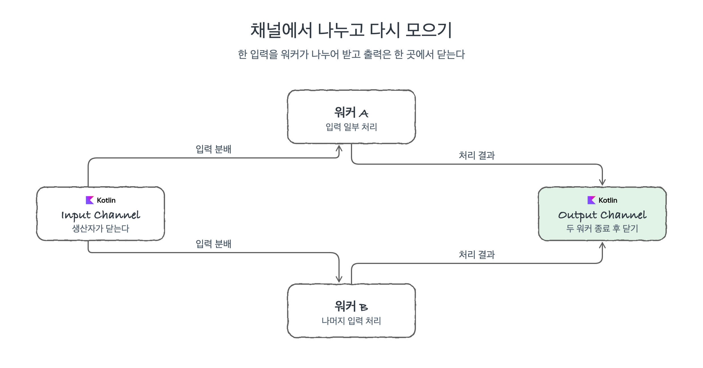

# Building Channel Pipelines with Fan-Out and Fan-In

파이프라인은 처리 단계를 채널로 연결한다. Fan-out은 여러 워커가 한 입력을 나누어 받고, Fan-in은 여러 워커나 생산자의 결과가 한 출력에 모이는 형태다. [Kotlin · Channels](https://kotlinlang.org/docs/channels.html) · [kotlinx.coroutines · Channel](https://kotlinlang.org/api/kotlinx.coroutines/kotlinx-coroutines-core/kotlinx.coroutines.channels/-channel/)

## 1. 입력을 나누고 출력을 합치는 실습

입력 생산자는 쓰기를 마치고 입력 채널을 닫는다. 여러 워커는 for 루프로 같은 입력을 나눠 소비한다. 출력 채널은 마지막 워커까지 끝난 뒤 한 곳에서 닫는다. [Kotlin · Channels](https://kotlinlang.org/docs/channels.html) · [kotlinx.coroutines · SendChannel.close](https://kotlinlang.org/api/kotlinx.coroutines/kotlinx-coroutines-core/kotlinx.coroutines.channels/-send-channel/close.html) · [kotlinx.coroutines · Job.join](https://kotlinlang.org/api/kotlinx.coroutines/kotlinx-coroutines-core/kotlinx.coroutines/-job/join.html)



그림의 근거 · [Kotlin · Channels](https://kotlinlang.org/docs/channels.html) · [kotlinx.coroutines · SendChannel.close](https://kotlinlang.org/api/kotlinx.coroutines/kotlinx-coroutines-core/kotlinx.coroutines.channels/-send-channel/close.html) · [kotlinx.coroutines · Job.join](https://kotlinlang.org/api/kotlinx.coroutines/kotlinx-coroutines-core/kotlinx.coroutines/-job/join.html)

```kotlin
import kotlinx.coroutines.Dispatchers
import kotlinx.coroutines.channels.Channel
import kotlinx.coroutines.coroutineScope
import kotlinx.coroutines.joinAll
import kotlinx.coroutines.launch
import kotlinx.coroutines.runBlocking

private suspend fun squares(): List<Int> = coroutineScope {
    val input = Channel<Int>(capacity = 2)
    val output = Channel<Int>(capacity = 2)

    launch {
        try {
            for (number in 1..6) input.send(number)
        } finally {
            input.close()
        }
    }
    val workers = List(3) {
        launch(Dispatchers.Default) {
            for (number in input) output.send(number * number)
        }
    }
    launch {
        workers.joinAll()
        output.close()
    }

    val result = mutableListOf<Int>()
    for (value in output) result.add(value)
    result
}

fun main() = runBlocking {
    check(squares().sorted() == listOf(1, 4, 9, 16, 25, 36))
}
```

## 2. 단계별 종료 소유자와 순서를 정한다

작업자 하나가 공유 출력을 먼저 닫으면 다른 작업자가 전송하지 못한다. 개별 생산자가 하나씩 끝나는 경우에도 Fan-in이 모든 생산자의 완료를 확인한 뒤 닫는다. 결과 병렬 처리의 순서가 필요하면 입력 순번으로 복원한다. 실패나 취소로 아래 단계가 먼저 끝날 때는 위 단계도 종료될 수 있게 같은 작업 범위에 둔다. [Kotlin · Channels](https://kotlinlang.org/docs/channels.html) · [kotlinx.coroutines · SendChannel.close](https://kotlinlang.org/api/kotlinx.coroutines/kotlinx-coroutines-core/kotlinx.coroutines.channels/-send-channel/close.html) · [kotlinx.coroutines · CoroutineScope](https://kotlinlang.org/api/kotlinx.coroutines/kotlinx-coroutines-core/kotlinx.coroutines/-coroutine-scope/)
