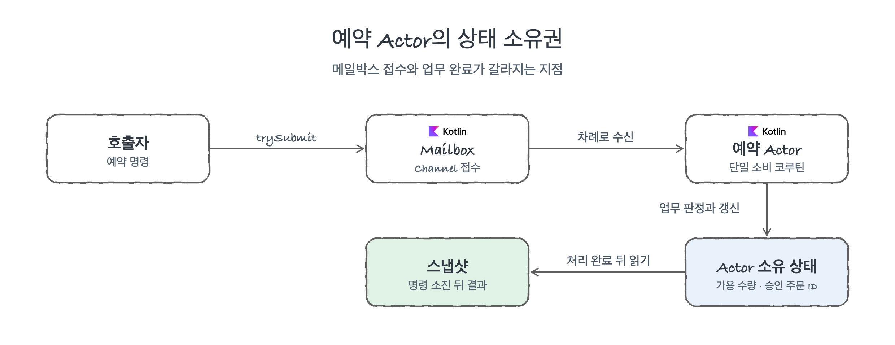

# Serializing Shared State with a Channel Actor

Actor 패턴은 상태를 한 코루틴이 소유하게 하고 외부에서는 명령을 보낸다. 여기서는 Channel과 한 소비 코루틴으로 구현한다. 라이브러리의 actor 빌더는 ObsoleteCoroutinesApi로 표시돼 있다. [kotlinx.coroutines · actor](https://kotlinlang.org/api/kotlinx.coroutines/kotlinx-coroutines-core/kotlinx.coroutines.channels/actor.html) · [kotlinx.coroutines · Channel](https://kotlinlang.org/api/kotlinx.coroutines/kotlinx-coroutines-core/kotlinx.coroutines.channels/-channel/) · [kotlinx.coroutines · CoroutineScope](https://kotlinlang.org/api/kotlinx.coroutines/kotlinx-coroutines-core/kotlinx.coroutines/-coroutine-scope/)

## 1. 가변 상태를 소유자 밖으로 내보내지 않는다

예제의 예약 Actor만 가용 수량과 승인 주문 ID를 갱신한다. trySubmit은 메일박스 접수 여부를 알려 준다. 실제 적용된 결과는 모든 명령을 처리한 뒤 스냅샷으로 읽는다. [kotlinx.coroutines · Channel](https://kotlinlang.org/api/kotlinx.coroutines/kotlinx-coroutines-core/kotlinx.coroutines.channels/-channel/) · [kotlinx.coroutines · trySend](https://kotlinlang.org/api/kotlinx.coroutines/kotlinx-coroutines-core/kotlinx.coroutines.channels/-send-channel/try-send.html) · [kotlinx.coroutines · actor](https://kotlinlang.org/api/kotlinx.coroutines/kotlinx-coroutines-core/kotlinx.coroutines.channels/actor.html) · [kotlinx.coroutines · SendChannel.close](https://kotlinlang.org/api/kotlinx.coroutines/kotlinx-coroutines-core/kotlinx.coroutines.channels/-send-channel/close.html)



그림의 근거 · [kotlinx.coroutines · Channel](https://kotlinlang.org/api/kotlinx.coroutines/kotlinx-coroutines-core/kotlinx.coroutines.channels/-channel/) · [kotlinx.coroutines · trySend](https://kotlinlang.org/api/kotlinx.coroutines/kotlinx-coroutines-core/kotlinx.coroutines.channels/-send-channel/try-send.html) · [kotlinx.coroutines · actor](https://kotlinlang.org/api/kotlinx.coroutines/kotlinx-coroutines-core/kotlinx.coroutines.channels/actor.html) · [kotlinx.coroutines · SendChannel.close](https://kotlinlang.org/api/kotlinx.coroutines/kotlinx-coroutines-core/kotlinx.coroutines.channels/-send-channel/close.html)

```kotlin
import kotlinx.coroutines.CoroutineScope
import kotlinx.coroutines.async
import kotlinx.coroutines.channels.Channel
import kotlinx.coroutines.runBlocking

private data class Reserve(val orderId: String, val quantity: Int)
private data class Snapshot(val available: Int, val accepted: Set<String>)

private class ReservationActor(scope: CoroutineScope, initial: Int) {
    private val mailbox = Channel<Reserve>(capacity = 8)
    private val result = scope.async {
        var available = initial
        val accepted = mutableSetOf<String>()
        for (command in mailbox) {
            if (command.quantity <= available && accepted.add(command.orderId)) {
                available -= command.quantity
            }
        }
        Snapshot(available, accepted.toSet())
    }

    init {
        result.invokeOnCompletion { failure ->
            if (failure != null) mailbox.cancel()
        }
    }

    fun trySubmit(command: Reserve): Boolean {
        require(command.quantity > 0)
        return mailbox.trySend(command).isSuccess
    }

    suspend fun closeAndRead(): Snapshot {
        mailbox.close()
        return result.await()
    }
}

fun main() = runBlocking {
    val actor = ReservationActor(this, initial = 2)
    check(actor.trySubmit(Reserve("A", 1)))
    check(actor.trySubmit(Reserve("A", 1)))
    check(actor.trySubmit(Reserve("B", 2)))
    check(actor.closeAndRead() == Snapshot(1, setOf("A")))
    check(!actor.trySubmit(Reserve("C", 1)))
}
```

## 2. 응답과 상태 복구가 필요한 시점을 구별한다

이 예는 동일한 주문 ID가 같은 명령을 가리킨다고 가정한다. 요청마다 성공 여부가 필요하면 업무 응답을 별도로 전달하고 실패·취소 때 대기 중인 호출도 끝낸다. 가득 찬 큐, 느린 처리, 프로세스 재시작 시 메모리 상태 유실을 고려해 메일박스와 상태 보존 정책을 선택한다. [kotlinx.coroutines · actor](https://kotlinlang.org/api/kotlinx.coroutines/kotlinx-coroutines-core/kotlinx.coroutines.channels/actor.html) · [kotlinx.coroutines · Channel](https://kotlinlang.org/api/kotlinx.coroutines/kotlinx-coroutines-core/kotlinx.coroutines.channels/-channel/) · [kotlinx.coroutines · trySend](https://kotlinlang.org/api/kotlinx.coroutines/kotlinx-coroutines-core/kotlinx.coroutines.channels/-send-channel/try-send.html) · [kotlinx.coroutines · CoroutineScope](https://kotlinlang.org/api/kotlinx.coroutines/kotlinx-coroutines-core/kotlinx.coroutines/-coroutine-scope/)
