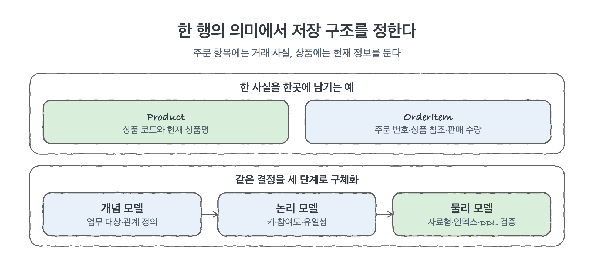

# Database Design Fundamentals

데이터베이스 설계는 업무에서 어떤 사실을 기록하고, 그 사실을 어떤 단위로 읽고 변경할지 정하는 작업이다. 데이터의 의미가 분명하면 중복으로 생기는 불일치를 줄이고, 업무 규칙이 바뀌었을 때 어느 구조를 수정할지 판단할 수 있다.

## 1. 한 행이 어떤 사실을 나타내는지 정하기

상품 판매 내역 한 행에 주문번호, 상품코드, 상품명, 판매 수량을 함께 넣었다고 하자. 이 행의 단위는 주문 항목인데, 상품명은 상품 자체의 현재 상태다. 같은 상품이 여러 번 팔리면 현재 상품명이 여러 주문 항목에 반복된다.

| 이상 현상 | 예시 |
| --- | --- |
| 수정 이상 | 상품 이름을 변경하면서 일부 판매 내역만 수정해 같은 상품코드에 두 이름이 남는다. |
| 삽입 이상 | 판매 내역에 주문번호가 필수라서 판매 기록 없이 신규 상품 정보를 넣기 어렵다. |
| 삭제 이상 | 특정 상품의 마지막 판매 기록을 지우면서 상품 정보도 사라진다. |

현재 상품명은 상품에 저장하고, 주문 항목은 상품 식별자를 참조하도록 분리한다. 판매 당시 합의한 단가는 주문 항목의 사실이므로 상품의 현재 판매가와 별도로 저장할 수 있다. 같은 값이 여러 곳에 보일 때는 변경 시 함께 바뀌어야 하는 동일한 사실인지, 서로 다른 시점의 사실인지 구분한다. [IBM Database Normalization](https://www.ibm.com/think/topics/database-normalization)

## 2. 개념, 논리, 물리 모델로 구체화하기

| 단계 | 설계 질문 | 주문 사례의 산출물 |
| --- | --- | --- |
| 개념적 모델링 | 업무에서 어떤 대상을 기록하고 어떻게 관계를 맺는가? | 회원은 여러 주문을 할 수 있고, 주문은 여러 항목을 갖는다는 업무 규칙과 개념 ERD |
| 논리적 모델링 | 관계형 모델에서 행을 무엇으로 식별하고 관계를 어떻게 표현하는가? | 회원, 주문, 주문 항목의 릴레이션, 기본 키와 외래 키, 유일성과 참여 조건 |
| 물리적 모델링 | 선택한 DBMS에서 어떤 자료형과 제약 조건을 적용하고, 어떤 접근 경로를 제공하는가? | 테이블 정의서, DDL, 회원 주문 이력의 검색과 정렬을 고려한 인덱스 후보 |

논리 모델에서는 릴레이션과 속성을 정의하고, 함수 종속을 살펴 같은 사실이 불필요하게 중복되는지 확인한다. 물리 모델에서 인덱스를 결정할 때는 예상 조회 패턴과 쓰기 비용을 함께 본다. 실행 계획에서 병목을 발견하거나 업무 규칙이 바뀌면 앞 단계의 결정을 다시 검토할 수 있다. [IBM Data Modeling](https://www.ibm.com/think/topics/data-modeling) · [Oracle Data Modeler Concepts](https://docs.oracle.com/en/database/oracle/sql-developer-data-modeler/22.2/dmdug/data-modeler-concepts-usage.html)

다음 문서에서는 업무 설명을 엔티티, 속성, 관계로 정리한다. [개념적 데이터 모델링](02_conceptual_data_modeling.md)

그림의 근거 · [모델링 개념](https://docs.oracle.com/en/database/oracle/sql-developer-data-modeler/24.3/dmdug/data-modeler-concepts-usage.html)
