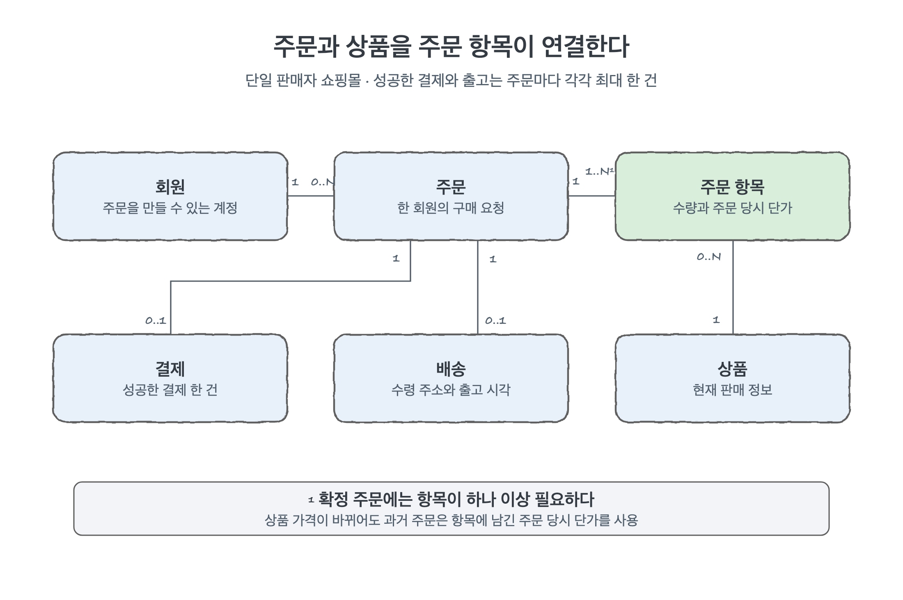

# Conceptual Modeling Workshop

자체 상품을 판매하는 온라인 쇼핑몰의 첫 출시 범위를 정하고, 업무 규칙을 개념 모델로 옮긴다. 회원 가입, 상품 관리, 주문, 결제, 배송이 실습 범위다. 외부 판매자 입점, 쿠폰, 리뷰, 분할 결제와 분할 배송은 후속 요구사항 후보로 기록한다.

## 1. 업무 흐름에서 저장할 사실 찾기

회원은 여러 상품을 골라 주문한다. 주문을 만들면 어떤 상품을 몇 개, 얼마에 주문했는지 남긴다. 결제가 성공한 시점과 상품이 출고된 시점은 별개의 사건으로 기록한다.

| 엔티티 | 한 인스턴스가 나타내는 사실 | 대표 속성 |
| --- | --- | --- |
| 회원 · Member | 쇼핑몰에 등록된 고객 한 명 | 회원 식별자, 이메일 |
| 상품 · Product | 판매 대상으로 등록한 상품 한 개 | 상품 식별자, 상품명, 현재 판매가 |
| 주문 · Order | 회원이 생성한 구매 요청 한 건 | 주문 식별자, 주문 시각 |
| 주문 항목 · OrderItem | 주문에 담긴 개별 상품 항목 한 줄 | 수량, 주문 시 단가 |
| 결제 · Payment | 주문의 성공한 결제 한 건 | 결제 식별자, 결제 시각, 결제 금액 |
| 배송 · Shipment | 주문에 대한 출고 한 건 | 배송 식별자, 수령 주소, 출고 시각 |

주문 시 단가는 주문의 합의 금액을 재현할 수 있게 항목에 기록한다. 이후 상품 판매가가 바뀌더라도 과거 주문 시 단가의 의미는 유지된다. 주문과 상품은 각각 여러 상대와 연결될 수 있으므로, 주문 항목이 두 대상을 연결하고 수량과 단가를 기록한다. [IBM ERD의 연관 엔티티](https://www.ibm.com/think/topics/entity-relationship-diagram)

## 2. 관계를 양방향으로 확인하기

| 관계 | 왼쪽 한 건에 대응하는 오른쪽 수 | 오른쪽 한 건에 대응하는 왼쪽 수 |
| --- | --- | --- |
| 회원 → 주문 | `0..N` | `1` |
| 주문 → 주문 항목 | 확정 시 `1..N` | `1` |
| 상품 → 주문 항목 | `0..N` | `1` |
| 주문 → 결제 | `0..1` | `1` |
| 주문 → 배송 | `0..1` | `1` |

그림의 근거 · [모델링 개념](https://docs.oracle.com/en/database/oracle/sql-developer-data-modeler/24.3/dmdug/data-modeler-concepts-usage.html)

신규 회원과 신규 상품은 주문 기록이 없어도 존재한다. 주문을 만들고 결제를 기다리는 구간에는 결제 기록이 없을 수 있다. 배송은 결제 성공 후 시작한다. 실습에서는 주문당 성공한 결제와 출고를 각각 최대 한 건 기록한다. 재시도 이력, 부분 환불, 분할 배송이 필요해지면 독립된 사건과 관계의 최대 수를 다시 정한다. 확정 주문에 항목이 최소 한 개 필요하다는 규칙은 주문 확정 시점을 기준으로 검증한다. [Oracle Data Modeler의 관계와 카디널리티](https://docs.oracle.com/en/database/oracle/sql-developer-data-modeler/22.2/dmdug/data-modeler-concepts-usage.html)

## 3. 팀에서 쓸 용어 확정하기

| 용어 | 영문 | 업무에서 뜻하는 값 |
| --- | --- | --- |
| 판매가 | Current Price | 현재 상품에 표시하는 한 단위의 가격 |
| 주문 시 단가 | Unit Price at Order | 해당 주문 항목에 적용된 한 단위의 가격 |
| 주문 수량 | Ordered Quantity | 한 주문 항목에 포함된 상품 개수 |
| 수령 주소 | Shipping Address | 해당 배송에 사용하기로 정한 주소. 회원 정보가 바뀌어도 이미 접수한 배송의 주소를 확인하는 데 쓴다. |

이 용어로 “상품 판매가를 변경한 뒤 과거 주문 금액을 다시 조회한다”와 “결제를 기다리는 주문을 조회한다”를 검토한다. 두 질문에 답하는 데 필요한 데이터가 어느 엔티티에 속하는지 확인한 뒤 논리 모델에서 키와 제약 조건을 결정한다. [논리 모델링 실습](08_logical_modeling_workshop.md)
