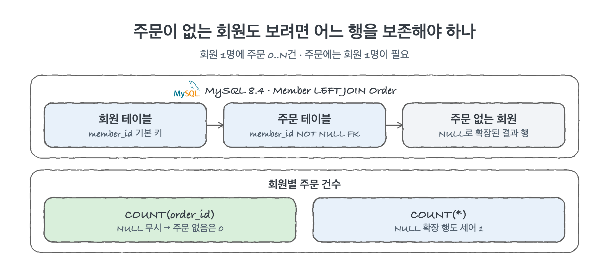

# Relationship Participation and One-to-Many Relationships

카디널리티는 한 행과 연결될 수 있는 상대 행의 최대 수를, 참여도는 최소 수를 나타낸다. 회원에서 보면 주문은 일대다 관계이고, 주문에서 보면 회원은 다대일 관계다. 두 관점에서 각각 최소 몇 행이 필요하고 최대 몇 행까지 허용하는지 정한다.

## 1. 참여도를 외래 키와 연결하기

| 읽는 방향 | 업무 규칙 예시 | 논리 모델 |
| --- | --- | --- |
| 회원에서 주문 | 회원은 아직 주문하지 않았거나 여러 주문을 할 수 있다. | 회원 한 행에 주문이 `0..N`개 연결된다. |
| 주문에서 회원 | 주문에는 회원이 반드시 한 명 있어야 한다. | 주문의 `member_id`에 외래 키와 `NOT NULL`을 둔다. |
| 주문에서 담당자 | 주문 접수 뒤에 담당자를 배정할 수 있다. | 담당자 외래 키에 `NULL`을 허용하면 주문당 담당자가 `0..1`명이다. |

외래 키는 다 쪽의 각 행에 부모를 가리키는 값을 하나 저장한다. 여러 자식이 같은 값을 사용할 수 있으므로 배정된 외래 키 값에 `UNIQUE`를 추가하면 관계의 최대 수까지 바뀐다. 외래 키가 어느 테이블에 있든 조회는 조인을 통해 양방향으로 할 수 있다. [MySQL FOREIGN KEY Constraints](https://dev.mysql.com/doc/refman/8.4/en/create-table-foreign-keys.html)

### 부모의 최소 참여는 별도 규칙으로 검증

확정된 주문에 주문 항목이 최소 한 개 필요하다고 가정하자. 항목의 `order_id NOT NULL`과 외래 키는 항목에 주문이 있음을 보장한다. 주문을 먼저 만든 뒤 아무 항목도 넣지 않는 것은 이 제약만으로 막을 수 없으므로 ERD에 `1..N` 규칙을 남기고, 항목 저장과 주문 확정을 같은 트랜잭션에서 처리한다. 확정 후에도 항목을 삭제하거나 다른 주문으로 옮길 수 있다면 마지막 항목을 제거하는 변경 역시 동시 요청을 고려해 통제한다. [MySQL FOREIGN KEY Constraints](https://dev.mysql.com/doc/refman/8.4/en/create-table-foreign-keys.html) · [트랜잭션과 격리 수준](../database/10_transactions_and_isolation_levels.md)



그림의 근거 · [외래 키 제약](https://dev.mysql.com/doc/refman/8.4/en/create-table-foreign-keys.html) · [JOIN](https://dev.mysql.com/doc/refman/8.4/en/join.html) · [집계 함수](https://dev.mysql.com/doc/refman/8.4/en/aggregate-functions.html)

## 2. MySQL 8.4 실습 · 주문 목록과 회원별 건수

실습 환경은 MySQL 8.4(InnoDB)다. 빈 스키마에서 회원 두 명을 만들고, 한 명에게만 두 주문을 연결한다.

```sql
CREATE TABLE dd05_members (
    member_id BIGINT PRIMARY KEY,
    name VARCHAR(30) NOT NULL
) ENGINE = InnoDB;

CREATE TABLE dd05_orders (
    order_id BIGINT PRIMARY KEY,
    member_id BIGINT NOT NULL,
    FOREIGN KEY (member_id) REFERENCES dd05_members (member_id)
) ENGINE = InnoDB;

INSERT INTO dd05_members VALUES (1, 'Ara'), (2, 'Jun');
INSERT INTO dd05_orders VALUES (101, 1), (102, 1);

SELECT m.member_id, o.order_id
FROM dd05_members AS m
LEFT JOIN dd05_orders AS o ON o.member_id = m.member_id
ORDER BY m.member_id, o.order_id;

SELECT m.member_id, COUNT(o.order_id) AS order_count
FROM dd05_members AS m
LEFT JOIN dd05_orders AS o ON o.member_id = m.member_id
GROUP BY m.member_id
ORDER BY m.member_id;
```

첫 조회의 행은 `(1, 101)`, `(1, 102)`, `(2, NULL)`이다. 조인된 결과의 단위가 회원 한 명에서 주문 한 건으로 내려가므로 회원 1이 두 번 나타난다. 반대로 주문을 기준으로 유일한 회원 ID에 조인하면 주문당 회원은 최대 한 명이다. 집계 결과는 회원 1의 주문 2건, 회원 2의 주문 0건이다. 여기서 `COUNT(*)`를 사용하면 미매칭에서 만들어진 `(2, NULL)`도 한 행으로 센다. 부모의 값을 합산하는 보고서라면 자식 데이터를 부모별 한 행으로 미리 집계한 뒤 붙이는 방법을 검토한다. [MySQL JOIN](https://dev.mysql.com/doc/refman/8.4/en/join.html) · [MySQL COUNT](https://dev.mysql.com/doc/refman/8.4/en/aggregate-functions.html#function_count)

MySQL InnoDB는 외래 키 열이 같은 순서로 인덱스의 맨 앞에 있어야 하며, 자식 쪽에 적합한 인덱스가 없으면 자동으로 만든다. 자식 쪽 외래 키 인덱스 자동 생성 여부는 DBMS에 따라 다르다. 점검할 때는 참조 제약과 조회에 필요한 인덱스를 각각 확인한다. [MySQL FOREIGN KEY Constraints](https://dev.mysql.com/doc/refman/8.4/en/create-table-foreign-keys.html) · [PostgreSQL Constraints](https://www.postgresql.org/docs/current/ddl-constraints.html)
