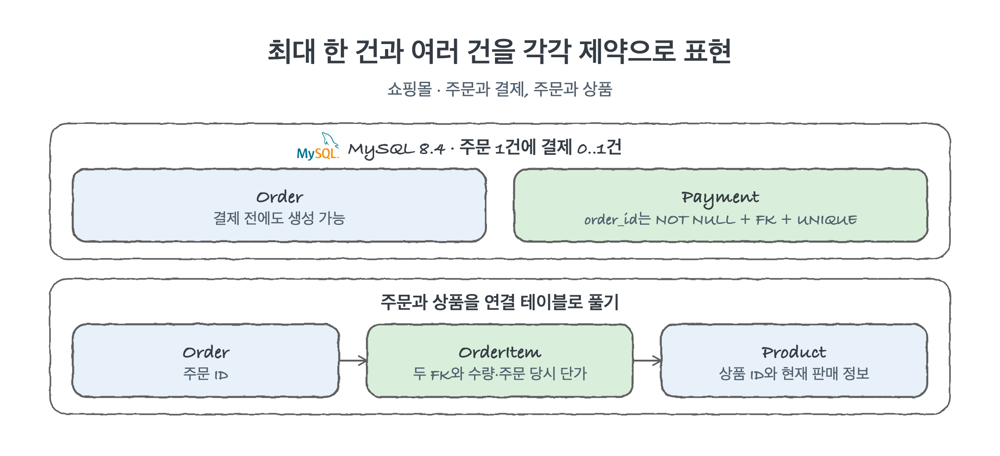

# One-to-One and Many-to-Many Relationships

일대일 관계는 한 행에 상대 행을 최대 하나만 연결하는 모델이다. 다대다 관계는 양쪽에 여러 행이 연결될 수 있어 연결 테이블로 풀어낸다. 두 관계 모두 한 행이 어떤 사실이나 사건을 기록하는지 정한 뒤 외래 키와 유일성 제약을 배치한다.

## 1. 일대일 관계에서 외래 키의 위치 정하기

주문과 결제를 예로 들어, 주문당 결제 기록을 최대 한 건만 보관하는 범위를 가정하자. 결제에 `order_id NOT NULL UNIQUE` 외래 키를 두면 결제는 반드시 하나의 주문을 참조하고 두 결제가 같은 주문을 참조할 수 없다. 주문은 결제 행 없이도 먼저 존재할 수 있다.

| 구조 | 적합한 경우 |
| --- | --- |
| 한 테이블에 저장 | 양쪽 정보의 수명과 접근 권한이 같고 대부분 동시에 조회한다. |
| 보조 테이블에 유일 외래 키 | 결제가 주문 후에 만들어지거나, 정보의 수명과 접근 권한이 다르다. 보조 행을 자체 키로 식별할 수 있다. |
| 보조 테이블의 기본 키를 외래 키로 공유 | 보조 행이 주 행의 식별자를 그대로 상속한다. 기본 키가 유일성도 보장한다. |
| 주 테이블에 유일 외래 키 | 주 행을 만들기 전에 보조 행이 존재해야 하거나 주 행의 참조가 필수다. `NOT NULL`은 그 방향의 최소 참여만 강제한다. |

결제를 여러 건 저장하게 된다면 결제 쪽의 유일성 제약을 완화하고, 결제 이력과 대표 결제를 조회하는 규칙을 다시 정한다. MySQL InnoDB에서 그 유일 인덱스가 외래 키를 지원하는 유일한 인덱스라면, 유일 제약을 제거하기 전에 외래 키 열로 시작하는 인덱스를 준비해야 한다. [MySQL CREATE TABLE](https://dev.mysql.com/doc/refman/8.4/en/create-table.html) · [MySQL FOREIGN KEY Constraints](https://dev.mysql.com/doc/refman/8.4/en/create-table-foreign-keys.html)

## 2. 다대다 관계에서 연결 행에 속성 두기

주문에는 여러 상품이 들어가고, 상품은 여러 주문에 등장할 수 있다. 주문 항목을 추가하면 `주문 1:N 주문 항목`과 `상품 1:N 주문 항목`으로 표현할 수 있다. 주문 항목은 양쪽 식별자와 함께 해당 주문에서 그 상품을 구매한 수량과 주문 시점 단가를 가진다.

같은 주문의 같은 상품을 한 행으로 합치는 정책에서는 `(order_id, product_id)`로 유일성을 강제할 수 있다. 같은 상품을 옵션이나 단가별로 여러 줄에 담아야 한다면 줄 번호를 포함한 `(order_id, line_no)` 등으로 행의 단위를 바꾼다. 결제가 아직 없는 주문이나 아직 주문되지 않은 상품도 기록할 수 있도록 부모와 연결 행의 참여도를 각각 정한다. [MySQL FOREIGN KEY Constraints](https://dev.mysql.com/doc/refman/8.4/en/create-table-foreign-keys.html) · [Relational Keys](04_relational_keys.md)



그림의 근거 · [테이블과 키 제약](https://dev.mysql.com/doc/refman/8.4/en/create-table.html) · [외래 키 제약](https://dev.mysql.com/doc/refman/8.4/en/create-table-foreign-keys.html)

## 3. MySQL 8.4 실습 · 결제와 주문 항목 조회

실습 환경은 MySQL 8.4(InnoDB)다. 빈 스키마에서 주문 두 건과 상품 두 종을 만든 뒤, 주문 101의 결제와 항목을 추가한다.

```sql
CREATE TABLE dd06_orders (
    order_id BIGINT PRIMARY KEY
) ENGINE = InnoDB;

CREATE TABLE dd06_payments (
    payment_id BIGINT PRIMARY KEY,
    order_id BIGINT NOT NULL UNIQUE,
    FOREIGN KEY (order_id) REFERENCES dd06_orders (order_id)
) ENGINE = InnoDB;

CREATE TABLE dd06_products (
    product_id BIGINT PRIMARY KEY,
    name VARCHAR(40) NOT NULL
) ENGINE = InnoDB;

CREATE TABLE dd06_order_items (
    order_id BIGINT NOT NULL,
    product_id BIGINT NOT NULL,
    quantity INT NOT NULL CHECK (quantity > 0),
    unit_price DECIMAL(10, 2) NOT NULL CHECK (unit_price >= 0),
    PRIMARY KEY (order_id, product_id),
    FOREIGN KEY (order_id) REFERENCES dd06_orders (order_id),
    FOREIGN KEY (product_id) REFERENCES dd06_products (product_id)
) ENGINE = InnoDB;

INSERT INTO dd06_orders VALUES (101), (102);
INSERT INTO dd06_payments VALUES (501, 101);
INSERT INTO dd06_products VALUES (1, 'Desk Mat'), (2, 'Cable Clip');
INSERT INTO dd06_order_items VALUES (101, 1, 2, 15.00), (101, 2, 1, 4.00);

SELECT o.order_id, p.payment_id
FROM dd06_orders AS o
LEFT JOIN dd06_payments AS p ON p.order_id = o.order_id
ORDER BY o.order_id;

SELECT i.order_id, p.name, i.quantity * i.unit_price AS line_total
FROM dd06_order_items AS i
JOIN dd06_products AS p ON p.product_id = i.product_id
WHERE i.order_id = 101
ORDER BY i.product_id;
```

첫 결과는 `(101, 501)`, `(102, NULL)`이다. 두 번째 결과는 `Desk Mat` 30.00, `Cable Clip` 4.00이다. 주문 101에 두 번째 결제를 붙이면 `UNIQUE`에, 101에 상품 1의 항목을 하나 더 넣으면 복합 기본 키에 걸린다. 주문 102는 결제 및 항목을 추가하기 전 상태이고, 확정 주문에 항목이 하나 이상 있어야 하는 규칙은 확정 처리에서 검사한다. [Relationship Participation and One-to-Many Relationships](05_relationship_participation_and_one_to_many.md)
