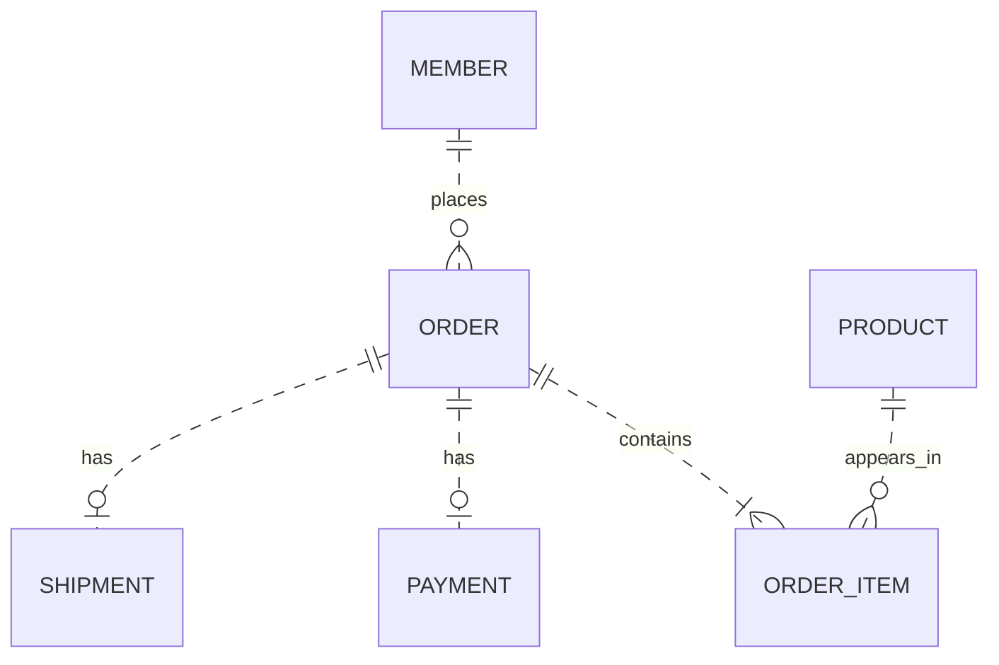

# Logical Modeling Workshop

[개념적 모델링 실습](03_conceptual_modeling_workshop.md)에서 정한 단일 판매자 쇼핑몰의 엔티티와 관계를 관계형 테이블로 옮긴다. 여기서는 행을 식별하는 키, 필수 열, 테이블 간 참조와 유일성 규칙을 결정한다. 자료형의 세부 규격, 인덱스와 DDL은 [물리적 모델링 실습](11_physical_modeling_workshop.md)에서 다룬다.

## 엔티티를 테이블과 키로 옮기기

개념 모델의 엔티티를 테이블로, 속성을 열로 옮긴다. 각 테이블에 독립적인 대리 기본 키를 두고, 업무에서 중복을 금지하는 값과 조합에는 별도의 `UNIQUE`를 둔다. 모든 외래 키는 현 범위에서 필수이므로 `NOT NULL`로 정한다.

| 엔티티 | 기본 키 | 외래 키와 유일성 규칙 | 행이 기록하는 사실 |
| --- | --- | --- | --- |
| Member | `member_id` | `email`은 필수이며 유일 | 한 회원의 계정 |
| Product | `product_id` | — | 한 상품의 현재 판매 정보 |
| Order | `order_id` | `member_id` → Member | 한 회원의 주문 |
| OrderItem | `order_item_id` | `order_id` → Order, `product_id` → Product, `UNIQUE (order_id, line_no)` | 주문의 한 항목과 수량, 주문 당시 단가 |
| Payment | `payment_id` | `order_id` → Order, `UNIQUE (order_id)` | 성공한 결제의 시각과 실제 결제 금액 |
| Shipment | `shipment_id` | `order_id` → Order, `UNIQUE (order_id)` | 주문의 출고 시각과 배송지 |

OrderItem의 `line_no`는 주문 안에서 항목을 구별하는 필수 값이다. 이번 실습은 같은 상품이 조건에 따라 별도 항목으로 기록될 수 있다고 가정한다. 상품당 주문 내 한 항목만 허용하는 정책이라면 `(order_id, product_id)`에 유일성 제약을 둔다. 어떤 조합이 고유한지는 업무 규칙에서 확인한다. [Oracle의 논리 모델과 관계형 모델](https://docs.oracle.com/en/database/oracle/sql-developer-data-modeler/24.3/dmdug/data-modeler-concepts-usage.html) · [유일성 및 참조 제약](https://www.postgresql.org/docs/current/ddl-constraints.html)

## 참여도와 카디널리티를 제약으로 옮기기

- 회원 한 명은 주문이 0건 이상일 수 있고, 주문 한 건에는 회원이 꼭 한 명 있다. `Order.member_id`에 필수 외래 키를 둔다.
- 주문과 상품 사이의 다대다 관계는 OrderItem으로 해소한다. 각 항목은 정확히 한 주문과 한 상품에 연결된다. 판매된 적 없는 상품은 항목이 없을 수 있다.
- 확정된 주문에는 항목이 하나 이상 있어야 한다. 외래 키는 각 항목의 주문 존재를 확인한다. 주문에 속한 항목의 최소 개수는 주문 생성이나 확정의 트랜잭션에서 별도로 보장한다.
- 한 주문의 성공한 결제와 출고는 각각 0건 또는 1건이다. 결제 및 배송의 필수 `order_id`에 각각 `UNIQUE`를 두어 주문별 최대 한 건을 보장한다. 분할 배송이나 여러 결제 이력이 필요해지면 개수 규칙과 이력의 식별 기준을 다시 정한다.

점선은 비식별 관계를 나타낸다. 위 테이블에서 각 외래 키는 자식의 기본 키에 포함되지 않는다. [Oracle Data Modeler의 카디널리티와 참여도](https://docs.oracle.com/en/database/oracle/sql-developer-data-modeler/21.4/dmdug/data-modeler-dialogs.html) · [Mermaid ERD 표기](https://mermaid.js.org/syntax/entityRelationshipDiagram.html)

## 시점과 저장 책임 확인하기

상품의 현재 가격과 `OrderItem.unit_price_at_order`는 기준 시점이 다르다. 상품 가격이 바뀌어도 과거 주문의 금액은 주문 당시 단가와 수량으로 계산한다. 배송지 역시 발송 대상으로 확정한 값을 배송 기록에서 관리한다. 취소나 환불을 지원한다면 삭제 여부와 보존할 이력을 먼저 설계하고 그에 맞는 참조 정책을 정한다.

검토할 때는 주문이 없는 회원, 결제 전 주문, 항목이 없는 확정 요청, 같은 주문 번호를 참조하는 두 번째 배송, 주문 후 상품 가격 변경을 사례로 대조한다. 테이블 제약이 처리하는 경우와 업무 흐름이 보장해야 하는 경우를 구별하면 물리 모델에서 구현 범위가 명확해진다.
