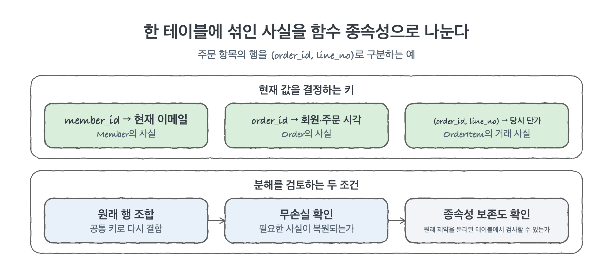

# Database Normalization

정규화는 하나의 테이블에 섞인 사실을 함수 종속성에 따라 나눠 저장 오류를 줄이는 과정이다. 주문과 회원의 현재 정보를 매 주문 항목에 함께 넣으면, 회원 정보가 바뀔 때 일부 행만 수정되는 **갱신 이상**, 주문 전에는 회원을 등록하기 어려운 **삽입 이상**, 마지막 주문을 삭제할 때 회원 정보까지 잃는 **삭제 이상**이 생길 수 있다.

## 함수 종속성과 정규형

`X → Y`는 모든 유효한 데이터에서 `X` 값이 같은 두 행의 `Y` 값도 같아야 한다는 뜻이다. 현재 데이터에서 우연히 값이 같은지보다 업무 규칙이 어떤 값을 결정하는지 확인한다. 후보 키는 행을 유일하게 식별하는 최소 열 집합이다. 슈퍼 키는 유일하게 식별하는 열 집합이며, 후보 키에 불필요한 열을 더한 집합도 포함한다.

| 정규형 | 확인할 규칙 |
| --- | --- |
| 1NF | 각 열의 값은 그 도메인에서 하나의 값으로 다룬다. 별도 식별이나 조회가 필요한 반복 항목은 개별 행으로 표현한다. |
| 2NF | 1NF를 만족하고, 어떤 후보 키에서도 비주요 속성이 그 키의 진부분집합에 종속되지 않는다. 비주요 속성은 어떤 후보 키에도 속하지 않는 열이다. |
| 3NF | 자명하지 않은 함수 종속 `X → A`마다 `X`가 슈퍼 키이거나, `A`가 어떤 후보 키에 속한다. 후보 키가 하나인 전형적인 예에서는 비키 속성을 거치는 이행 종속을 분리해 적용한다. |
| BCNF | 자명하지 않은 모든 함수 종속의 결정자 `X`가 슈퍼 키다. `A`가 후보 키에 속하는 경우에도 확인한다. |

자명한 종속은 `(order_id, line_no) → order_id`처럼 결정자가 이미 종속 열을 포함하는 경우다. 정규형을 판정할 때는 기본 키로 고른 열과 더불어 다른 후보 키도 확인한다. [IBM의 정규화와 데이터 이상](https://www.ibm.com/think/topics/database-normalization) · [Database System Concepts의 정규형 정의](https://db-book.com/slides-dir/PDF-dir/ch7.pdf)

## 주문 정보 분해하기

1. **반복 항목을 행으로 바꾼다.** 주문의 상품과 수량을 쉼표 문자열이나 `product_1`, `product_2` 같은 반복 열에 넣으면 개별 항목에 상품 외래 키나 수량 제약을 적용하기 어렵다. 상품별 항목을 행으로 만들고 각 항목에 `(order_id, line_no)`를 부여한다.
2. **부분 종속을 분리한다.** 주문 시각과 회원 ID는 `order_id`로 결정된다. 이 정보는 Order에 두고, `(order_id, line_no)` 전체가 필요한 상품 ID, 수량, 주문 당시 단가는 OrderItem에 남긴다.
3. **이행 종속을 분리한다.** Order에 회원의 현재 이메일도 넣으면 `order_id → member_id → member_email`이 된다. 현재 이메일은 Member가 관리하고 Order에는 참조인 `member_id`를 둔다. 주문 당시 단가처럼 과거의 거래 사실로 정해진 값은 현재 상품 단가와 구분해 OrderItem에 남긴다.

Order와 OrderItem을 다시 조인할 때는 양쪽의 공통 열인 `order_id`가 Order의 키이므로 각 항목은 해당 주문 한 건에만 붙는다. 분해할 때는 필요한 사실을 조인으로 복원할 수 있는 무손실 분해인지, 분리한 테이블의 제약만으로 원래 종속성을 확인할 수 있는지도 확인한다. [무손실 분해와 종속성 보존](https://db-book.com/slides-dir/PDF-dir/ch7.pdf) · [쇼핑몰 논리 모델](08_logical_modeling_workshop.md)

그림의 근거 · [관계형 설계와 정규화](https://db-book.com/slides-dir/PDF-dir/ch7.pdf)

## 3NF와 BCNF가 갈리는 예

수강 배정 테이블 `Enrollment(student_id, subject_id, instructor_id)`에서 학생은 한 과목에 한 강사만 배정받고, 강사 한 명은 한 과목만 맡는다고 가정한다. 같은 과목을 여러 강사가 맡을 수 있다.

- 업무 규칙은 `(student_id, subject_id) → instructor_id`와 `instructor_id → subject_id`다.
- 후보 키는 `(student_id, subject_id)`와 `(student_id, instructor_id)`다. `instructor_id → subject_id`의 오른쪽 열이 후보 키에 속하므로 3NF를 만족한다.
- `instructor_id` 하나로 수강 배정의 각 행을 식별할 수 없으므로 BCNF를 위반한다.

`InstructorSubject(instructor_id, subject_id)`와 `StudentInstructor(student_id, instructor_id)`로 나누면 공통 열 `instructor_id`가 첫 테이블의 키이므로 무손실이다. 다만 각 테이블의 키 제약만으로는 한 학생이 같은 과목의 강사 두 명에 배정되는 일을 막을 수 없다. 이 예에서는 BCNF 분해와 원래 종속성 보존을 따로 평가한다. [3NF와 BCNF 및 분해의 선택 기준](https://db-book.com/slides-dir/PDF-dir/ch7.pdf)

## 조회 비용은 물리 모델에서 검증하기

정규화된 구조에서 업무 규칙을 명시한 뒤 실제 조회의 조인, 인덱스, 데이터 분포를 확인한다. 반복적으로 읽는 집계 값을 저장할 필요가 있다면 원본, 갱신 트랜잭션, 불일치 검증 방법을 함께 정한다. 예를 들어 주문 총액을 저장한다면 주문 항목의 수량과 단가 합계에서 다시 계산할 수 있어야 한다. [IBM의 정규화 비용](https://www.ibm.com/think/topics/database-normalization) · [물리적 모델링](10_physical_database_modeling.md)
