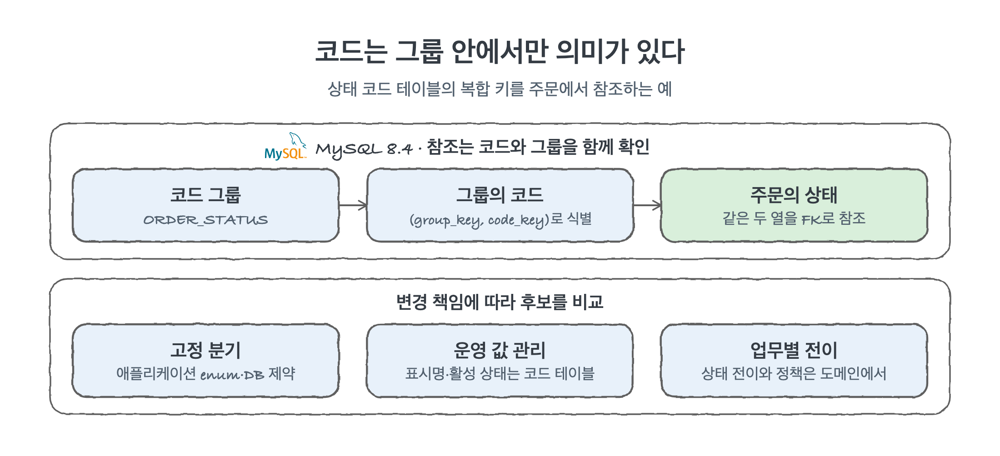

# Reference Data and Code Tables

주문 표시 상태나 문의 채널처럼 여러 곳에서 같은 값의 목록을 사용한다면, 값의 정체성과 화면에 보이는 이름을 나눠 관리할 수 있다. 코드에는 안정적인 식별값을 쓰고 표시명, 정렬 순서, 사용 여부는 별도 속성으로 둔다. 상태 전이, 결제 승인 여부, 과금 정책처럼 업무의 의미가 큰 규칙은 담당 도메인에서 정의한다.

## 1. 값의 변경 주체에 따라 모델 선택하기

| 요구 | 선택지 |
| --- | --- |
| 배포와 함께 바뀌고 프로그램 분기에서 사용 | 애플리케이션 열거형과 필요한 DB 제약 |
| 운영자가 표시명이나 활성 여부를 관리 | 도메인별 참조 테이블 또는 그룹화한 공통 코드 |
| 상태마다 규칙과 추가 속성이 다름 | 도메인 테이블과 상태 전이 규칙 |

공통 코드 테이블은 저장과 표시의 공통 부분을 재사용한다. 상태 이름이나 순서는 데이터로 관리할 수 있지만, 어떤 상태에서 환불이 가능한지처럼 프로그램의 동작을 바꾸는 규칙은 따로 검증한다. DB가 허용하는 코드 목록과 애플리케이션 열거형을 모두 둔다면 새 코드의 적용 순서와 구버전 클라이언트의 동작을 정한다. [MySQL ENUM](https://dev.mysql.com/doc/refman/8.4/en/enum.html) · [관계형 모델의 키](04_relational_keys.md)

## 2. 그룹 안에서 코드의 유효성 보장하기

서로 다른 그룹이 같은 코드 값을 쓸 수 있다. 예제에서는 주문 상태와 문의 상태에 모두 `OPEN`을 둔다. 코드 값 하나만 참조하면 필요한 그룹을 구별할 수 없으므로, 업무 행은 `(group_key, code_key)`를 외래 키로 참조한다. 두 열 모두 필수라면 각각 `NOT NULL`을 둔다.

실습 환경은 MySQL 8.4(InnoDB)다. 빈 스키마에서 SQL 블록을 실행한다.

```sql
CREATE TABLE db13_code_group (
    group_key VARCHAR(24) PRIMARY KEY,
    label VARCHAR(60) NOT NULL
) ENGINE = InnoDB;

CREATE TABLE db13_code (
    group_key VARCHAR(24) NOT NULL,
    code_key VARCHAR(16) NOT NULL,
    label VARCHAR(60) NOT NULL,
    display_order INT NOT NULL,
    is_active BOOLEAN NOT NULL DEFAULT TRUE,
    PRIMARY KEY (group_key, code_key),
    FOREIGN KEY (group_key) REFERENCES db13_code_group (group_key)
) ENGINE = InnoDB;

CREATE TABLE db13_order (
    order_id BIGINT PRIMARY KEY,
    status_group VARCHAR(24) NOT NULL DEFAULT 'ORDER_STATUS',
    status_code VARCHAR(16) NOT NULL,
    CHECK (status_group = 'ORDER_STATUS'),
    FOREIGN KEY (status_group, status_code)
        REFERENCES db13_code (group_key, code_key)
) ENGINE = InnoDB;

INSERT INTO db13_code_group VALUES
    ('ORDER_STATUS', 'Order status'),
    ('TICKET_STATUS', 'Ticket status');

INSERT INTO db13_code VALUES
    ('ORDER_STATUS', 'OPEN', 'Order received', 10, TRUE),
    ('ORDER_STATUS', 'PAID', 'Payment received', 20, TRUE),
    ('TICKET_STATUS', 'OPEN', 'Awaiting reply', 10, TRUE);

INSERT INTO db13_order (order_id, status_code) VALUES (101, 'OPEN');

SELECT o.order_id, o.status_code, c.label
FROM db13_order AS o
JOIN db13_code AS c
  ON c.group_key = o.status_group AND c.code_key = o.status_code
ORDER BY o.order_id;
```

결과는 `101, OPEN, Order received`다. 복합 외래 키는 코드가 해당 그룹에 존재하는지, `CHECK`는 주문에서 참조할 그룹이 주문 상태인지 검사한다. 외래 키는 `is_active`까지 확인하지 않는다. 종료된 코드는 기존 참조에 남겨 두고 신규 선택에서는 제외하는 정책이라면, 등록·수정 경로에서 활성 여부를 검사한다. [MySQL CREATE TABLE](https://dev.mysql.com/doc/refman/8.4/en/create-table.html) · [복합 외래 키](https://dev.mysql.com/doc/refman/8.4/en/create-table-foreign-keys.html) · [CHECK 제약](https://dev.mysql.com/doc/refman/8.4/en/create-table-check-constraints.html)



그림의 근거 · [외래 키 제약](https://dev.mysql.com/doc/refman/8.4/en/create-table-foreign-keys.html) · [테이블과 키 제약](https://dev.mysql.com/doc/refman/8.4/en/create-table.html) · [ENUM 자료형](https://dev.mysql.com/doc/refman/8.4/en/enum.html)

## 3. 조회 비용과 변경 전파 다루기

코드 표시명을 SQL에서 가져오면 화면에 필요한 그룹마다 조인이 늘 수 있다. 조회를 표준화할 때는 조인을 뷰로 묶을 수 있다. 애플리케이션에서 표시명을 변환할 때는 화면에 필요한 그룹을 한꺼번에 읽어 행마다 추가 조회가 생기는 일을 피한다. 자주 읽는 그룹을 캐시한다면 변경 시 무효화나 TTL을 정하고 허용할 지연을 확인한다. 쓰기 무결성은 DB 제약과 업무 검증을 기준으로 처리한다. [MySQL 뷰](https://dev.mysql.com/doc/refman/8.4/en/create-view.html)

정렬 순서와 사용 여부처럼 여러 그룹에서 의미가 같은 속성은 공통 열에 적합하다. 회원 등급의 할인율이나 결제 수단의 수수료율을 같은 `attr_1`에 두면 단위와 검증 규칙을 열 이름과 자료형에 담기 어렵다. 이름과 타입을 명시한 도메인 테이블로 분리할 수 있고, 언어별 표시명은 `(group_key, code_key, locale)`을 키로 쓰는 별도 테이블에 둘 수 있다.
