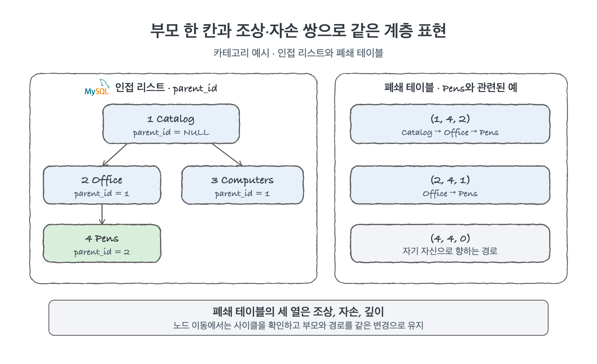

# Hierarchical Data Modeling

상품 분류나 조직도처럼 한 노드가 최대 한 부모를 가지는 구조를 트리 또는 포리스트로 모델링할 수 있다. 어떤 읽기가 많은지 먼저 확인한다. 직계 자식을 주로 읽는 경우와 전체 하위 트리, 조상 경로를 자주 읽는 경우는 비용이 다르다.

## 1. 인접 리스트에서 직계 관계 저장하기

인접 리스트는 각 노드에 `parent_id`를 저장한다. 루트는 부모가 없으므로 `NULL`을 쓴다. 자기 참조 외래 키는 부모 행의 존재를 보장한다. 직계 자식은 `parent_id`로 찾고, 여러 단계의 자손은 시작 집합에 반복해서 자식을 붙이는 재귀 CTE로 조회한다.

실습 환경은 MySQL 8.4(InnoDB)다. 빈 스키마에서 아래 블록을 순서대로 실행한다.

```sql
CREATE TABLE db14_category (
    category_id BIGINT PRIMARY KEY,
    parent_id BIGINT NULL,
    category_name VARCHAR(60) NOT NULL,
    INDEX ix_db14_parent (parent_id),
    FOREIGN KEY (parent_id) REFERENCES db14_category (category_id)
) ENGINE = InnoDB;

INSERT INTO db14_category VALUES (1, NULL, 'Catalog');
INSERT INTO db14_category VALUES (2, 1, 'Office'), (3, 1, 'Computers');
INSERT INTO db14_category VALUES (4, 2, 'Pens');

WITH RECURSIVE subtree (category_id, depth) AS (
    SELECT category_id, 0
    FROM db14_category
    WHERE category_id = 1
    UNION ALL
    SELECT c.category_id, subtree.depth + 1
    FROM subtree
    JOIN db14_category AS c ON c.parent_id = subtree.category_id
    WHERE subtree.depth < 20
)
SELECT s.category_id, c.category_name, s.depth
FROM subtree AS s
JOIN db14_category AS c ON c.category_id = s.category_id
ORDER BY s.depth, s.category_id;
```

`Catalog`은 깊이 0, `Office`와 `Computers`는 1, `Pens`는 2다. 정렬 키를 따로 지정해야 출력 순서를 보장할 수 있다. 이 예제는 깊이 20까지만 조회한다. 업무상 최대 깊이를 정할 수 없다면 조회에서 깊이를 제한하는 방식과 순환 탐지를 구별하고, 사용하는 DBMS의 재귀 한도도 확인한다. [MySQL 재귀 CTE](https://dev.mysql.com/doc/refman/8.4/en/with.html) · [자기 참조 외래 키](https://dev.mysql.com/doc/refman/8.4/en/create-table-foreign-keys.html)

## 2. 폐쇄 테이블로 조상과 자손 조회하기

폐쇄 테이블은 트리에서 경로로 연결되는 모든 `(ancestor_id, descendant_id)` 쌍과 거리 `depth`를 기록한다. 자기 자신으로 가는 거리 0의 행도 둔다. 자손 조회는 조상 ID로, 조상 조회는 자손 ID로 찾는다. 자손에서 역방향으로 조회하는 패턴도 많다면 자손 ID가 선두인 인덱스를 검토한다.

```sql
CREATE TABLE db14_category_closure (
    ancestor_id BIGINT NOT NULL,
    descendant_id BIGINT NOT NULL,
    depth INT NOT NULL CHECK (depth >= 0),
    PRIMARY KEY (ancestor_id, descendant_id),
    INDEX ix_db14_descendant (descendant_id, ancestor_id),
    FOREIGN KEY (ancestor_id) REFERENCES db14_category (category_id),
    FOREIGN KEY (descendant_id) REFERENCES db14_category (category_id)
) ENGINE = InnoDB;

INSERT INTO db14_category_closure (ancestor_id, descendant_id, depth)
WITH RECURSIVE paths (ancestor_id, descendant_id, depth) AS (
    SELECT category_id, category_id, 0
    FROM db14_category
    UNION ALL
    SELECT paths.ancestor_id, c.category_id, paths.depth + 1
    FROM paths
    JOIN db14_category AS c ON c.parent_id = paths.descendant_id
)
SELECT ancestor_id, descendant_id, depth
FROM paths;

START TRANSACTION;
INSERT INTO db14_category VALUES (5, 3, 'Monitors');
INSERT INTO db14_category_closure (ancestor_id, descendant_id, depth)
SELECT p.ancestor_id, 5, p.depth + 1
FROM db14_category_closure AS p
WHERE p.descendant_id = 3;
INSERT INTO db14_category_closure VALUES (5, 5, 0);
COMMIT;

SELECT c.category_name, p.depth
FROM db14_category_closure AS p
JOIN db14_category AS c ON c.category_id = p.ancestor_id
WHERE p.descendant_id = 5
ORDER BY p.depth DESC;
```

새 잎 노드 `Monitors`의 경로는 `Catalog, 2`, `Computers, 1`, `Monitors, 0`이다. 현재 부모의 조상 경로를 하나씩 늘리고 새 노드의 자기 경로를 추가했다. 삽입 과정에서 부모 관계와 폐쇄 테이블을 같은 트랜잭션으로 갱신하면 중간 상태가 커밋되지 않는다. [MySQL INSERT ... SELECT](https://dev.mysql.com/doc/refman/8.4/en/insert-select.html) · [트랜잭션 제어](https://dev.mysql.com/doc/refman/8.4/en/commit.html)



그림의 근거 · [재귀 CTE](https://dev.mysql.com/doc/refman/8.4/en/with.html) · [외래 키 제약](https://dev.mysql.com/doc/refman/8.4/en/create-table-foreign-keys.html) · [트랜잭션 제어](https://dev.mysql.com/doc/refman/8.4/en/commit.html)

## 3. 사이클과 노드 이동 다루기

외래 키만으로는 노드 자신이나 자기 자손을 부모로 정하는 사이클을 막을 수 없다. 이동 전에 새 부모가 이동 대상 또는 대상의 자손인지 검사하고, 같은 트리의 동시 변경이 검사와 갱신 사이에 끼지 않도록 직렬화한다. 예를 들어 트리를 대표하는 행을 먼저 잠그고 그 트리의 모든 변경 경로가 같은 규칙을 따르게 할 수 있다. 여러 트리에 걸친 이동은 대표 행들을 일정한 순서로 잠근다. [InnoDB 잠금 읽기](https://dev.mysql.com/doc/refman/8.4/en/innodb-locking-reads.html)

폐쇄 테이블에서 하위 트리를 옮기면 내부 경로는 보존하고 기존 바깥 조상에서 이동 대상 하위 노드로 가는 경로를 제거한다. 새 바깥 조상과 이동 대상 하위 노드를 잇는 경로를 다시 만들 때는 조상에서 새 부모까지의 거리, 새 연결 한 단계, 이동 대상에서 하위 노드까지의 거리를 더한다. 갱신할 경로가 많으면 인접 리스트와 재귀 조회가 더 단순할 수 있다. 일렬로 긴 트리에서 폐쇄 테이블의 경로 수는 노드 수의 제곱에 비례하므로 실제 깊이와 이동 빈도로 비용을 비교한다.
