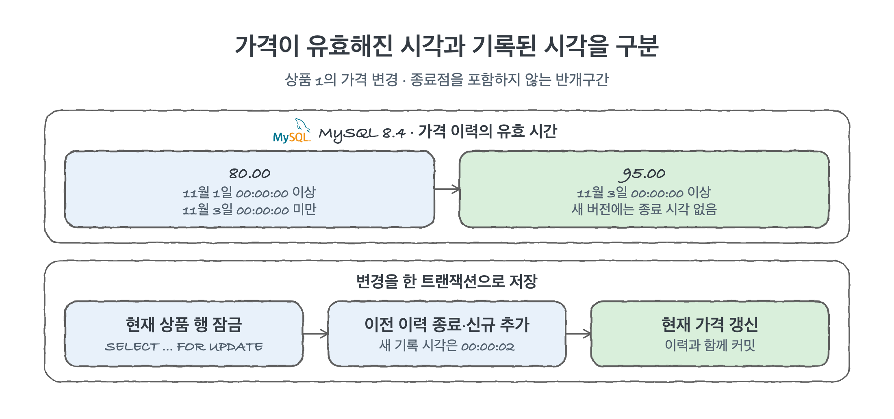

# Row Versioning and History Tables

[감사 열](15_audit_columns_and_change_metadata.md)이 마지막 수정자와 수정 시각을 보여 준다면, 이력 테이블은 값이 바뀐 순서나 특정 시점의 상태를 복원한다. 어떤 조회가 필요한지 먼저 정하면 저장할 버전의 단위와 시간 축을 결정할 수 있다.

## 1. 복원하려는 범위로 방식 고르기

| 저장 방식 | 적합한 질문 | 관리할 비용 |
| --- | --- | --- |
| 직전 값 열 | 가장 최근 변경 전 가격은 얼마였는가? | 그보다 이전의 값은 보관 범위를 벗어난다. |
| 한 테이블에 모든 버전 | 현재와 과거를 같은 구조로 조회할 수 있는가? | 현재 버전 조건과 버전별 키가 필요하고, 다른 테이블의 외래 키가 엔티티를 참조할지 버전을 참조할지 정해야 한다. |
| 현재 테이블과 전체 행 스냅샷 | 현재 조회를 단순하게 유지하면서 과거 주문 시점의 가격과 조건을 복원할 수 있는가? | 변경 시 여러 테이블을 함께 유지하고, 열이 추가되면 이력의 스키마도 검토한다. |
| 열 단위 변경 로그 | 누가 어떤 필드를 어떤 값으로 바꿨는가? | 과거의 전체 행을 복원하려면 기준 스냅샷과 이후 변경을 순서대로 적용한다. |
| 여러 엔티티가 공유하는 이력 | 운영자가 서로 다른 업무 객체의 변경을 한 곳에서 검색할 수 있는가? | 엔티티별 키와 값 형식, 조회 권한, 보관 규칙을 별도로 정의한다. |

스냅샷 이력은 변경 전 버전만 보관하거나, 최초 버전부터 현재까지 모든 버전을 포함할 수 있다. 전자는 전체 기간 조회에 현재 테이블을 함께 읽는다. 후자는 이력 테이블에서 모든 시점을 조회할 수 있으며, 현재 행과 열린 이력 버전을 함께 갱신한다.

## 2. 유효 시각과 기록 시각 구별하기

유효 시각은 가격이 **업무상 적용된 시점**이고, 기록 시각은 그 변경을 시스템이 **기록한 시점**이다. 예를 들어 가격을 11월 3일부터 적용하기로 한 사실을 11월 5일에 정정하면 두 날짜가 다르다. 업무 시점의 가격과 당시 시스템이 알고 있던 가격이 모두 필요하면 두 시간 축을 함께 보존한다. 아래 실습은 유효 시각으로 가격을 찾고 기록 시각을 보조 정보로 남긴다. 취소·정정을 거친 이전의 시스템 관점까지 복원하려면 기록 시간에도 별도의 버전 구간이 필요하다. SQL Server의 시스템 버전 관리는 시스템이 기록한 기간을 관리하는 제품별 기능의 예다. [SQL Server Temporal Tables](https://learn.microsoft.com/en-us/sql/relational-databases/tables/temporal/overview?view=sql-server-ver17)

유효 기간은 시작을 포함하고 끝을 제외하는 `[valid_from, valid_to)`로 기록한다. 다음 버전의 시작 시각이 앞 버전의 종료 시각과 같아도 어느 한 버전만 해당한다. `valid_to IS NULL`은 아직 닫히지 않은 구간을 뜻한다. 개체별 구간의 겹침과 허용할 공백을 업무 규칙으로 정한다.

## 3. 가격 스냅샷을 시간 구간으로 조회하기

실습 환경은 MySQL 8.4(InnoDB)다. 빈 스키마의 한 세션에서 실행한다. 상품 1의 최초 가격과 첫 가격 변경을 기록한다. 모든 시각은 UTC로 입력한다.

```sql
CREATE TABLE dd16_product_prices (
    product_id INT PRIMARY KEY,
    price DECIMAL(9, 2) NOT NULL CHECK (price >= 0),
    valid_from DATETIME(6) NOT NULL
) ENGINE = InnoDB;

CREATE TABLE dd16_price_history (
    product_id INT NOT NULL,
    valid_from DATETIME(6) NOT NULL,
    valid_to DATETIME(6),
    recorded_at DATETIME(6) NOT NULL,
    price DECIMAL(9, 2) NOT NULL CHECK (price >= 0),
    open_product_id INT GENERATED ALWAYS AS (
        CASE WHEN valid_to IS NULL THEN product_id END
    ) STORED,
    PRIMARY KEY (product_id, valid_from),
    UNIQUE (open_product_id),
    FOREIGN KEY (product_id) REFERENCES dd16_product_prices (product_id),
    CHECK (valid_to IS NULL OR valid_from < valid_to)
) ENGINE = InnoDB;

INSERT INTO dd16_product_prices VALUES (1, 80.00, '2026-11-01 00:00:00');
INSERT INTO dd16_price_history
    (product_id, valid_from, valid_to, recorded_at, price)
VALUES (1, '2026-11-01 00:00:00', NULL, '2026-11-01 00:00:00', 80.00);

START TRANSACTION;

SELECT product_id
FROM dd16_product_prices
WHERE product_id = 1
FOR UPDATE;

UPDATE dd16_price_history
SET valid_to = '2026-11-03 00:00:00'
WHERE product_id = 1 AND valid_to IS NULL;

INSERT INTO dd16_price_history
    (product_id, valid_from, valid_to, recorded_at, price)
VALUES (1, '2026-11-03 00:00:00', NULL, '2026-11-03 00:00:02', 95.00);

UPDATE dd16_product_prices
SET price = 95.00, valid_from = '2026-11-03 00:00:00'
WHERE product_id = 1;

COMMIT;

WITH query_times AS (
    SELECT CAST('2026-11-02 23:59:59' AS DATETIME) AS as_of
    UNION ALL
    SELECT CAST('2026-11-03 00:00:00' AS DATETIME)
)
SELECT t.as_of, h.price
FROM query_times AS t
JOIN dd16_price_history AS h
  ON h.product_id = 1
 AND h.valid_from <= t.as_of
 AND (h.valid_to > t.as_of OR h.valid_to IS NULL)
ORDER BY t.as_of;
```

잠금 조회에서 상품 ID `1`이 반환된다. 가격 조회 결과는 경계 직전 `80.00`, 경계 시각 `95.00`이다. 생성 열과 고유 제약은 상품별 열린 행을 하나로 제한한다. 닫힌 구간끼리 겹치지 않는지는 이 제약만으로 검사할 수 없다. 쓰기 경로가 동일 상품 행을 먼저 잠그고 유효 시각이 직전 시작보다 늦은지, 닫힌 행이 정확히 하나인지 검사한 뒤 커밋한다. 역일자 변경이 필요하면 영향을 받는 구간을 다시 계산하는 별도의 흐름을 정의한다. 이 설계에서 상품 키는 이력이 남는 동안 보관한다. [MySQL 잠금 읽기](https://dev.mysql.com/doc/refman/8.4/en/innodb-locking-reads.html) · [MySQL 생성 열](https://dev.mysql.com/doc/refman/8.4/en/create-table-generated-columns.html) · [트랜잭션과 격리 수준](../database/10_transactions_and_isolation_levels.md)



그림의 근거 · [InnoDB 잠금 읽기](https://dev.mysql.com/doc/refman/8.4/en/innodb-locking-reads.html) · [트랜잭션 제어](https://dev.mysql.com/doc/refman/8.4/en/commit.html)
