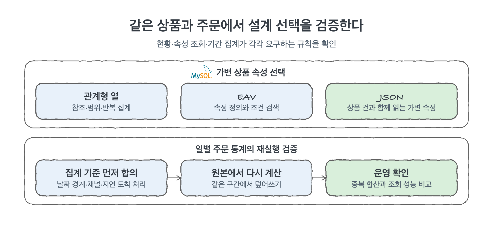

# Database Design Patterns Review and Next Steps

같은 업무도 어떤 제약을 지켜야 하고 어떤 조회가 자주 실행되는지에 따라 모델이 달라진다. 설계 패턴을 선택할 때는 한 행이 기록하는 사실, 데이터의 원본, 필요한 보존 기간, 변경 비용을 먼저 확인한다. [설계 1부 복습](12_database_design_review_and_next_steps.md)

## 1. 요구사항에 맞는 패턴 비교하기

| 요구사항 | 선택할 때 확인할 점 | 관련 문서 |
| --- | --- | --- |
| 화면에 표시하는 상태 코드와 이름을 관리한다. | 값 목록을 운영 중에 수정해야 하는가? 모든 업무가 같은 코드의 의미와 제약을 공유하는가? | [공통 코드](13_reference_data_and_code_tables.md) |
| 카테고리의 조상이나 하위 전체를 조회한다. | 부모 변경이 자주 일어나는가? 경로를 매번 조회할 비용과 관계를 미리 저장할 비용 중 어느 쪽이 큰가? | [계층 구조](14_hierarchical_data_modeling.md) |
| 누가 언제 무엇을 변경했는지 확인한다. | 마지막 변경 정보만 필요한가? 특정 시점의 이전 값과 업무상 적용 기간도 재현해야 하는가? | [감사 컬럼](15_audit_columns_and_change_metadata.md) · [행 버전과 이력](16_row_versioning_and_history_tables.md) |
| 삭제된 행을 화면에서 숨기고 필요하면 복구한다. | 활성 행의 유일성을 어떻게 지킬 것인가? 복구, 참조 유지, 물리 삭제는 각각 언제 필요한가? | [논리 삭제와 데이터 수명 주기](17_soft_delete_and_data_lifecycle.md) |
| 일별·월별 지표를 빠르게 보여 준다. | 통계 한 행의 집계 단위, 집계가 허용하는 지연, 재처리 기준은 무엇인가? | [통계 테이블](18_aggregate_table_design.md) |
| 유형마다 공통 속성과 고유 속성이 있다. | 유형을 가로지르는 조회가 자주 필요한가? 하위 유형의 필수 속성과 공통 참조를 어디서 검사할 것인가? | [상속 관계](19_relational_inheritance_mapping.md) |
| 상품마다 속성의 개수와 종류가 다르다. | 개별 속성에 유일성이나 자료형 검사가 필요한가? 여러 상품을 같은 속성으로 검색할 것인가? | [EAV](20_entity_attribute_value_modeling.md) · [JSON](21_json_data_modeling.md) |

## 2. 같은 쇼핑몰에서 두 가지 결정을 검증하기

- **상품 속성**이 유형마다 다르더라도 주문, 가격, 상품의 관계처럼 참조와 범위 검사가 중요한 값은 모델의 키와 열로 표현한다. 추가 속성의 조건 검색이 중요하면 속성 정의와 값을 나눈 모델을 살펴본다. 주로 상품 한 건과 함께 읽는 값이라면 JSON을 검토하고, 자주 검색하는 경로는 별도로 인덱싱할 수 있는지 확인한다. [MySQL JSON 자료형과 인덱스](https://dev.mysql.com/doc/refman/8.4/en/json.html)
- **일별 주문 통계**를 미리 저장하면 목록 조회에서 원본 주문을 매번 합산하는 비용을 줄일 수 있다. 집계의 기준 시간대와 합산 단위를 기록하고, 지연 도착한 결제·취소를 어느 기간에 다시 반영할지 정한다. 재실행 전후의 통계가 원본과 일치하고, 동일 집계 구간을 다시 처리해도 중복 합산되지 않는지 확인한다. [통계 테이블 설계](18_aggregate_table_design.md)

그림의 근거 · [JSON 자료형 및 인덱싱](https://dev.mysql.com/doc/refman/8.4/en/json.html) · [집계 키의 덮어쓰기](https://dev.mysql.com/doc/refman/8.4/en/insert-on-duplicate.html) · [집계 함수](https://dev.mysql.com/doc/refman/8.4/en/aggregate-functions.html)

## 3. 성능과 운영 검증으로 이어가기

실제 요청의 필터와 정렬, 데이터 규모와 분포를 바탕으로 느린 쿼리를 고른다. 실행 계획의 예상 행 수와 실측 처리량을 비교하고, 인덱스나 구조를 바꾼 뒤 같은 조건에서 읽기와 쓰기를 다시 측정한다. 정상 동작뿐 아니라 동시 변경, 재시도, 과거 데이터 정리 후에도 제약과 조회 결과가 맞는지 확인한다. [MySQL Optimization](https://dev.mysql.com/doc/refman/8.4/en/optimization.html) · [실행 계획과 복합 인덱스](../database/08_composite_and_covering_indexes.md)
