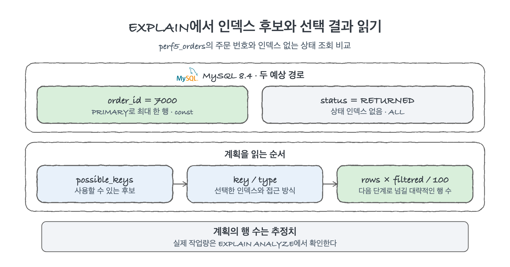

# Reading Execution Plans with EXPLAIN

실행 계획은 DB가 테이블을 어떤 순서로 읽고, 어떤 인덱스와 연산자를 사용할지 보여 준다. MySQL의 일반 `EXPLAIN`으로 조회의 추정 계획을 읽고, 실제 작업량은 [EXPLAIN ANALYZE](03_measuring_query_execution_with_explain_analyze.md)에서 대조한다. MySQL 8.4에서는 출력 형식을 명시하면 세션의 기본 설정과 관계없이 같은 형태로 비교할 수 있다. [EXPLAIN Statement](https://dev.mysql.com/doc/refman/8.4/en/explain.html)

## 1. 접근 경로와 예상 행 수

| 항목 | 읽는 방법 |
| --- | --- |
| `type` | `const`는 상수 키로 최대 한 행을 읽는다. `eq_ref`는 앞쪽 조인 행의 조합당 유일 키로 최대 한 행을 찾고, `ref`는 키 값에 맞는 여러 행을 읽을 수 있다. |
| `type` | `range`는 키의 구간을 읽는다. `index`는 인덱스 전체를, `ALL`은 테이블 전체를 스캔한다. |
| `possible_keys`, `key` | 전자는 조회에 사용할 후보 인덱스, 후자는 실제로 선택한 인덱스다. 커버링 전체 인덱스 스캔에서 후보에 없던 인덱스가 선택될 수 있다. |
| `key_len`, `ref` | 인덱스 접근에 사용하는 키 길이와 비교 대상이다. 자료형과 NULL 허용 여부를 함께 봐야 사용한 복합 키 부분을 해석할 수 있다. |
| `rows`, `filtered` | 읽을 행 수와 조건을 통과할 비율에 대한 추정치다. `rows × filtered / 100`으로 다음 조인 단계에 전달할 행 수를 대략 읽는다. |

`Extra`의 `Using index`는 인덱스가 필요한 열을 제공한다는 뜻이다. `Using index condition`은 일부 조건을 인덱스 항목에서 먼저 검사한다는 뜻이다. `Using filesort`와 `Using temporary`는 별도 정렬 작업과 내부 임시 테이블 사용을 각각 나타낸다. 비용을 판단할 때는 표시와 함께 실제로 처리하는 행 수를 본다. [EXPLAIN Output Format](https://dev.mysql.com/doc/refman/8.4/en/explain-output.html)



그림의 근거 · [EXPLAIN 출력](https://dev.mysql.com/doc/refman/8.4/en/explain-output.html)

## 2. 실습 · 기본 키 조회와 상태 조회

실습 환경은 MySQL 8.4(InnoDB)다. [공통 실습 데이터](01_database_performance_and_query_execution_architecture.md#3-공통-실습-데이터)를 사용한다.

```sql
EXPLAIN FORMAT=TRADITIONAL SELECT * FROM perf5_orders WHERE order_id = 7000;
EXPLAIN FORMAT=TRADITIONAL SELECT * FROM perf5_orders WHERE status = 'RETURNED';
EXPLAIN FORMAT=TREE SELECT * FROM perf5_orders WHERE status = 'RETURNED';
```

기본 키 조회에서 선택된 `key`와 두 번째 계획의 `type`, `rows`를 비교한다. TREE 형식에서는 테이블 읽기와 필터링이 어느 연산자로 배치되는지 확인한다.
