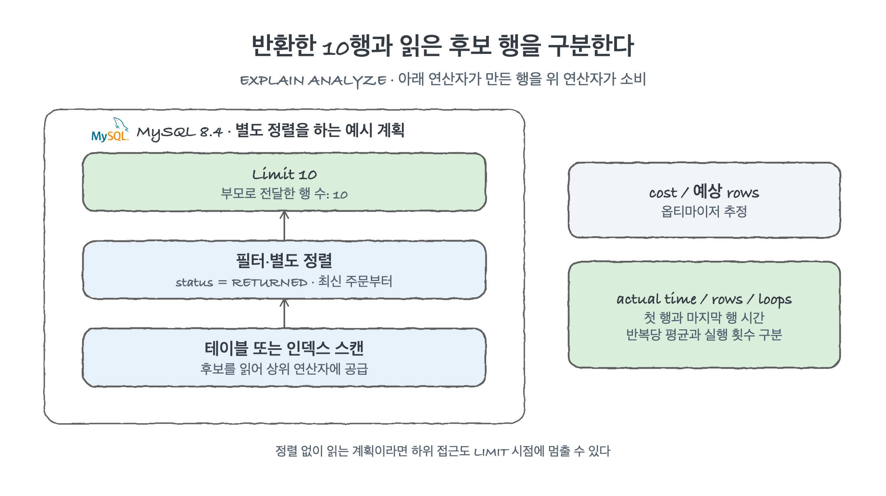

# Measuring Query Execution with EXPLAIN ANALYZE

실행 계획의 추정치가 틀리면 옵티마이저가 비효율적인 접근 경로를 고를 수 있다. MySQL 8.4의 `EXPLAIN ANALYZE`는 쿼리를 실행하고, TREE 형식에서 연산자별 추정치와 측정치를 함께 보여 준다. 조회라도 처리량이 클 수 있으므로 먼저 일반 `EXPLAIN`으로 범위를 확인한다. [EXPLAIN ANALYZE](https://dev.mysql.com/doc/refman/8.4/en/explain.html#explain-analyze)

## 1. 연산자별 실측값

| 항목 | 의미 |
| --- | --- |
| `cost`, 예상 `rows` | 옵티마이저가 계산한 비교용 비용과 반환 행 수다. 비용과 밀리초는 단위가 다르다. |
| `actual time=a..b` | 첫 행을 반환하기까지 걸린 시간과 전체 행을 반환하기까지 걸린 시간이다. 단위는 밀리초다. |
| 실측 `rows`, `loops` | 반환 행 수와 연산자 실행 횟수다. 반복 실행된 연산자는 시간과 행 수를 반복당 평균으로 읽는다. |

조인의 내부 연산자가 반복당 3행을 반환하고 500회 실행됐다면 전체 반환량은 약 1,500행이다. 상위 연산자의 시간에는 하위 연산자에서 행을 받아 오는 시간이 포함되므로, 트리의 시간을 모두 합산하면 중복된다. [EXPLAIN ANALYZE](https://dev.mysql.com/doc/refman/8.4/en/explain.html#explain-analyze)

## 2. 실습 · 추정치와 실측치 대조

실습 환경은 MySQL 8.4(InnoDB)다. [공통 실습 데이터](01_database_performance_and_query_execution_architecture.md#3-공통-실습-데이터)를 사용한다.

```sql
EXPLAIN FORMAT=TREE
SELECT order_id, ordered_at
FROM perf5_orders
WHERE status = 'RETURNED'
ORDER BY ordered_at DESC, order_id DESC
LIMIT 10;

EXPLAIN ANALYZE FORMAT=TREE
SELECT order_id, ordered_at
FROM perf5_orders
WHERE status = 'RETURNED'
ORDER BY ordered_at DESC, order_id DESC
LIMIT 10;
```

`LIMIT` 노드가 반환한 10행과 그 아래 필터와 스캔에서 처리한 행 수를 구분한다. 일부 연산자는 행을 읽는 즉시 상위로 보낼 수 있다. 별도 정렬이 필요하면 상위 10개만 유지하는 최적화가 적용되더라도 어떤 행이 상위 10개인지 판단할 후보는 읽어야 한다. 인덱스 순서로 곧바로 반환할 수 있을 때 하위 읽기도 일찍 끝날 수 있다. [LIMIT Query Optimization](https://dev.mysql.com/doc/refman/8.4/en/limit-optimization.html)



그림의 근거 · [EXPLAIN ANALYZE](https://dev.mysql.com/doc/refman/8.4/en/explain.html#explain-analyze) · [LIMIT 최적화](https://dev.mysql.com/doc/refman/8.4/en/limit-optimization.html)
