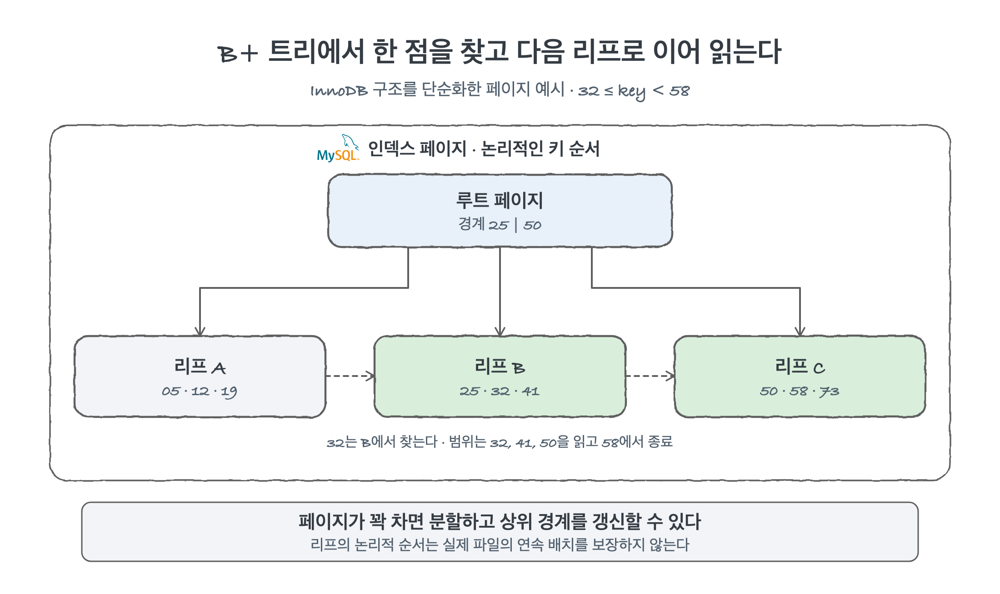

# B+ Tree Index Internals

B+ 트리는 정렬된 키를 페이지에 나눠 담는 균형 트리다. 내부 노드는 키의 경계와 하위 페이지 포인터를 저장하고, 리프 노드에 검색에 필요한 레코드를 저장한다. 한 페이지가 여러 하위 페이지를 가리키므로 많은 키를 적은 깊이로 탐색할 수 있다.

## 1. 점 조회와 범위 스캔



그림의 근거 · [InnoDB 인덱스 페이지](https://dev.mysql.com/doc/refman/8.4/en/innodb-physical-structure.html)

위 예시에서 `32`를 찾으려면 루트에서 가운데 리프로 이동한다. `32 <= key < 58` 범위를 읽으려면 같은 리프에서 32를 찾은 뒤 다음 리프로 이어 읽다가 58에서 멈춘다. 리프의 논리적 키 순서가 디스크의 물리적 배치를 보장하지는 않는다.

## 2. 페이지 분할과 키 크기

대상 페이지에 새 키를 넣을 공간이 부족하면 페이지를 분할하고 상위 노드의 경계를 조정할 수 있다. 상위 페이지도 가득 찼다면 분할이 위로 전파된다. 키와 인덱스 레코드가 넓어지면 페이지당 담을 수 있는 항목이 줄고, 같은 행 수에서 더 많은 페이지를 읽거나 캐싱해야 할 수 있다.

MySQL 8.4의 InnoDB 매뉴얼은 일반 인덱스를 B-tree라고 부르고, 인덱스 레코드가 리프 페이지에 저장된다고 설명한다. 기본 인덱스 페이지 크기는 16 KiB이며 인스턴스 초기화 시 정해진 페이지 크기에 따라 달라진다. [Physical Structure of an InnoDB Index](https://dev.mysql.com/doc/refman/8.4/en/innodb-physical-structure.html)

## 3. 실습 · 한 키와 연속 구간

실습 환경은 MySQL 8.4(InnoDB)다. [공통 실습 데이터](01_database_performance_and_query_execution_architecture.md#3-공통-실습-데이터)를 사용한다.

```sql
EXPLAIN FORMAT=TREE SELECT order_id FROM perf5_orders WHERE order_id = 3500;
EXPLAIN FORMAT=TREE
SELECT order_id FROM perf5_orders WHERE order_id >= 3500 AND order_id < 3520;
```

첫 계획에서 단건 키 조회를, 두 번째 계획에서 같은 기본 키에 대한 범위 접근을 확인한다.
