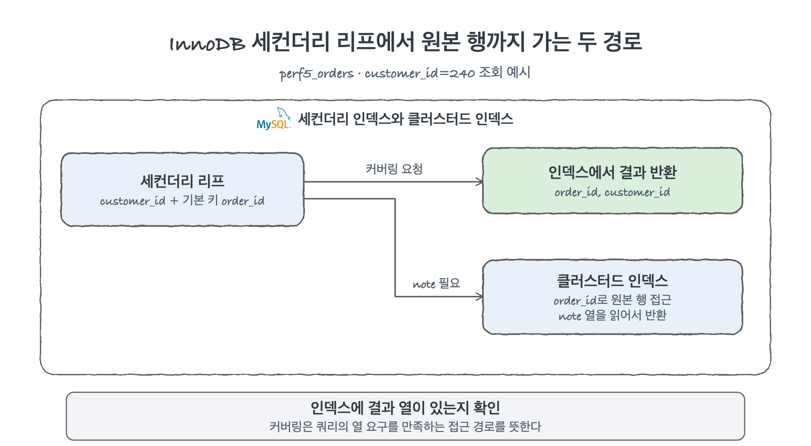

# Clustered and Secondary Indexes

클러스터드 인덱스는 리프에 원본 행을 저장한다. 다른 인덱스에서 원본 행을 찾는 방법은 저장 엔진에 따라 달라진다. InnoDB에서는 테이블에 지정한 기본 키를 클러스터드 키로 사용한다. 기본 키가 없으면 모든 열이 `NOT NULL`인 첫 번째 유일 인덱스를 사용하며, 그것도 없으면 내부 행 ID로 인덱스를 만든다. [Clustered and Secondary Indexes](https://dev.mysql.com/doc/refman/8.4/en/innodb-index-types.html)

## 1. 세컨더리 인덱스의 행 조회

| 필요한 열 | InnoDB의 조회 경로 |
| --- | --- |
| 기본 키로 조회 | 클러스터드 인덱스에서 행을 찾는다. |
| 세컨더리 키와 기본 키만 조회 | 해당 인덱스가 쿼리를 커버하면 그 인덱스에서 결과를 만든다. |
| 세컨더리 인덱스에 없는 열도 조회 | 세컨더리 인덱스의 기본 키 값으로 클러스터드 인덱스의 원본 행을 찾는다. |

InnoDB의 세컨더리 인덱스에는 기본 키 열이 포함된다. 기본 키가 넓으면 여러 세컨더리 인덱스의 크기에도 영향을 준다. 순차적으로 증가하는 기본 키는 새 행이 비슷한 위치에 모이기 쉽고, 무작위로 흩어지는 키는 여러 페이지에 쓰기를 분산시킬 수 있다. 읽기의 지역성과 페이지 분할 영향은 데이터 크기, 버퍼 풀 적중률, 삽입 패턴을 대표하는 부하로 비교한다. [Clustered and Secondary Indexes](https://dev.mysql.com/doc/refman/8.4/en/innodb-index-types.html) · [Physical Structure of an InnoDB Index](https://dev.mysql.com/doc/refman/8.4/en/innodb-physical-structure.html)



그림의 근거 · [클러스터드·세컨더리 인덱스](https://dev.mysql.com/doc/refman/8.4/en/innodb-index-types.html) · [EXPLAIN 출력](https://dev.mysql.com/doc/refman/8.4/en/explain-output.html)

## 2. 실습 · 원본 행으로 돌아가는 조회

실습 환경은 MySQL 8.4(InnoDB)다. [공통 실습 데이터](01_database_performance_and_query_execution_architecture.md#3-공통-실습-데이터)를 사용한다.

```sql
CREATE INDEX perf5_cluster_customer ON perf5_orders (customer_id);

EXPLAIN FORMAT=TRADITIONAL
SELECT order_id, customer_id FROM perf5_orders WHERE customer_id = 240;

EXPLAIN FORMAT=TRADITIONAL
SELECT order_id, customer_id, note FROM perf5_orders WHERE customer_id = 240;

DROP INDEX perf5_cluster_customer ON perf5_orders;
```

두 계획의 `key`와 `Extra`를 비교한다. 두 번째 조회의 `note`는 인덱스 키 바깥에 있다. [EXPLAIN Output Format](https://dev.mysql.com/doc/refman/8.4/en/explain-output.html)
