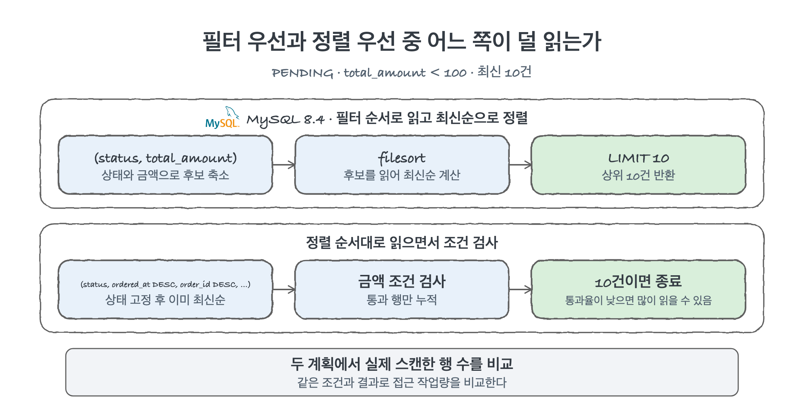

# Diagnosing Filesort and Enabling Early Termination

MySQL의 `Using filesort`는 결과 순서를 만들기 위해 별도 정렬 작업을 했다는 뜻이다. 정렬은 메모리에서 끝나거나 필요에 따라 디스크의 임시 파일을 사용할 수 있다. `ORDER BY ... LIMIT`이 인덱스 순서와 맞으면 결과 개수를 채운 시점에 읽기를 멈출 수 있다. 별도로 정렬해야 하는 경우에는 상위 N개만 유지하더라도 정렬의 후보 행은 확인해야 한다. [ORDER BY Optimization](https://dev.mysql.com/doc/refman/8.4/en/order-by-optimization.html) · [LIMIT Query Optimization](https://dev.mysql.com/doc/refman/8.4/en/limit-optimization.html)

## 1. 실습 · 낮은 주문 금액 필터와 최신순 정렬

실습 환경은 MySQL 8.4(InnoDB)다. [공통 실습 데이터](01_database_performance_and_query_execution_architecture.md#3-공통-실습-데이터)를 사용한다.

```sql
CREATE INDEX perf5_sort_filter ON perf5_orders (status, total_amount);

EXPLAIN ANALYZE FORMAT=TREE
SELECT order_id, ordered_at, total_amount
FROM perf5_orders
WHERE status = 'PENDING' AND total_amount < 100
ORDER BY ordered_at DESC, order_id DESC
LIMIT 10;

DROP INDEX perf5_sort_filter ON perf5_orders;
CREATE INDEX perf5_sort_order
    ON perf5_orders (status, ordered_at DESC, order_id DESC, total_amount);

EXPLAIN ANALYZE FORMAT=TREE
SELECT order_id, ordered_at, total_amount
FROM perf5_orders
WHERE status = 'PENDING' AND total_amount < 100
ORDER BY ordered_at DESC, order_id DESC
LIMIT 10;

DROP INDEX perf5_sort_order ON perf5_orders;
```

## 2. 두 접근의 작업량 비교

- 필터 우선 인덱스는 금액 구간으로 후보를 줄인다. 해당 구간이 최신순으로 정렬되어 있지 않아 결과를 재정렬한다.
- 정렬 우선 인덱스는 상태를 고정하고 시각과 주문 번호 순서로 읽는다. 금액 조건을 통과한 행이 10건 모이면 멈출 수 있다.
- 일치하는 행이 시각 순서의 뒤쪽에 몰려 있거나 조건을 통과하는 행이 적으면 정렬 우선 접근도 많이 읽는다. `LIMIT`의 출력 행 수와 그 아래 접근 경로의 실제 작업량을 비교한다.

주문 번호는 같은 시각의 행 순서를 결정한다. 두 인덱스를 비교할 때 필터와 정렬이 같은 결과를 내도록 유지한다. [Descending Indexes](https://dev.mysql.com/doc/refman/8.4/en/descending-indexes.html) · [LIMIT Query Optimization](https://dev.mysql.com/doc/refman/8.4/en/limit-optimization.html)



그림의 근거 · [ORDER BY 최적화](https://dev.mysql.com/doc/refman/8.4/en/order-by-optimization.html) · [LIMIT 최적화](https://dev.mysql.com/doc/refman/8.4/en/limit-optimization.html)
