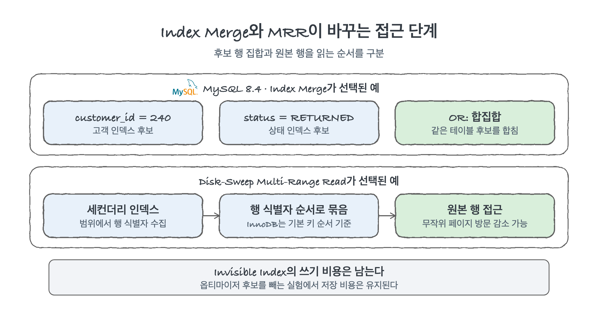

# Advanced Index Access and Index Management

인덱스 접근을 고를 때는 찾을 키의 범위와 원본 행을 읽는 비용을 함께 살핀다. 여러 인덱스를 조합하거나 원본 행에 접근하는 순서를 바꾸는 최적화는 같은 쿼리에서 서로 다른 비용을 줄인다.

## 1. Index Merge와 Multi-Range Read

- **Index Merge**는 한 테이블의 여러 인덱스 스캔 결과를 합친다. 조건에 따라 교집합, 합집합, 정렬 후 합집합을 선택할 수 있다. `EXPLAIN`에서 `type = index_merge`와 `Extra`의 병합 방식을 확인한다.
- **Multi-Range Read**(MRR)는 세컨더리 인덱스에서 찾은 행 식별자를 모아 행 조회 순서를 바꿔 무작위 페이지 접근을 줄일 수 있다. InnoDB에서는 클러스터드 키 순서가 이때 쓰인다. 인덱스가 필요한 열을 모두 제공하면 이 원본 행 접근 최적화의 이점이 없다.

[Index Merge Optimization](https://dev.mysql.com/doc/refman/8.4/en/index-merge-optimization.html) · [Multi-Range Read Optimization](https://dev.mysql.com/doc/refman/8.4/en/mrr-optimization.html)

## 2. 인덱스 기능과 운영 비용

| 기능 | 적용할 상황 |
| --- | --- |
| 함수 인덱스 | `DATE(ordered_at)`처럼 같은 표현식을 반복해 검색한다. 원본 시각의 범위 조건으로 바꿀 수 있는지도 검토한다. |
| 내림차순 인덱스 | `ORDER BY ordered_at DESC, order_id ASC`처럼 방향이 섞여 있어 키 부분의 정렬 방향이 중요하다. |
| Invisible Index | 인덱스를 실제로 삭제하기 전에 옵티마이저가 해당 인덱스를 제외한 계획을 선택하는지 관찰한다. 인덱스 저장 공간과 쓰기 비용은 유지된다. |
| 옵티마이저 힌트 | 후보 인덱스나 접근 기법을 제한해 비용 추정과 실제 실행 결과를 비교한다. 데이터 분포가 변하면 동일한 힌트의 효과도 다시 확인한다. |

인덱스를 추가하면 쿼리의 읽기 비용은 줄 수 있지만, 변경 시 인덱스도 갱신해야 한다. 인덱스의 크기와 쓰기 부하, 쿼리별 사용 빈도를 함께 측정한다. [CREATE INDEX](https://dev.mysql.com/doc/refman/8.4/en/create-index.html) · [Descending Indexes](https://dev.mysql.com/doc/refman/8.4/en/descending-indexes.html) · [Invisible Indexes](https://dev.mysql.com/doc/refman/8.4/en/invisible-indexes.html) · [Optimizer Hints](https://dev.mysql.com/doc/refman/8.4/en/optimizer-hints.html)



그림의 근거 · [Index Merge](https://dev.mysql.com/doc/refman/8.4/en/index-merge-optimization.html) · [Multi-Range Read](https://dev.mysql.com/doc/refman/8.4/en/mrr-optimization.html) · [Invisible Index](https://dev.mysql.com/doc/refman/8.4/en/invisible-indexes.html)

## 3. 실습 · OR 조건과 인덱스 가시성

실습 환경은 MySQL 8.4(InnoDB)다. [공통 실습 데이터](01_database_performance_and_query_execution_architecture.md#3-공통-실습-데이터)를 사용한다.

```sql
CREATE INDEX perf5_merge_customer ON perf5_orders (customer_id);
CREATE INDEX perf5_merge_status ON perf5_orders (status);

EXPLAIN FORMAT=TRADITIONAL
SELECT order_id, note FROM perf5_orders WHERE customer_id = 240 OR status = 'RETURNED';

ALTER TABLE perf5_orders ALTER INDEX perf5_merge_status INVISIBLE;

EXPLAIN FORMAT=TRADITIONAL
SELECT order_id, note FROM perf5_orders WHERE customer_id = 240 OR status = 'RETURNED';

DROP INDEX perf5_merge_status ON perf5_orders;
DROP INDEX perf5_merge_customer ON perf5_orders;
```

두 계획에서 `type`, `key`, `rows`를 비교한다. 처음에는 병합을 고려할 수 있고, 두 번째에는 기본 세션 설정에서 숨긴 인덱스가 후보에서 빠진다. 비용 판단에 따라 두 쿼리 모두 풀 스캔이 선택될 수 있다. [Index Merge Optimization](https://dev.mysql.com/doc/refman/8.4/en/index-merge-optimization.html) · [Invisible Indexes](https://dev.mysql.com/doc/refman/8.4/en/invisible-indexes.html)
