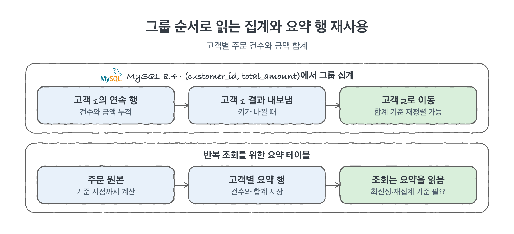

# Streaming Aggregation and Pre-Aggregated Tables

고객별 주문을 집계할 때 고객 키 순서로 입력이 오면 한 고객의 합계를 계산하고 다음 고객으로 넘어갈 수 있다. 인덱스 순서가 그룹 키와 맞지 않으면 엔진은 다른 방식으로 그룹을 모을 수 있다. 고객별 합계를 만든 뒤 금액순 상위 N개를 구한다면 그룹 집계를 스트리밍으로 처리하더라도 합계에 대한 별도 정렬 작업은 남을 수 있다. [GROUP BY Optimization](https://dev.mysql.com/doc/refman/8.4/en/group-by-optimization.html) · [Internal Temporary Table Use](https://dev.mysql.com/doc/refman/8.4/en/internal-temporary-tables.html)

## 1. 실습 · 그룹 키 순서로 읽기

실습 환경은 MySQL 8.4(InnoDB)다. [공통 실습 데이터](01_database_performance_and_query_execution_architecture.md#3-공통-실습-데이터)를 사용한다.

```sql
EXPLAIN ANALYZE FORMAT=TREE
SELECT customer_id, COUNT(*) AS order_count, SUM(total_amount) AS total_spent
FROM perf5_orders
GROUP BY customer_id;

CREATE INDEX perf5_group_customer_amount ON perf5_orders (customer_id, total_amount);

EXPLAIN ANALYZE FORMAT=TREE
SELECT customer_id, COUNT(*) AS order_count, SUM(total_amount) AS total_spent
FROM perf5_orders
GROUP BY customer_id;
```

두 번째 계획에서 정렬이나 임시 테이블 집계 대신 고객 키 순서의 그룹 집계가 선택되는지 확인한다. `COUNT(*)`와 `SUM(total_amount)`는 그룹에 속하는 모든 주문을 읽는다. [조인 집계 실습](12_reducing_random_access_in_joins_with_covering_indexes.md)에서는 고객 쪽 인덱스 순서와 조인 알고리즘도 같은 고객의 주문이 연속해서 도착하는지에 영향을 준다.



그림의 근거 · [GROUP BY 최적화](https://dev.mysql.com/doc/refman/8.4/en/group-by-optimization.html) · [집계 함수](https://dev.mysql.com/doc/refman/8.4/en/aggregate-functions.html)

## 2. 실습 · 반복 집계를 요약 행으로 읽기

같은 집계를 자주 읽으면 고객당 한 행을 계산해 둘 수 있다. 아래 임시 테이블은 한 세션 안에서 한 번 계산한 요약을 보여 준다. 실제 운영에서 영속 테이블로 만들면 갱신 주기, 정정·삭제 반영 규칙, 재처리 시 중복을 막는 방식을 먼저 정한다. [Aggregate Table Design](../database-design/18_aggregate_table_design.md)

```sql
CREATE TEMPORARY TABLE perf5_customer_totals (
    customer_id INT PRIMARY KEY,
    order_count BIGINT NOT NULL,
    total_spent DECIMAL(20, 2) NOT NULL
) ENGINE = InnoDB;

INSERT INTO perf5_customer_totals (customer_id, order_count, total_spent)
SELECT customer_id, COUNT(*), SUM(total_amount)
FROM perf5_orders
GROUP BY customer_id;

EXPLAIN ANALYZE FORMAT=TREE
SELECT c.customer_id, c.customer_name, t.order_count, t.total_spent
FROM perf5_customers AS c
JOIN perf5_customer_totals AS t ON t.customer_id = c.customer_id
WHERE c.tier = 'VIP'
ORDER BY t.total_spent DESC, c.customer_id ASC
LIMIT 20;

DROP TEMPORARY TABLE perf5_customer_totals;
DROP INDEX perf5_group_customer_amount ON perf5_orders;
```

원본 데이터가 그대로라면 조회 결과를 [원본 조인 집계](12_reducing_random_access_in_joins_with_covering_indexes.md)와 비교할 수 있다. 인덱스 순서의 집계는 조회 때 최신 원본을 읽고, 사전 집계는 반복 읽기 비용 일부를 갱신과 저장 비용으로 옮긴다.
